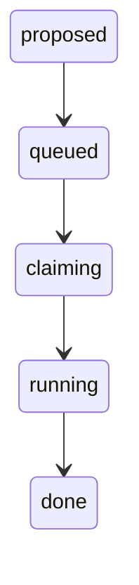

# The happy path: one ticket, from Linear to a finished job

The shortest full trip through steward. A ticket is read from Linear, mapped to a work item,
and stored as a `proposed` job. A person confirms the proposal through the API. The job id goes
on a BullMQ queue. The worker takes it, `processJob` claims a slot, makes a git worktree, runs
the phase-1 echo runner, marks the job `done`, and cleans up. Nothing is pushed and nothing is
written back to the tracker yet.

## At a glance

- Trigger: one Linear issue, assigned to the configured user, in team `LINEAR_TEAM_KEY`, with
  status `Todo` or `Backlog`.
- Starts in / ends in: `proposed` → `queued` → `claiming` → `running` → `done`.
- Waits: the poll runs every `POLL_INTERVAL_MS` (default 30000 ms) with ±10% jitter, capped at
  ten minutes. The rest of the path takes milliseconds with the echo runner.
- Main files: `src/linear.ts`, `src/linear-map.ts`, `src/intake.ts`, `src/intake-policy.ts`,
  `src/db/store.ts`, `src/api/app.ts`, `src/jobs-commands.ts`, `src/worker/queue.ts`,
  `src/worker/process-job.ts`, `src/platform/git.ts`, `src/runner/echo.ts`.

The row is inserted directly in `proposed`, so no edge leads into it. From there the happy path
uses exactly four edges of the state machine.



Source: `src/transitions.ts` (the allowed-moves table)

```ts
const TRANSITIONS: Readonly<Record<JobState, readonly JobState[]>> = {
  proposed: ['queued', 'declined'],
  declined: ['proposed'],
  queued: ['claiming', 'cancelled', 'failed'],
  // claiming/running -> queued is the automatic infra retry (backoff); `failed` means retries are exhausted.
  claiming: ['running', 'queued', 'failed', 'cancelled'],
  // TODO(phase-4): remove running -> done. It exists only for the phase-1 echo worker stub.
  running: ['pr_open', 'done', 'queued', 'failed', 'cancelled'],
```

`running -> done` exists only for the phase-1 stub. Every other row of the table belongs to a
path that leaves this one.

## Files involved

| File                        | Role in this flow                                                          |
| --------------------------- | -------------------------------------------------------------------------- |
| `src/entries/worker.ts`     | Process entry: reads the environment, starts the worker, then polls.       |
| `src/composition/worker.ts` | Wiring: migrate, reconcile, register the queue handler, run the poll loop. |
| `src/linear.ts`             | The Linear `WorkFeed`: one GraphQL query, paging, retry on 429 and 5xx.    |
| `src/linear-map.ts`         | Maps one Linear issue node to a `WorkItem`.                                |
| `src/intake.ts`             | One intake poll: collect the feed, decide, insert jobs, enqueue.           |
| `src/intake-policy.ts`      | The pure decision: propose, queue or skip each item.                       |
| `src/db/intake-queries.ts`  | Three reads: known ids, the source has jobs, open proposals.               |
| `src/db/store.ts`           | Postgres writes: insert, transition, slot acquire and release.             |
| `src/api/app.ts`            | `POST /v1/jobs/:id/confirm`, then a re-read for the response.              |
| `src/jobs-commands.ts`      | `confirmJob`: the rule that a proposal may be confirmed.                   |
| `src/worker/queue.ts`       | The only BullMQ module. Delivers one steward job id per delivery.          |
| `src/worker/process-job.ts` | One delivery attempt: slot, git, runner, state, cleanup.                   |
| `src/platform/git.ts`       | Worktree create, attach and remove; base fetch.                            |
| `src/runner/echo.ts`        | The phase-1 stand-in for an agent. Writes transcript lines and returns.    |
| `src/runner/transcript.ts`  | `transcript.jsonl` and `raw.jsonl` writer.                                 |
| `src/jobs-queries.ts`       | The read model: `JobSummary`, `allowedActions`.                            |

## Step by step

### 0. The worker process starts

`src/entries/worker.ts` reads `STEWARD_CONFIG_FILE` if it is set, passes the environment and the
file to `loadConfig` (`src/platform/config.ts`), builds the worker with `composeWorker`
(`src/composition/worker.ts`), then awaits `worker.start()` and `worker.poll()`. The config file
is read only; secrets come from the environment.

`start` applies the migrations in `src/db/migrations`, runs the reconciler once, then registers
`processJob` as the BullMQ handler. The liveness probe returns `false` for every job: this
process is the only worker, so nothing it sees has a live worker.

Source: `src/composition/worker.ts` (`start`)

```ts
  const start = async (): Promise<void> => {
    await migrateDb(db)
    // No job survives a restart of this single worker process, so none has a live worker.
    const report = await reconcile(
      { db, queue, isWorkerAlive: () => Promise.resolve(false) },
      { now: clock(), rand: Math.random, backoff: BACKOFF, slotCount: config.SLOT_COUNT },
    )
    logger.info('Reconciled on startup', { ...report })
```

`poll` then loops forever: one `runIntakePoll`, one sleep. A failed poll increments a counter and
the next delay doubles for each consecutive failure. `SIGTERM` or `SIGINT` closes the queue and
the pool. The queue consumer is live before the first feed read.

Source: `src/intake.ts` (poll delay constants)

```ts
const MAX_POLL_DELAY_MS = 10 * 60_000
const JITTER_RATIO = 0.1
```

### 1. The poll reads Linear and maps the ticket

`runIntakePoll` iterates `feed.poll()`. The feed is built once by `createLinearClient`; `pollPages`
sends one GraphQL POST to `https://api.linear.app/graphql` per page, 50 nodes per page, and
follows `endCursor` while `hasNextPage` is true. A response is retried only on status 429 or 5xx:
`MAX_TRIES = 5`, base delay 1000 ms that doubles, and the `retry-after` header when Linear sends
one. Any other status throws, and the poll logs a failure.

Source: `src/linear.ts` (the query filter)

```ts
const ISSUES_QUERY = `query StewardIntake($teamKey: String!, $after: String, $first: Int!) {
  issues(
    filter: {
      team: { key: { eq: $teamKey } }
      assignee: { isMe: { eq: true } }
      state: { name: { in: ["Todo", "Backlog", "In Progress"] } }
    }
    first: $first
    after: $after
  ) {
```

Each node goes through `mapIssueToWorkItem`. A node that fails mapping is logged with its Linear
id and skipped; the rest of the page is still used. `externalId` is the Linear issue id, not the
human identifier, so tracker types never leave this adapter.

Source: `src/linear-map.ts` (`mapIssueToWorkItem`)

```ts
/**
 * Maps one Linear issue node (unknown JSON) to a WorkItem.
 * `branch` is only set when `branchName` is a non-empty string.
 */
export function mapIssueToWorkItem(node: unknown, source: string): WorkItem {
  const issue = readObject(node, 'issue', source)
  const state = readObject(issue.state, 'state', source)

  const item: WorkItem = {
    source,
    externalId: readNonEmptyString(issue.id, 'id', source),
    identifier: readNonEmptyString(issue.identifier, 'identifier', source),
    title: readNonEmptyString(issue.title, 'title', source),
    body: readNullableString(issue.description, 'description', source) ?? '',
    labels: readLabelNames(issue.labels, source),
    url: readNonEmptyString(issue.url, 'url', source),
    status: readNonEmptyString(state.name, 'state.name', source),
  }

  const branch = readNullableString(issue.branchName, 'branchName', source)
  if (branch !== null && branch.length > 0) item.branch = branch

  return item
}
```

TST-1 arrives as this item. There is no `branch` key, because Linear returned an empty
`branchName`.

```json
{
  "source": "linear",
  "externalId": "lin-1",
  "identifier": "TST-1",
  "title": "Add a retry button",
  "body": "The jobs page has no retry button.",
  "labels": ["agent"],
  "url": "https://linear.app/example/issue/TST-1",
  "status": "Todo"
}
```

What changes: nothing in the database. The items are held in memory until the policy has run.
The raw first page is logged only in dry run: `withoutRawResponses` drops that log line when
`DRY_RUN` is false, so ticket text stays out of the process log.

### 2. The intake policy decides, and the job row appears

`runIntakePoll` first collects the whole feed, then reads the source from the first item. An
empty feed logs zero counts and stops there. Otherwise it reads three things in parallel (all in
`src/db/intake-queries.ts`): the known `external_id` values for the source, the number of jobs
for the source, and the number of `proposed` jobs across all sources. Then `decideIntake` runs,
with no clock and no I/O.

Source: `src/intake-policy.ts` (the proposal statuses)

```ts
function isProposalStatus(status: string): boolean {
  return status === 'Todo' || status === 'Backlog'
}
```

For TST-1 the rules apply in this order: it is not a known external id, its status is not
`In Progress`, it is a proposal status, and the open-proposal count is below
`MAX_OPEN_PROPOSALS` (default 20). The reason stored on the decision is the status name itself
(`Todo`). A proposal is skipped, not created, once `openProposals` plus the proposals already
made in this poll reach that cap (reason `proposal limit`). A duplicate `source + externalId`
is skipped too (reason `already has a job`).

`runIntakePoll` inserts one job per decision. A proposal goes in state `proposed` and is not
enqueued. The unique index on `(source, external_id)` is the dedupe: a lost race writes no
second row and no event, and is counted as skipped.

Source: `src/db/store.ts` (`insertJob`)

```ts
export async function insertJob(
  db: Db,
  input: { item: WorkItem; state: 'proposed' | 'queued'; maxAttempts: number; now: Date },
): Promise<{ job: Job; created: boolean }> {
  return db.transaction(async (tx) => {
    const [inserted] = await tx
      .insert(jobs)
      .values({
        source: input.item.source,
        externalId: input.item.externalId,
        identifier: input.item.identifier,
        item: input.item,
        state: input.state,
        attempt: 0,
        maxAttempts: input.maxAttempts,
        nextRunAt: null,
        failureKind: null,
        createdAt: input.now,
        updatedAt: input.now,
      })
      .onConflictDoNothing({ target: [jobs.source, jobs.externalId] })
      .returning()
```

In the same transaction the store appends the first `job_events` row: `from_state` null,
`to_state` `proposed`, `reason` null, `failure_kind` null. `maxAttempts` is copied from
`MAX_ATTEMPTS` (default 3) at insert time, so a later config change does not move the job's
limit.

What changes:

| Place              | Value for TST-1                                                                                                             |
| ------------------ | --------------------------------------------------------------------------------------------------------------------------- |
| `jobs` row         | `state='proposed'`, `attempt=0`, `max_attempts=3`, `next_run_at=null`, `failure_kind=null`, `item` = the whole `WorkItem`   |
| `job_events` row 1 | `from_state=null`, `to_state='proposed'`, `reason=null`, `failure_kind=null`                                                |
| queue              | nothing                                                                                                                     |
| log                | `Intake decision` with `action: "propose"`, `reason: "Todo"`, then `Intake poll finished` with `{ queued: 0, proposed: 1 }` |

### 3. A person confirms it through the API

The route validates the path as a UUID, calls the command, and re-reads the job so the response
is the read model, not the domain row.

Source: `src/api/app.ts` (the confirm route)

```ts
    .post('/v1/jobs/:id/confirm', zValidator('param', idParamSchema, rejectInvalid), async (c) => {
      const job = await commands.confirm(c.req.valid('param').id)
      return c.json(await reload(reads, job.id))
    })
```

`confirmJob` loads the job, requires that it is `proposed`, writes the move with reason
`confirmed`, and only then enqueues the id. Anything else raises `IllegalTransitionError`, which
the app maps to 409. A missing id is a 404.

Source: `src/jobs-commands.ts` (`confirmJob`)

```ts
/** A confirmed proposal becomes a queued job and is delivered to the queue. */
export async function confirmJob(deps: CommandDeps, id: string): Promise<Job> {
  const job = await load(deps, id)
  requireFrom(job, 'queued', CONFIRMABLE)
  const updated = await deps.store.transitionJob(id, 'queued', { now: deps.clock(), reason: 'confirmed' })
  await deps.enqueue(id)
  return updated
}
```

`transitionJob` locks the row (`for update`), asserts the edge, updates the row, appends the
event, and deletes the slot row when the new state no longer holds one. `attempt` moves only on
the move to `claiming`, so it stays 0 here.

`enqueue` is the BullMQ write. It skips the add when a delivery for the same steward job is
still waiting, delayed or prioritized. Each BullMQ job carries its own id,
`<job-id>_<uuid>`, because BullMQ ignores an add whose id already exists, even for a finished
job.

Source: `src/worker/queue.ts` (`enqueue`)

```ts
    async enqueue(jobId: string, delayMs = 0): Promise<void> {
      if (await hasPending(jobId)) {
        return
      }
      await queue.add(JOB_NAME, { id: jobId }, { jobId: `${jobId}_${randomUUID()}`, delay: delayMs })
    },
```

What changes: event 2 (`proposed` → `queued`, reason `confirmed`), one BullMQ job on the queue
named `steward-<INSTANCE>` with `attempts: 1`, and the API answers 200 with the job in state
`queued`. If the enqueue fails, the row is already `queued`; the startup reconciler enqueues a
`queued` job that the queue does not hold.

### 4. The worker takes the id and runs `processJob`

BullMQ calls the handler registered in step 0 with `job.data.id`, and the handler calls
`processJob`. Postgres is the source of truth: the id from the queue is only a hint, so
`processJob` re-reads the row and drops anything that is not `queued`. A redelivery of a `done`
job therefore does nothing.

Source: `src/worker/process-job.ts` (`processJob`, guard and slot)

```ts
export async function processJob(deps: ProcessJobDeps, jobId: string): Promise<void> {
  const job = await getJob(deps.db, jobId)
  if (job === null || job.state !== 'queued') {
    deps.log?.(`job ${jobId}: not queued, ignoring`)
    return
  }

  const slot = await acquireSlot(deps.db, jobId, deps.config.slotCount, deps.clock())
  if (slot === null) {
    deps.log?.(`job ${jobId}: no free slot, re-enqueued in 5000ms`)
    await deps.queue.enqueue(jobId, 5000)
    return
  }
```

`acquireSlot` takes the lowest free slot, or returns the slot the job already holds, or retries
up to four times when a competing insert wins the unique index. It returns `null` when every
slot is taken. `SLOT_COUNT` defaults to 3, so the first job on an idle instance gets slot 0.
With no free slot the id is re-enqueued with a fixed 5000 ms delay and the job stays `queued`;
`attempt` does not move.

With a slot held, the first transition is `claiming`, and `attempt` becomes 1. The base branch
is `BASE_BRANCH` (default `main`). The fetch writes only `refs/remotes/origin/<base>`, so the
worktree starts from what origin holds now, not from a stale `HEAD`. The worktree path is
`<RUNS_DIR>/<job-id>/worktree`.

Source: `src/worker/process-job.ts` (`processJob`, claim and fetch)

```ts
  try {
    current = await transitionJob(deps.db, jobId, 'claiming', { now: deps.clock() })
    if (!existsSync(deps.config.repoPath)) {
      throw new SetupError(`Repository path does not exist: ${deps.config.repoPath}`)
    }

    // A new branch starts from what is on origin now, never from whatever HEAD happens to be.
    const baseBranch = deps.baseBranch ?? 'main'
    await fetchBaseClassified(deps, baseBranch)
    const branch = branchName(current.identifier)
    // A worker that died mid-run never ran its cleanup. Clear what it left, or `git worktree add`
    // refuses the path on every retry. The branch and its commits are not touched.
    await deps.git.removeWorktree(deps.config.repoPath, worktreePath)
```

The branch name comes from the ticket identifier, not from Linear's `branchName`:

Source: `src/worker/process-job.ts` (`branchName`)

```ts
function branchName(identifier: string): string {
  return `agent/${identifier.toLowerCase().replace(/[^a-z0-9]/g, '-')}`
}
```

For TST-1 that is `agent/tst-1`. A non-empty left-over worktree is removed first. If the branch
does not exist, `createWorktree` (`src/platform/git.ts`) runs `git worktree add -b agent/tst-1
<path> origin/main`. If it exists, an earlier attempt or an open pull request owns it: the
worktree is attached to it and `origin/main` is merged in. A merge conflict fails the job as
`agent`, because the echo runner cannot resolve a conflict.

Then the job moves to `running` and the runner starts. The echo runner returns at once: it
writes four transcript lines and makes no commit. Validation and a draft pull request do not
exist yet, so the next move is straight to `done`.

Source: `src/worker/process-job.ts` (`processJob`, run and finish)

```ts
    } else {
      await deps.git.createWorktree({
        repoPath: deps.config.repoPath,
        worktreePath,
        branch,
        baseRef: `origin/${baseBranch}`,
      })
    }
    current = await transitionJob(deps.db, jobId, 'running', { now: deps.clock() })
    await deps.runner.start(current)
    // TODO(phase-4): go to pr_open after validation and the draft pull request.
    await transitionJob(deps.db, jobId, 'done', { now: deps.clock() })
    deps.log?.(`job ${jobId}: done`)
```

Every step from the claim onwards runs inside one `try`, so a failure is recorded in Postgres
instead of thrown at the queue. The `finally` block removes the worktree and releases the slot
on every path out of that `try`, including a failed transition.

Source: `src/worker/process-job.ts` (`processJob`, cleanup)

```ts
  } finally {
    try {
      await deps.git.removeWorktree(deps.config.repoPath, worktreePath)
    } catch (cleanupError) {
      logCleanupError(deps, jobId, 'removing the worktree', cleanupError)
    }
    try {
      // transitionJob frees the slot on claiming/running -> queued/failed; this
      // also covers a failure before `claiming` and a failed transition.
      await releaseSlot(deps.db, jobId)
    } catch (releaseError) {
      logCleanupError(deps, jobId, 'releasing the slot', releaseError)
    }
  }
```

The slot row is normally deleted by the `running` → `done` transition itself: a `done` job does
not hold a slot, and the delete runs in the same transaction. `releaseSlot` is the safety net
and is idempotent.

| Moment                               | `jobs.state` | `attempt` | Slot                                   | Event appended         |
| ------------------------------------ | ------------ | --------- | -------------------------------------- | ---------------------- |
| Queue delivery, before anything else | `queued`     | 0         | none                                   | none                   |
| `acquireSlot` returns 0              | `queued`     | 0         | 0 (row in `slots`)                     | none                   |
| Transition to `claiming`             | `claiming`   | 1         | 0                                      | `queued` → `claiming`  |
| Transition to `running`              | `running`    | 1         | 0                                      | `claiming` → `running` |
| Transition to `done`                 | `done`       | 1         | none (deleted in the same transaction) | `running` → `done`     |
| `finally`                            | `done`       | 1         | none                                   | none                   |

### 5. What is left on disk, and what is gone

The run directory is `<RUNS_DIR>/<job-id>/`. `RUNS_DIR` defaults to
`$HOME/steward-instances/<instance>/runs` (`src/platform/config.ts`).

| Path                             | After the happy path                                                                                                          |
| -------------------------------- | ----------------------------------------------------------------------------------------------------------------------------- |
| `runs/<job-id>/transcript.jsonl` | Kept. Four lines, `seq` 1 to 4, mode 0600 in a directory of mode 0700.                                                        |
| `runs/<job-id>/raw.jsonl`        | Kept. Three lines, the JSON of each agent event, mode 0600. Never served by the API.                                          |
| `runs/<job-id>/worktree`         | Gone. The `finally` block removed it; `git worktree list` no longer names it.                                                 |
| The clone at `REPO_PATH`         | Still holds branch `agent/tst-1`. The echo runner made no commit, so it points at the commit `origin/main` had at fetch time. |

Source: `src/runner/transcript.ts` (`writeAgent`)

```ts
    writeAgent(kind, event, rawLine) {
      appendFileSync(join(dir, RAW_FILE), `${rawLine}\n`, { mode: 0o600 })
      return appendEnvelope(kind, event)
    },
```

The transcript for TST-1. `raw.jsonl` holds the same three agent events as `JSON.stringify`
output, one per line, without the envelope:

```jsonl
{"seq":1,"ts":"2026-03-02T09:00:20.001Z","kind":"orchestrator","data":{"msg":"started","jobId":"6f1c0b5e-6a2e-4a5f-9d3c-1b2a3c4d5e6f","sessionId":"echo-6f1c0b5e-6a2e-4a5f-9d3c-1b2a3c4d5e6f"}}
{"seq":2,"ts":"2026-03-02T09:00:20.002Z","kind":"system","data":{"type":"system","subtype":"init","sessionId":"echo-6f1c0b5e-6a2e-4a5f-9d3c-1b2a3c4d5e6f","model":"echo"}}
{"seq":3,"ts":"2026-03-02T09:00:20.002Z","kind":"assistant","data":{"type":"assistant","message":{"role":"assistant","content":[{"type":"text","text":"echo TST-1"}]}}}
{"seq":4,"ts":"2026-03-02T09:00:20.003Z","kind":"result","data":{"type":"result","subtype":"success","sessionId":"echo-6f1c0b5e-6a2e-4a5f-9d3c-1b2a3c4d5e6f","is_error":false}}
```

## The event rows and the counters, for TST-1

A proposal confirmed by hand writes five event rows: one from the insert, four from
`transitionJob`. `failure_kind` is null on all five and `next_run_at` stays null. The `jobs`
table has no `slot` column: `slot` comes from a left join with `slots` on `job_id`.

| #   | `from_state` | `to_state` | `reason`    | `attempt` after | Slot after |
| --- | ------------ | ---------- | ----------- | --------------- | ---------- |
| 1   | `null`       | `proposed` | `null`      | 0               | none       |
| 2   | `proposed`   | `queued`   | `confirmed` | 0               | none       |
| 3   | `queued`     | `claiming` | `null`      | 1               | 0          |
| 4   | `claiming`   | `running`  | `null`      | 1               | 0          |
| 5   | `running`    | `done`     | `null`      | 1               | none       |

`tests/integration/process-job.int.test.ts`, test
`walks queued -> claiming -> running -> done and cleans up`, asserts the last four rows, the
final `attempt: 1`, the null slot, the kept transcript, the removed worktree, and the kept
branch. It creates the job already `queued`, so it has no proposal rows.

### The same thing on a clock

All times are UTC on a made-up day. One worker, three slots, nothing else running.

| Time         | What happens                                                                                                | Event |
| ------------ | ----------------------------------------------------------------------------------------------------------- | ----- |
| 09:00:00.100 | Poll 1 starts and sends the GraphQL query to Linear.                                                        | —     |
| 09:00:00.400 | Linear answers; TST-1 (`Todo`) is mapped to a `WorkItem`.                                                   | —     |
| 09:00:00.482 | `insertJob` writes the row and event 1. The poll logs `proposed: 1`. No queue entry.                        | 1     |
| 09:00:18.114 | A person posts `/v1/jobs/<id>/confirm`. The row becomes `queued`, then the id is enqueued.                  | 2     |
| 09:00:18.402 | BullMQ delivers. `processJob` re-reads, takes slot 0, transitions to `claiming`.                            | 3     |
| 09:00:18.900 | `fetchBase` updates `origin/main`; `git worktree add -b agent/tst-1` creates the tree.                      | —     |
| 09:00:19.807 | Transition to `running`; the echo runner writes the four transcript lines.                                  | 4     |
| 09:00:20.013 | Transition to `done`; the slot row is deleted. The `finally` block removes the worktree and releases again. | 5     |
| 09:00:31.400 | Poll 2 starts (30000 ms plus jitter). TST-1 is skipped as `already has a job`.                              | —     |

## What the API and dashboard show at each step

`GET /v1/jobs/:id` returns a `JobSummary` from `src/jobs-queries.ts`: no tracker external id,
dates as ISO strings, and the button list for the current state. `allowedActionsFor`
(`src/jobs-commands.ts`) is the single source of that list, so a client never offers a button
the command would reject. `GET /v1/jobs?state=proposed` lists only proposals.

```json
{
  "id": "6f1c0b5e-6a2e-4a5f-9d3c-1b2a3c4d5e6f",
  "identifier": "TST-1",
  "source": "linear",
  "state": "proposed",
  "attempt": 0,
  "maxAttempts": 3,
  "slot": null,
  "nextRunAt": null,
  "failureKind": null,
  "allowedActions": ["confirm", "decline"]
}
```

| State      | `attempt` | `slot` | `allowedActions` | Dashboard lane and label (`dashboard/src/model.ts`) |
| ---------- | --------- | ------ | ---------------- | --------------------------------------------------- |
| `proposed` | 0         | null   | confirm, decline | Waiting, "Proposed"                                 |
| `queued`   | 0         | null   | cancel           | Waiting, "Queued"                                   |
| `claiming` | 1         | 0      | cancel           | Waiting, "Claiming"                                 |
| `running`  | 1         | 0      | cancel           | Working, "Running"                                  |
| `done`     | 1         | null   | none             | Finished, "Done"                                    |

The dashboard reads these summaries: Confirm and Decline on the proposed card, a spinning icon
while `claiming` or `running` (`isSpinning` in `dashboard/src/model.ts`), no buttons on a
finished job. Cancel on `queued`, `claiming` or `running` leaves this path. `GET
/v1/jobs/:id/log` tails `transcript.jsonl` over SSE, resuming from `Last-Event-ID`; on this path
the four envelopes arrive in one poll of 1000 ms.

## Branches

Every row here is a real exit from the happy path, except the last, which is the ending that
phase 4 will replace. The detail is in the linked document.

| If ...                                                                                                                             | Then ...                                                                                                                                                                  | Where in code                                        | Document                                           |
| ---------------------------------------------------------------------------------------------------------------------------------- | ------------------------------------------------------------------------------------------------------------------------------------------------------------------------- | ---------------------------------------------------- | -------------------------------------------------- |
| The ticket is `In Progress`, or the source has no jobs yet (baseline), or a new `In Progress` batch is over `MAX_ENQUEUE_PER_POLL` | The job is created `queued` and enqueued with no confirm. Test: `queues In Progress items after the source has jobs`                                                      | `src/intake-policy.ts`, `src/intake.ts`              | [intake](02-intake.md)                             |
| The ticket is past `MAX_OPEN_PROPOSALS` or already has a job                                                                       | No job, or no second job; the item is skipped. Test: `skips proposals once open proposals reach the cap, mid-list`                                                        | `src/intake-policy.ts`, `src/db/store.ts`            | [intake](02-intake.md)                             |
| The person declines the proposal                                                                                                   | The row goes `proposed` → `declined` with a reason and is never processed. Test: `records the reason`                                                                     | `src/jobs-commands.ts`                               | [intake](02-intake.md)                             |
| The poll fails: network, 5xx, bad payload                                                                                          | The poll logs `Intake poll failed`; the next delay doubles to the ten-minute cap                                                                                          | `src/composition/worker.ts`, `src/intake.ts`         | [intake](02-intake.md)                             |
| No slot is free                                                                                                                    | The id is re-enqueued with a 5000 ms delay; the job stays `queued`. Test: `re-enqueues with a delay when no slot is free and leaves the job queued`                       | `src/worker/process-job.ts`                          | [failures and retries](03-failures-and-retries.md) |
| A step after the slot is taken throws                                                                                              | `recordFailure` writes `queued` with backoff (`infra`) or `failed` at once (`agent`, `setup`). Test: `retries an infra failure with the backoff delay and frees the slot` | `src/worker/process-job.ts`, `src/retry-policy.ts`   | [failures and retries](03-failures-and-retries.md) |
| The worker dies between `claiming` and `done`                                                                                      | The next start retries as `infra`, or fails it when attempts are spent, and frees the slot. Test: `retries a running job whose worker is gone and frees its slot`         | `src/worker/reconcile.ts`                            | [crash and recovery](04-crash-and-recovery.md)     |
| The branch exists, a worktree was left behind, or the base merge conflicts                                                         | The branch is continued and the base merged in; a conflict fails as `agent`. Test: `continues an existing branch and merges the base into it, keeping earlier commits`    | `src/worker/process-job.ts`, `src/platform/git.ts`   | [git and branches](05-git-and-branches.md)         |
| The fetch cannot succeed: no remote, no base branch, repo missing                                                                  | `SetupError`, so `failed` with `setup` and no retry. Test: `fails a missing base branch as setup, at once and without a retry`                                            | `src/worker/process-job.ts`                          | [git and branches](05-git-and-branches.md)         |
| The call is rejected: bad token, Host, Origin or id; job not `proposed`                                                            | 401, 403, 400 or 409; the job does not move. Test: `returns 409 for a job that is not proposed`                                                                           | `src/api/app.ts`, `src/api/auth.ts`                  | [api and dashboard](06-api-and-dashboard.md)       |
| A person cancels, or retries a job that stopped                                                                                    | Cancel stops the run and moves the row to `cancelled`; retry reuses the row and resets `attempt`. Test: `stops the run first, then records the cancel`                    | `src/jobs-commands.ts`, `src/db/store.ts`            | [api and dashboard](06-api-and-dashboard.md)       |
| The worker or API will not start: no migration, no build, missing config                                                           | The process exits before it reads the feed or the queue                                                                                                                   | `src/entries/worker.ts`, `src/composition/worker.ts` | [deploy and startup](07-deploy-and-startup.md)     |
| The work needs a real agent, a validator, a draft PR or a Linear write                                                             | Not built. Phase 4 replaces the last move, `running` → `done`, with `running` → `pr_open` plus the pull request                                                           | `src/worker/process-job.ts`, `src/transitions.ts`    | [planned phases](08-planned-phases.md)             |

## See it yourself

```bash
pnpm dev:worker
pnpm dev:api

curl -s -H "Authorization: Bearer <API_TOKEN>" "http://127.0.0.1:3000/v1/jobs?state=proposed"
curl -s -X POST -H "Authorization: Bearer <API_TOKEN>" "http://127.0.0.1:3000/v1/jobs/<job-id>/confirm"
```

The rows, in order:

```sql
select identifier, state, attempt, max_attempts, next_run_at, failure_kind
from jobs where identifier = 'TST-1';

select from_state, to_state, reason, failure_kind, at
from job_events where job_id = '<job-id>' order by id;

select slot, job_id, acquired_at from slots;
```

The files and the branch (`REPO_PATH` and `RUNS_DIR` come from the instance env):

```bash
ls -l "$HOME/steward-instances/personal/runs/<job-id>"
cat "$HOME/steward-instances/personal/runs/<job-id>/transcript.jsonl"
git -C "$HOME/steward-instances/personal/repo" branch --list 'agent/*'
git -C "$HOME/steward-instances/personal/repo" worktree list
```

The test that pins this path (needs `TEST_DATABASE_URL` and a git binary):

```bash
pnpm test:integration -- tests/integration/process-job.int.test.ts \
  -t 'walks queued -> claiming -> running -> done and cleans up'
```

## Not built yet

Each line names the phase from `docs/status.md`. None of it exists on `main` today.

- Phase 2: the real Claude Code runner in a Podman container replaces the echo runner
  (`TODO(phase-2)` in `src/bootstrap.ts` and `src/runner/echo.ts`). Transcript lines then come
  from the agent, and a merge conflict is handed to it instead of failing as `agent`.
- Phase 3: a validator (typecheck, lint, test, diff policy) runs after the agent, and an `agent`
  failure enters that loop instead of going straight to `failed` (`TODO(phase-3)` in
  `src/retry-policy.ts`).
- Phase 4: `processJob` goes to `pr_open` after validation and the draft pull request, not
  straight to `done` (`TODO(phase-4)` in `src/worker/process-job.ts`), and the `running -> done`
  edge is removed (`TODO(phase-4)` in `src/transitions.ts`). The same phase adds the claim
  (empty commit plus draft PR), the single push, the Linear status move and comment approval,
  and notifications.

Docs disagree: `docs/project-brief.md` says a confirm moves the ticket to `In Progress` in
Linear; today it only writes the local row and the queue.
