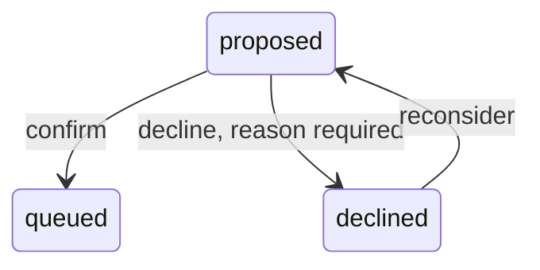

# Intake: from a Linear poll to a proposal or a queued job

Intake is the only code that creates a job row. The worker process asks Linear for the tickets
assigned to the configured user, turns each ticket into a `WorkItem`, and asks a pure function
what to do with it: make a job that waits for a person (`proposed`), make a job the queue may start
(`queued`), or do nothing. This document follows one poll, then works through every outcome.

## At a glance

- Trigger: the worker calls `poll()` once at start, then after every delay. Nothing else starts a
  poll: there is no route, no API timer, no command.
- Starts in / ends in: no job row → `proposed` or `queued`. A person then moves `proposed` to
  `queued` (confirm) or `declined` (decline), and `declined` back to `proposed` (reconsider).
- Main files: `src/composition/worker.ts`, `src/intake.ts`, `src/intake-policy.ts`,
  `src/linear.ts`, `src/linear-map.ts`, `src/db/intake-queries.ts`, `src/db/store.ts`,
  `src/jobs-commands.ts`.



The poll has no state of its own. It writes a row, or it does not.

## Files involved

| File                        | Role in this flow                                                                                                         |
| --------------------------- | ------------------------------------------------------------------------------------------------------------------------- |
| `src/entries/worker.ts`     | Entry point: loads config, calls `worker.start()` then `worker.poll()`.                                                   |
| `src/composition/worker.ts` | Wires the Linear client, store and queue into the loop. Holds the failure counter and the sleep.                          |
| `src/intake.ts`             | One poll: collect the feed, call the policy, log, insert, enqueue. Computes the next delay.                               |
| `src/intake-policy.ts`      | Pure decision table. No clock, I/O or environment. Returns decisions and skips with a reason string.                      |
| `src/linear.ts`             | `WorkFeed` over Linear's GraphQL API: query, pages, retries, raw-response log.                                            |
| `src/linear-map.ts`         | Maps one issue node to a `WorkItem`; raises `LinearMapError` on a bad shape.                                              |
| `src/db/intake-queries.ts`  | Three reads: known source ids, job count for a source, open proposal count.                                               |
| `src/db/store.ts`           | `insertJob`: inserts a row and its first event in one transaction, or reports the existing row.                           |
| `src/db/schema.ts`          | Tables `jobs` and `job_events`; unique index on `(source, source_id)`.                                                    |
| `src/worker/queue.ts`       | BullMQ queue. `enqueue(jobId)` carries only the steward job id.                                                           |
| `src/platform/config.ts`    | Validates `POLL_INTERVAL_MS`, `MAX_ENQUEUE_PER_POLL`, `MAX_OPEN_PROPOSALS`, `DRY_RUN`, `LINEAR_TEAM_KEY`, `MAX_ATTEMPTS`. |
| `src/jobs-commands.ts`      | `confirmJob`, `declineJob`, `reconsiderJob`: the person's moves around `proposed`.                                        |
| `src/api/app.ts`            | Routes that call those commands and list jobs.                                                                            |

## Step by step

### 1. The worker starts the loop

`src/entries/worker.ts` calls `worker.poll()` after `worker.start()`. In
`src/composition/worker.ts`, `composeWorker` runs a `while` loop until `close()` sets `stopping`:
one poll, then a sleep, then the next poll. The poll gets the real feed, the Postgres handle, the
logger, the queue, `now: clock()` — read once per poll, so every row from one poll has the same
timestamp — and four config values: `DRY_RUN`, `MAX_ENQUEUE_PER_POLL` (default 2, minimum 0),
`MAX_OPEN_PROPOSALS` (default 20, minimum 1) and `MAX_ATTEMPTS` (default 3).

### 2. The feed is read to the end before anything is decided

`src/intake.ts` `runIntakePoll` drains `feed.poll()` into an array first. No write happens while
pages are still arriving, so a failure on page two throws away the items of page one and the poll
writes nothing. An empty feed exits at once, logs `Intake poll finished` with three zeros, and
makes no database query.

The whole batch is one source, taken from `items[0].source`. The Linear client sets the same source
on every item (default `"linear"`), so this holds in practice.

### 3. The Linear client builds one GraphQL query per page

`createLinearClient` posts to `https://api.linear.app/graphql` with the API key in the
`Authorization` header and no `Bearer` prefix. `teamKey` is `LINEAR_TEAM_KEY` (required, no
default), `first` is `PAGE_SIZE` (50) and `after` is the cursor, `null` on the first page.

Source: `src/linear.ts` (`ISSUES_QUERY`, the filter and the paging arguments)

```ts
const ISSUES_QUERY = `query StewardIntake($teamKey: String!, $after: String, $first: Int!) {
  issues(
    filter: {
      team: { key: { eq: $teamKey } }
      assignee: { isMe: { eq: true } }
      state: { name: { in: ["Todo", "Backlog", "In Progress"] } }
    }
    first: $first
    after: $after
  ) {
```

The query also asks for `id`, `ticketKey`, `title`, `description`, `url`, `branchName`,
`labels { nodes { name } }`, `state { name }`, and `pageInfo { hasNextPage endCursor }`.

The client retries a `429` or any `5xx` up to `MAX_TRIES` (5) with backoff; any other non-2xx
status throws at once. The first page's raw JSON is logged as `Linear raw response`; the worker
drops that line when `DRY_RUN` is false, so ticket text only reaches the log in dry run.

### 4. Each node becomes a `WorkItem`

`pollPages` maps each node with `mapIssueToWorkItem`. A node that fails validation raises
`LinearMapError`; the client logs `Skipping malformed Linear issue` with the node id and keeps the
other nodes of the page. A malformed page envelope, or a non-empty GraphQL `errors` array, throws
and fails the whole poll.

Source: `src/linear-map.ts` (`mapIssueToWorkItem`)

```ts
export function mapIssueToWorkItem(node: unknown, source: string): WorkItem {
  const issue = readObject(node, 'issue', source)
  const state = readObject(issue.state, 'state', source)

  const item: WorkItem = {
    source,
    sourceId: readNonEmptyString(issue.id, 'id', source),
    ticketKey: readNonEmptyString(issue.identifier, 'identifier', source),
    title: readNonEmptyString(issue.title, 'title', source),
    body: readNullableString(issue.description, 'description', source) ?? '',
    labels: readLabelNames(issue.labels, source),
    url: readNonEmptyString(issue.url, 'url', source),
    status: readNonEmptyString(state.name, 'state.name', source),
  }

  const branch = readNullableString(issue.branchName, 'branchName', source)
  if (branch !== null && branch.length > 0) item.branch = branch

  return item
}
```

Three details matter later: `sourceId` is Linear's issue `id` (not the ticketKey) and is the
dedupe key; a null `description` becomes `""`; a null or empty `branchName` leaves `branch` out.
`status` is the state name exactly as Linear writes it, because every policy comparison is an
exact string match.

### 5. Three reads from Postgres

`runIntakePoll` calls `knownSourceIds(db, source)`, `countJobsForSource(db, source)` and
`countOpenProposals(db)` in parallel, once per poll.

- `knownSourceIds` returns every source id with a job row for this source, in any state:
  `proposed`, `declined`, `queued`, `done`, `failed`, all of them.
- `countJobsForSource` counts every row for this source. Zero means this poll is the source's
  baseline (`sourceHasJobs: false`).
- `countOpenProposals` counts `proposed` rows for **all** sources and takes no source argument: one
  query, `where jobs.state = 'proposed'`, no source filter. Two feeds would share one cap.

### 6. The pure policy decides

`decideIntake` returns two lists, `decisions` (propose or queue) and `skipped`, both in input
order. Three facts are computed before the loop: `newInProgress` (new In Progress items only),
`baseline` (the source has no job row at all) and `burstOverCap` (`newInProgress >
maxEnqueuePerPoll`). The burst rule is all-or-nothing, never "the first two run".

Source: `src/intake-policy.ts` (the reason strings and the two proposal statuses)

```ts
const ALREADY_HAS_JOB = 'already has a job'
const BASELINE = 'baseline'
const BURST_OVER_CAP = 'burst over cap'
const PROPOSAL_LIMIT = 'proposal limit'
const UNKNOWN_STATUS = 'unknown status'
const IN_PROGRESS = 'In Progress'

function isProposalStatus(status: string): boolean {
  return status === 'Todo' || status === 'Backlog'
}
```

Source: `src/intake-policy.ts` (`decideIntake`, the proposal helper and the per-item loop)

```ts
  const propose = (item: WorkItem, reason: string): void => {
    if (input.openProposals + proposalsSoFar >= input.maxOpenProposals) {
      skipped.push({ item, reason: PROPOSAL_LIMIT })
      return
    }
    decisions.push({ item, action: 'propose', reason })
    proposalsSoFar += 1
  }

  for (const item of input.items) {
    if (input.knownSourceIds.has(item.sourceId)) {
      skipped.push({ item, reason: ALREADY_HAS_JOB })
      continue
    }

    if (item.status === IN_PROGRESS) {
      if (baseline) {
        propose(item, BASELINE)
      } else if (burstOverCap) {
        propose(item, BURST_OVER_CAP)
      } else {
        decisions.push({ item, action: 'queue', reason: IN_PROGRESS })
      }
      continue
    }

    if (isProposalStatus(item.status)) {
      propose(item, item.status)
      continue
    }
```

The check order is the rule order. An id that already has a job is skipped before its status is
read, so it never counts toward the burst and never reaches the proposal cap. The last branch,
`skipped.push({ item, reason: UNKNOWN_STATUS })`, catches every other status. The proposal cap uses
`>=`, so when `openProposals` already equals `maxOpenProposals` every new proposal is skipped.
Queueing is never capped.

### 7. Every decision is logged

`runIntakePoll` logs one `Intake decision` line per decision and one `Intake skipped` line per
skip. A decision line has `source`, `sourceId`, `ticketKey`, `action` and `reason`; a skip line
has the same fields without `action`. `src/platform/logger.ts` writes one JSON object per call:

```json
{
  "ts": "2026-10-30T09:00:00.000Z",
  "level": "info",
  "msg": "Intake decision",
  "source": "linear",
  "sourceId": "lin_synthetic_0001",
  "ticketKey": "TST-1",
  "action": "propose",
  "reason": "Todo"
}
```

That `reason` is the policy's string. It is **not** written to the database: `insertJob` stores
`reason: null` on the event. The log line is the only place the intake reason survives.

### 8. Dry run stops here

Source: `src/intake.ts` (`runIntakePoll`, the dry-run exit)

```ts
  if (config.dryRun) {
    const counts = {
      queued: result.decisions.filter((decision) => decision.action === 'queue').length,
      proposed: result.decisions.filter((decision) => decision.action === 'propose').length,
      skipped: result.skipped.length,
    }
    logFinished(logger, true, counts)
    return counts
  }
```

In dry run the code reads Linear and Postgres, logs the same decisions and skips, logs
`Intake poll finished` with `dryRun: true`, and writes nothing: no `jobs` row, no `job_events` row,
no `queue.enqueue`. The counts say what a live poll would have done, so the next dry-run poll
repeats the same lines. `DRY_RUN` defaults to `true` when the key is absent (`parseDryRun` in
`src/platform/config.ts`), so a fresh instance starts dry.

### 9. Each decision becomes a row and one event

`src/intake.ts` calls `store.insertJob` once per decision, in order, each in its own transaction.

Source: `src/db/store.ts` (`insertJob`, the insert and its first event)

```ts
      .onConflictDoNothing({ target: [jobs.source, jobs.sourceId] })
      .returning()

    if (inserted !== undefined) {
      await tx.insert(jobEvents).values({
        jobId: inserted.id,
        fromState: null,
        toState: input.state,
        failureKind: null,
        reason: null,
        data: null,
        at: input.now,
      })
      return { job: toJob({ job: inserted, slot: null }), created: true }
    }
```

The `jobs` row copies `source`, `source_id` and `ticketKey`, stores the whole `WorkItem` as JSON
in `item`, and sets `state`, `attempt = 0`, `max_attempts = MAX_ATTEMPTS`, `next_run_at = NULL`,
`failure_kind = NULL`, `created_at = updated_at = poll time`. Its single event is `from_state
NULL`, `to_state` the new state, `failure_kind NULL`, `reason NULL`, `data NULL`, `at` the poll
time.

When the unique index on `(source, source_id)` rejects a row, `onConflictDoNothing` returns
nothing. `insertJob` then reads the existing row and reports `created: false`; intake logs `Intake
duplicate between decision and insert`, writes no event and enqueues nothing. The poll's `skipped`
count includes those duplicates.

### 10. Only a queued decision reaches the queue

A created `queued` job is passed to `queue.enqueue(job.id)`; a `proposed` job is not.
`src/worker/queue.ts` stores only the steward job id in the BullMQ payload and skips the add when a
waiting or delayed copy of that id is already present. The poll ends with `Intake poll finished`:
`{ dryRun, queued, proposed, skipped }`.

### 11. A failed poll waits longer

Source: `src/composition/worker.ts` (`composeWorker`, the poll failure path)

```ts
      } catch (error) {
        failures += 1
        logger.error('Intake poll failed', { failures, error: error instanceof Error ? error.message : 'unknown' })
      }
      await sleep(nextPollDelayMs(config.POLL_INTERVAL_MS, Math.random(), failures))
```

`POLL_INTERVAL_MS` defaults to 30000 (minimum 1000). With no failure the wait is the interval ±10%.
Each failure doubles it, capped at ten minutes (`MAX_POLL_DELAY_MS`). At the default: first failure
54–66 s, second 108–132 s, and by the fifth the cap holds it at 540–600 s. A good poll resets
`failures` to 0.

## Branches

The reason is the string in the `Intake decision` or `Intake skipped` log line. Every intake
`job_events` row has `reason = NULL`; among the moves around intake, only the person's commands
store one.

| If …                                                             | Then …                                                                                       | Where in code                      | Test that covers it                                                                                         |
| ---------------------------------------------------------------- | -------------------------------------------------------------------------------------------- | ---------------------------------- | ----------------------------------------------------------------------------------------------------------- |
| The feed yields no items                                         | log three zeros, make no store call                                                          | `runIntakePoll`                    | `src/intake.test.ts` "returns zeros and makes no store calls for an empty feed"                             |
| The id already has a job for the source                          | skip `already has a job`, before any status check; row untouched                             | `decideIntake`                     | `src/intake-policy.test.ts` "skips items that already have a job, before looking at their status"           |
| Status is `Todo`                                                 | propose with reason `Todo`; row `proposed`                                                   | `decideIntake`                     | `src/intake-policy.test.ts` "proposes Todo items"                                                           |
| Status is `Backlog`                                              | propose with reason `Backlog`; row `proposed`                                                | `decideIntake`                     | `src/intake-policy.test.ts` "proposes Backlog items"                                                        |
| `In Progress`, source has jobs, burst fits                       | queue with reason `In Progress`; enqueued                                                    | `decideIntake`                     | `src/intake-policy.test.ts` "queues In Progress items after the source has jobs"                            |
| `In Progress` and the source has no job row                      | propose with `baseline`                                                                      | `decideIntake`                     | `src/intake-policy.test.ts` "proposes every In Progress item on the first poll for a source"                |
| New In Progress items exceed the enqueue cap                     | propose every one with `burst over cap`; none queued                                         | `decideIntake`                     | `src/intake-policy.test.ts` "proposes all new In Progress items when the poll would exceed the enqueue cap" |
| New In Progress items equal the cap                              | queue them (the test is `>`)                                                                 | `decideIntake`                     | `src/intake-policy.test.ts` "queues In Progress items exactly at the enqueue cap"                           |
| The enqueue cap is 0 and one In Progress item is new             | propose it with `burst over cap`                                                             | `decideIntake`                     | `src/intake-policy.test.ts` "proposes new In Progress items when the enqueue cap is zero"                   |
| Known items also sit in the feed                                 | they do not count toward the burst                                                           | `decideIntake`                     | `src/intake-policy.test.ts` "does not count items that already have a job toward the enqueue cap"           |
| Open proposals plus those made so far reach the cap              | skip with `proposal limit`, mid-list                                                         | `decideIntake`                     | `src/intake-policy.test.ts` "skips proposals once open proposals reach the cap, mid-list"                   |
| The proposal cap is already full and an In Progress item arrives | queue it anyway                                                                              | `decideIntake`                     | `src/intake-policy.test.ts` "still queues In Progress items when the proposal cap is already reached"       |
| Status is neither `Todo`, `Backlog` nor `In Progress`            | skip with `unknown status`; no row                                                           | `decideIntake`                     | `src/intake-policy.test.ts` "skips statuses that are not part of intake"                                    |
| The insert hits the unique index                                 | log `Intake duplicate between decision and insert`; no event, no enqueue, counted as skipped | `runIntakePoll` and `insertJob`    | `src/intake.test.ts` "does not enqueue a duplicate that another poll inserted first"                        |
| `DRY_RUN` is true                                                | log decisions, skips and counts; write nothing                                               | `runIntakePoll`                    | `src/intake.test.ts` "creates nothing in dry-run mode and logs decisions and counts"                        |
| A job is created `queued`                                        | `queue.enqueue` runs with the new id                                                         | `runIntakePoll`                    | `src/intake.test.ts` "inserts queued and proposed jobs and enqueues only newly created queued jobs"         |
| One node is malformed                                            | warn and keep the other nodes                                                                | `pollPages`                        | `src/linear.test.ts` "skips one malformed node and returns the others"                                      |
| Linear answers 429 or 5xx                                        | retry with backoff, up to 5 tries                                                            | `createPageFetcher`                | `src/linear.test.ts` "retries a 429 and then succeeds"                                                      |
| Linear says `hasNextPage: true`                                  | follow `endCursor` and read the next page                                                    | `pollPages`                        | `src/linear.test.ts` "follows pagination cursors across pages and yields every node"                        |
| The body carries GraphQL `errors`                                | throw `LinearMapError`; the poll fails                                                       | `parsePageEnvelope`                | `src/linear.test.ts` "throws a LinearMapError for GraphQL errors"                                           |
| The poll throws                                                  | log `Intake poll failed`; double the next delay                                              | `composeWorker`, `nextPollDelayMs` | `src/intake.test.ts` "backs off exponentially after consecutive failures"                                   |
| A person declines a proposal                                     | `proposed` → `declined`, event reason is the text                                            | `declineJob`                       | `src/jobs-commands.test.ts` "records the reason"                                                            |
| A decline arrives with a blank reason                            | command throws `A decline needs a reason`; route answers 400                                 | `declineJob`                       | `src/jobs-commands.test.ts` "needs a reason"                                                                |
| A person reconsiders a declined proposal                         | `declined` → `proposed`, event reason `reconsidered`, not enqueued                           | `reconsiderJob`                    | `src/jobs-commands.test.ts` "returns a declined job to proposed without enqueueing it"                      |

## Worked examples

Assume `MAX_ENQUEUE_PER_POLL=2`, `MAX_OPEN_PROPOSALS=20`, `MAX_ATTEMPTS=3`, `DRY_RUN=false`, one
source `linear`, and a poll that is not the first, unless the example says otherwise.

### First poll for a source: everything becomes a proposal

The source has no `jobs` row, so `countJobsForSource` is 0 and `baseline` is true.

- Feed: TST-1 and TST-2, both `In Progress`, both new.
- Log: two `Intake decision` lines, `action: "propose"`, `reason: "baseline"`.
- `jobs`: two rows, `state='proposed'`, `attempt=0`, `max_attempts=3`, `next_run_at=NULL`.
- `job_events`: for each, `(from_state NULL → to_state 'proposed', reason NULL)`.
- Queue: untouched. A `Todo` ticket in that same first poll is proposed with `Todo`, not `baseline`.

In a live poll the baseline lasts exactly one poll. The next poll sees two rows, so `sourceHasJobs`
is true and a new `In Progress` ticket is queued instead. A dry run writes no row, so every dry-run
poll is a baseline poll and `In Progress` tickets are always proposed, never queued.

### A `Todo` ticket

- Feed: TST-4, `Todo`, new. Log: `action: "propose"`, `reason: "Todo"`.
- `jobs`: one row, `state='proposed'`. `job_events`: `(NULL → 'proposed', reason NULL)`.
- Nothing runs until a person confirms.

### A `Backlog` ticket

The same as `Todo`, with `reason: "Backlog"`. The only difference is the log string.

### An `In Progress` ticket is queued and enqueued

- Feed: TST-6, `In Progress`, new. `newInProgress` is 1, the cap is 2, so `burstOverCap` is false.
- Log: `action: "queue"`, `reason: "In Progress"`.
- `jobs`: one row, `state='queued'`. `job_events`: `(NULL → 'queued', reason NULL)`.
- Queue: `enqueue(<job id>)` runs, and the worker flow takes over. This is the only intake path
  that starts work without a person.

### A burst over the enqueue cap

- Feed: TST-7, TST-8, TST-9, all new `In Progress`. `newInProgress` is 3, the cap is 2.
- Decisions: three proposals, each `reason: "burst over cap"`. None is queued, not even the first
  two. `jobs`: three rows, `state='proposed'`. Queue: untouched.

With `MAX_ENQUEUE_PER_POLL=0` (allowed; the config minimum is 0) every new `In Progress` ticket
takes this path.

### The cap on open proposals

`MAX_OPEN_PROPOSALS` is a ceiling on rows in state `proposed`, not a limit per poll. The default is
20 and the config minimum is 1.

- Before the poll: 19 proposals, one of them from another source.
- Feed: TST-10 (`Todo`), TST-11 (`Todo`).
- TST-10: `19 + 0 >= 20` is false, so it is proposed. TST-11: `19 + 1 >= 20` is true, so it is
  skipped with `proposal limit`. No row, no event.
- Next poll: TST-11 is still new, `openProposals` is now 20, so it is skipped again. Skipped
  tickets are remembered nowhere; the poll tries them again until a proposal leaves the state or
  the cap is raised.

An `In Progress` ticket in the same poll is not blocked by the cap: if the burst fits, it is
queued, because the cap is checked only inside the `propose` helper.

### A ticket seen again is a duplicate

(a) Seen by an earlier poll. The id is in `knownSourceIds`, so the policy skips it with
`already has a job` before any status logic. There is no `insertJob` call: no second row, no second
event, no enqueue. The row keeps its state, even `declined`, `done` or `failed`. Intake never
reopens a ticket it has seen.

(b) The same id twice in one poll, or a second worker inserting it at the same moment. The
in-memory set cannot catch that, so `insertJob` runs twice; the unique index on `(source,
source_id)` rejects the second row, `onConflictDoNothing` returns nothing, and `insertJob` reads
the existing row and returns `created: false`. Intake logs `Intake duplicate between decision and
insert` and continues.

### A status steward ignores

`Done`, `In Review`, `Triage`: any other name is skipped with `unknown status`. No row, no event. A
ticket with another name produces this line and nothing else:

```json
{
  "ts": "2026-10-30T09:05:00.000Z",
  "level": "info",
  "msg": "Intake skipped",
  "source": "linear",
  "sourceId": "lin_synthetic_0013",
  "ticketKey": "TST-13",
  "reason": "unknown status"
}
```

With the Linear client as written, the filter asks only for the three intake states, so this branch
is defensive: it fires only if Linear returns another name (after a rename, say) or a different
`WorkFeed` is plugged in. `ALLOWED_STATUSES` plays no part; nothing in intake reads it.

### `DRY_RUN=true`

The poll reads the feed and the three counts, runs the same policy, logs every decision and skip,
and exits before the insert loop. For a feed of one `In Progress` and one `Todo` ticket:

```json
{"ts":"2026-10-30T09:10:00.000Z","level":"info","msg":"Intake decision","source":"linear","sourceId":"lin_synthetic_0014","ticketKey":"TST-14","action":"queue","reason":"In Progress"}
{"ts":"2026-10-30T09:10:00.000Z","level":"info","msg":"Intake decision","source":"linear","sourceId":"lin_synthetic_0015","ticketKey":"TST-15","action":"propose","reason":"Todo"}
{"ts":"2026-10-30T09:10:00.000Z","level":"info","msg":"Intake poll finished","dryRun":true,"queued":1,"proposed":1,"skipped":0}
```

`queued: 1` is what a live poll would have queued. Nothing was written, so the next dry run repeats
these decisions.

### Decline needs a reason

`declineJob` trims the reason and throws when the result is empty. It then requires the job to be
`proposed` and the move `proposed → declined` to be legal.

Source: `src/jobs-commands.ts` (`declineJob`)

```ts
export async function declineJob(deps: CommandDeps, id: string, reason: string): Promise<Job> {
  const trimmed = reason.trim()
  if (trimmed === '') {
    throw new Error('A decline needs a reason')
  }
  const job = await load(deps, id)
  requireFrom(job, 'declined', DECLINABLE)
  return deps.store.transitionJob(id, 'declined', { now: deps.clock(), reason: trimmed })
}
```

The route runs `declineBodySchema` (`reason: z.string().trim().min(1)`) first, so a missing or blank
reason is a `400`; a job that is not `proposed` is a `409`; an unknown id is a `404`.

What changes: `jobs.state` becomes `declined`; one `job_events` row `(proposed → declined, reason
= the trimmed text)`. Nothing is enqueued and no slot is held. Unlike an intake insert, this event
carries a reason, and that reason is free text.

### Reconsider puts it back in the pool

Source: `src/jobs-commands.ts` (`reconsiderJob`)

```ts
export async function reconsiderJob(deps: CommandDeps, id: string): Promise<Job> {
  const job = await load(deps, id)
  requireFrom(job, 'proposed', RECONSIDERABLE)
  return deps.store.transitionJob(id, 'proposed', { now: deps.clock(), reason: 'reconsidered' })
}
```

`jobs.state` is `proposed` again and the event is `(declined → proposed, reason 'reconsidered')`.
The job counts toward `MAX_OPEN_PROPOSALS` again, and the next poll still skips it as
`already has a job`. Only a person moves it out of `proposed`.

### A Linear error or a failed poll

An error from the feed — an HTTP status, a GraphQL `errors` array, a malformed envelope — arrives
while the items are still being collected, before any database read or write, so that poll writes
nothing, page one included. The worker catches it and logs:

```json
{
  "ts": "2026-10-30T09:15:00.000Z",
  "level": "error",
  "msg": "Intake poll failed",
  "failures": 1,
  "error": "Linear request failed with status 500"
}
```

Then it sleeps with the doubled delay and tries again. Which error is which:

- `429` and `5xx`: retried inside the client up to 5 tries, so one blip does not fail the poll.
- Any other non-2xx: thrown at once as `Linear request failed with status <n>`.
- A non-empty `errors` array, or a malformed page envelope: `LinearMapError`, not retried.
- One malformed node: not a poll failure; the node is skipped and the rest are used.

A failure inside the insert loop is different. Each decision is its own transaction, and a job is
written together with its first event, so no job is left without an event. The rows already
committed stay. A `queued` row whose `queue.enqueue` failed stays unqueued until the next worker
start, where `reconcile` in `src/worker/reconcile.ts` enqueues queued jobs that are missing from
the queue.

## See it yourself

Replace `<API_TOKEN>` with the instance token. `API_PORT` defaults to 3000, and the Host check
accepts `127.0.0.1:<port>`.

```bash
# proposals, newest first
curl -sS -H "Authorization: Bearer <API_TOKEN>" \
  "http://127.0.0.1:3000/v1/jobs?state=proposed&limit=50"
```

The response is a JSON array of job summaries: `id`, `ticketKey`, `source`, `state`, `attempt`,
`maxAttempts`, `slot`, `nextRunAt`, `failureKind` and `allowedActions`. `source_id` is not in it,
and `allowedActions` for a proposal is `["confirm","decline"]`.

The database holds more than the API shows:

```sql
-- every proposal, with the ticket status the policy saw
select ticketKey, item->>'status' as ticket_status, source_id, created_at
from jobs
where state = 'proposed'
order by created_at desc;
```

```sql
-- the number the proposal cap compares against (all sources)
select count(*) from jobs where state = 'proposed';
```

```sql
-- the event history of one job; intake rows have from_state and reason both null
select id, from_state, to_state, failure_kind, reason, at
from job_events
where job_id = (select id from jobs where source = 'linear' and ticketKey = 'TST-1')
order by id;
```

The worker writes its JSON lines to stdout; `pnpm dev:worker` shows them on the terminal. The
`limit` query parameter is validated by the route but the store's `listJobs` ignores it, so the
route currently returns every matching row.

## Not built yet

- **No write to Linear.** Intake only reads. No status moves, no comment, no label. `ALLOWED_STATUSES`
  is parsed and validated but read by nothing else. Both are phase 4.
- **No notifications.** A new proposal notifies nobody; a person has to look at the API or the
  dashboard. Phase 4.
- **No branch or pull request.** A job gets a worktree only when the worker claims it. The claim,
  empty commit and draft PR are phase 4, so intake creates no `agent/*` branch and there is no
  `jobs.branch` column.
- **No poll on demand.** There is no route, CLI or timer outside the worker loop.
- **No retry inside a poll.** A ticket skipped for `proposal limit` waits for a later poll; there
  is no queue of pending candidates.

Unverified Linear facts, from "Not yet checked" in `docs/status.md` and the comment at the top of
`src/linear.ts`. The code assumes them; only `In Progress` tickets were tried against the real API:

- `Todo` and `Backlog` tickets come back from the filter;
- a response with `hasNextPage: true` and a second page works;
- a null `description` arrives as `null` (the mapper turns it into `""`);
- `isMe` really excludes other people's tickets when the workspace has several users.

Docs disagree: `docs/decisions.md` (decision 6 says open proposals reaching `MAX_OPEN_PROPOSALS` make
tickets proposals; the code skips them and creates no row).
