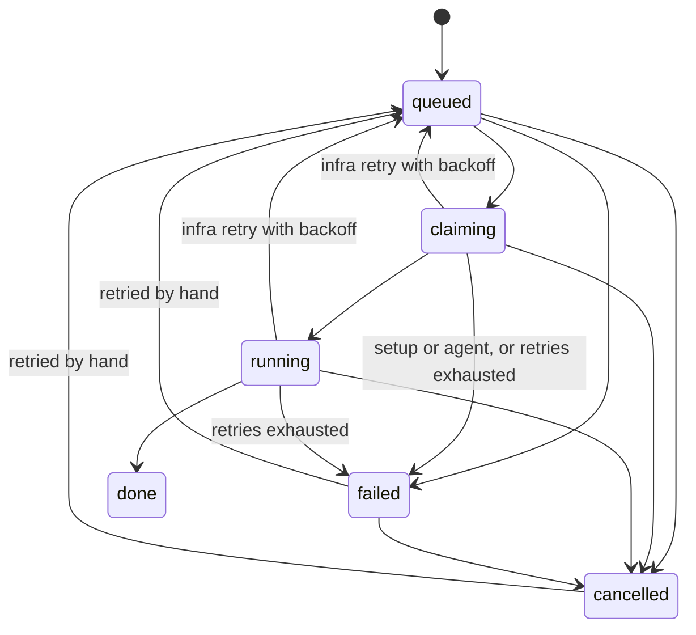

# Failures, retries, cancel, and the dead letter

This flow starts when one delivery attempt of a job throws, or when a person asks to retry or cancel a job. Steward classifies the error, decides whether to back off and try again, and either puts the job back in the queue or parks it in `failed`, the dead letter. The same document covers the manual commands, the slot in every case, and the cleanup that must not hide the original error.

## At a glance

- Trigger: `processJob` throws, or a person calls retry or cancel over the API.
- Starts in / ends in: a job in `claiming` or `running` ends in `queued` (automatic retry), `failed` (dead letter) or `cancelled`. A manual retry takes `failed` or `cancelled` back to `queued`.
- Main files: `src/worker/process-job.ts`, `src/retry-policy.ts`, `src/transitions.ts`, `src/db/store.ts`, `src/jobs-commands.ts`, `src/worker/queue.ts`, `src/bootstrap.ts`



Every edge above is in the table in `src/transitions.ts`. Two of them are declared but never written by the code today: `queued` → `failed` and `failed` → `cancelled`. Failures always happen after `claiming`, and cancel refuses a `failed` job.

## Files involved

| File                        | Role in this flow                                                                                      |
| --------------------------- | ------------------------------------------------------------------------------------------------------ |
| `src/worker/process-job.ts` | One delivery attempt. Classifies the error, records it, and runs the cleanup.                          |
| `src/retry-policy.ts`       | Pure decision: retry with a delay, or fail. Holds the backoff formula.                                 |
| `src/transitions.ts`        | The legal moves. `claiming`/`running` → `queued` is the automatic retry; `failed` is the dead letter.  |
| `src/db/store.ts`           | `transitionJob` writes the row, the event, the attempt counter, the failure kind and the slot release. |
| `src/jobs-commands.ts`      | `retryJob` and `cancelJob`, the two commands a person can send.                                        |
| `src/worker/queue.ts`       | The delayed re-enqueue. BullMQ never retries on its own.                                               |
| `src/bootstrap.ts`          | The backoff constants the worker passes to the policy.                                                 |
| `src/platform/config.ts`    | `MAX_ATTEMPTS` (fallback 3) and `SLOT_COUNT` (fallback 3).                                             |
| `src/worker/reconcile.ts`   | Repairs jobs that a crash left in `claiming` or `running`, with the same policy and the kind `infra`.  |

## Step by step

### 1. The delivery arrives, and the row decides

`src/composition/worker.ts` passes `src/worker/process-job.ts` `processJob` to `src/worker/queue.ts` `startWorker`, which calls it with the steward job id. The queue entry carries only the id, so `processJob` re-reads the row first. A row that is not `queued` is ignored: this is how a queue entry that survives a cancel, or a duplicate delivery, is dropped.

Source: `src/worker/process-job.ts` (the start of `processJob`)

```ts
  const job = await getJob(deps.db, jobId)
  if (job === null || job.state !== 'queued') {
    deps.log?.(`job ${jobId}: not queued, ignoring`)
    return
  }
```

What changes: nothing.

### 2. Take a slot, or come back in 5 seconds

`acquireSlot` writes a row in `slots`, or returns `null` when every slot is taken. With no free slot the job stays exactly as it was, and the queue gets a delayed entry.

Source: `src/worker/process-job.ts` (the no-free-slot branch)

```ts
  const slot = await acquireSlot(deps.db, jobId, deps.config.slotCount, deps.clock())
  if (slot === null) {
    deps.log?.(`job ${jobId}: no free slot, re-enqueued in 5000ms`)
    await deps.queue.enqueue(jobId, 5000)
    return
  }
```

What changes: no database row, no event, no attempt. `state` stays `queued`, `attempt` stays 0. The 5000 ms is a literal in this function; it is not part of the backoff and not part of `POLL_INTERVAL_MS`.

### 3. Claim the job: the attempt counter goes up

The move `queued` → `claiming` is the only place the attempt counter grows. It also clears `failure_kind` and `next_run_at`, so a retried job enters the run with a clean slate.

Source: `src/db/store.ts` (`nextAttempt`)

```ts
function nextAttempt(from: JobState, to: JobState, attempt: number): number {
  if (to === 'claiming') return attempt + 1
  if (isManualRetry(from, to)) return 0
  return attempt
}
```

Source: `src/db/store.ts` (the field rules in `transitionJob`)

```ts
    const manualRetry = isManualRetry(from, to)
    const failureKind = recordsFailureKind(from, to) ? (opts.failureKind ?? null) : null
    const nextRunAt =
      opts.nextRunAt !== undefined ? opts.nextRunAt : manualRetry || to === 'claiming' ? null : current.nextRunAt
```

What changes: `jobs.attempt` becomes `old + 1`, `failure_kind` and `next_run_at` become null, and a `job_events` row reaching `claiming` with `failure_kind` null is appended.

### 4. Check the local setup, then fetch

Two errors are raised on purpose in this step. `SetupError` means no retry can help. `AgentError` means only an agent can fix it. Everything else is left alone and becomes `infra`.

Source: `src/worker/process-job.ts` (the repository check)

```ts
    if (!existsSync(deps.config.repoPath)) {
      throw new SetupError(`Repository path does not exist: ${deps.config.repoPath}`)
    }
```

Source: `src/worker/process-job.ts` (`isSetupFetchMessage`)

```ts
function isSetupFetchMessage(message: string): boolean {
  return /does not appear to be a git repository|No such remote|couldn't find remote ref|Repository not found/.test(
    message,
  )
}
```

Only a fetch error is tested against that pattern: `fetchBaseClassified` wraps the error in `SetupError` when the message matches and rethrows it unchanged otherwise. A merge conflict on an existing branch is the one `AgentError` today.

Source: `src/worker/process-job.ts` (the conflict case)

```ts
      if (outcome === 'conflict') {
        // TODO(phase-2): hand the conflicted tree to the runner to resolve. The echo stub cannot, and
        // finishing as `done` would report success and then throw the tree away.
        throw new AgentError(`merge conflict with origin/${baseBranch}; the echo runner cannot resolve it`)
      }
```

What changes: nothing yet. The errors only change the decision later.

### 5. Run the job, then finish

`claiming` → `running`, then `deps.runner.start(current)`, then `running` → `done`. A throw from any statement in the `try` block, including a failed transition, goes to the `catch` and then to `recordFailure`.

### 6. Classify the error, and re-read the row

`recordFailure` assigns the kind with one ternary, then reads the row again, because the job may have changed while the run was in progress.

Source: `src/worker/process-job.ts` (`recordFailure`, the kind)

```ts
  const kind: FailureKind = error instanceof SetupError ? 'setup' : error instanceof AgentError ? 'agent' : 'infra'
```

Then comes the guard that makes a cancel win. It asks whether the job still holds a slot, and only `claiming` and `running` hold one (the `HOLDING_STATES` list in `src/allocate.ts`). Any other state means the run lost the job.

Source: `src/worker/process-job.ts` (`recordFailure`, the cancel guard)

```ts
  // A cancel (or any other move) that happened mid-run wins: never turn it back into a retry.
  if (!holdsSlot(job.state)) {
    deps.log?.(`job ${jobId}: left ${job.state} during the run, failure not recorded: ${reason}`)
    return
  }
```

What changes: with the guard hit, nothing at all. The error is logged and dropped, the row keeps the state a person or another path gave it, and no retry is enqueued.

### 7. Decide: retry with a delay, or fail

`decideAfterFailure` is pure: the clock, the random number and the bounds come in as arguments.

Source: `src/retry-policy.ts` (`decideAfterFailure`, the switch)

```ts
  switch (input.kind) {
    case 'setup':
      return { action: 'fail' }
    case 'agent':
      // TODO(phase-3): agent failures go to the validation feedback loop, not generic backoff
      return { action: 'fail' }
    case 'infra': {
      if (input.attempt >= input.maxAttempts) {
        return { action: 'fail' }
      }

      const delayMs = backoffDelayMs(input.attempt, input.backoff, input.rand)
      return { action: 'retry', nextRunAt: new Date(input.now.getTime() + delayMs) }
    }
  }
```

Only an `infra` failure computes a delay, so only `infra` consumes the random number (`rand: kind === 'infra' ? deps.rand() : 0` in `recordFailure`).

Source: `src/retry-policy.ts` (the end of `backoffDelayMs`)

```ts
  const raw = opts.baseMs * factor ** (attempt - 1)
  const capped = Math.min(opts.maxMs, raw)
  const jittered = capped * (1 - jitterRatio + 2 * jitterRatio * rand)
  const clamped = Math.min(opts.maxMs, Math.max(0, jittered))

  return Math.round(clamped)
```

The numbers, with the file each comes from:

| Number                   | Value in a default instance | Where                                                                                                 |
| ------------------------ | --------------------------- | ----------------------------------------------------------------------------------------------------- |
| `maxAttempts` on the job | 3                           | `MAX_ATTEMPTS` fallback in `src/platform/config.ts`, copied into the row at insert in `src/intake.ts` |
| `baseMs`                 | 30 000 ms (30 s)            | `BACKOFF` in `src/bootstrap.ts`                                                                       |
| `maxMs`                  | 600 000 ms (10 min)         | `BACKOFF` in `src/bootstrap.ts`                                                                       |
| `factor`                 | 2                           | `DEFAULT_FACTOR` in `src/retry-policy.ts`                                                             |
| `jitterRatio`            | 0.2                         | `DEFAULT_JITTER_RATIO` in `src/retry-policy.ts`                                                       |

`maxAttempts` is stored per job at insert, so raising `MAX_ATTEMPTS` later does not change jobs that already exist. `baseMs` and `maxMs` are constants in `src/bootstrap.ts`; the config file has no keys for them.

### 8. Write the retry, or write the dead letter

A retry moves the job to `queued` with `failure_kind` and `next_run_at` set, then asks the queue for a delayed delivery. A fail moves it to `failed` with no `next_run_at`.

Source: `src/worker/process-job.ts` (`recordFailure`, the two writes)

```ts
    if (decision.action === 'retry') {
      await transitionJob(deps.db, jobId, 'queued', {
        now,
        failureKind: kind,
        reason,
        nextRunAt: decision.nextRunAt,
      })
      await deps.queue.enqueue(jobId, Math.max(0, decision.nextRunAt.getTime() - now.getTime()))
      deps.log?.(`job ${jobId}: ${kind} failure, retrying at ${decision.nextRunAt.toISOString()}: ${reason}`)
      return
    }

    await transitionJob(deps.db, jobId, 'failed', { now, failureKind: kind, reason })
```

The `reason` is `error.message` (or `String(error)` for a non-Error), stored on the event row. `jobs` has no reason column, so the event row is the only place the message lives.

The delayed enqueue is safe from inside the running handler because every BullMQ entry gets a fresh id: `<jobId>_<uuid>`. BullMQ ignores an `add` whose id already exists.

Source: `src/worker/queue.ts` (`enqueue`)

```ts
    async enqueue(jobId: string, delayMs = 0): Promise<void> {
      if (await hasPending(jobId)) {
        return
      }
      await queue.add(JOB_NAME, { id: jobId }, { jobId: `${jobId}_${randomUUID()}`, delay: delayMs })
    },
```

What changes for a retry: `jobs.state` becomes `queued`, `failure_kind` the kind, `next_run_at` the computed time, `attempt` unchanged, plus a `job_events` row. The `slots` row for this job is deleted by the same transaction, because the job leaves a state that holds a slot (`claiming` or `running`) for one that does not.

### 9. Cleanup always runs

Two cleanups run on every path after the slot was acquired, and neither may throw out of `processJob`: an error in a cleanup is logged and the original failure stands.

Source: `src/worker/process-job.ts` (`finally`)

```ts
  } finally {
    try {
      await deps.git.removeWorktree(deps.config.repoPath, worktreePath)
    } catch (cleanupError) {
      logCleanupError(deps, jobId, 'removing the worktree', cleanupError)
    }
    try {
      // transitionJob frees the slot on claiming/running -> queued/failed; this
      // also covers a failure before `claiming` and a failed transition.
      await releaseSlot(deps.db, jobId)
    } catch (releaseError) {
      logCleanupError(deps, jobId, 'releasing the slot', releaseError)
    }
  }
```

What changes: the worktree directory `<RUNS_DIR>/<jobId>/worktree` is removed. The branch and its commits stay, so the next attempt continues on the same branch. `releaseSlot` is a plain delete, so it is harmless when `transitionJob` already removed the row. If `recordFailure` itself fails (for example the transition throws), that error is logged too, and the job may stay in `claiming` or `running` with no slot row. The reconciler at the next worker start treats such a job as `infra` with the reason `worker lost on restart`.

### 10. A person retries or cancels

Both commands name the states they accept, so a legal edge alone is not enough.

Source: `src/jobs-commands.ts` (the two state lists)

```ts
const RETRYABLE: readonly JobState[] = ['failed', 'cancelled']
const CANCELLABLE: readonly JobState[] = ['queued', 'claiming', 'running', 'pr_open', 'in_review', 'changes_requested']
```

A manual retry reuses the row and clears the failure, then enqueues with no delay.

Source: `src/jobs-commands.ts` (`retryJob`)

```ts
/** A manual retry of a job that stopped: the row is reused, the attempt counter resets in the store. */
export async function retryJob(deps: CommandDeps, id: string): Promise<Job> {
  const job = await load(deps, id)
  requireFrom(job, 'queued', RETRYABLE)
  const updated = await deps.store.transitionJob(id, 'queued', { now: deps.clock(), reason: 'retried by hand' })
  await deps.enqueue(id)
  return updated
}
```

What a manual retry resets: `attempt` to 0, `failure_kind` to null, `next_run_at` to null. What it keeps: the row id, the stored `max_attempts`, the branch `agent/<slug>`, and the whole `job_events` history. The slot is already free, because `failed` and `cancelled` hold none.

Cancel stops the run first, then changes the row.

Source: `src/jobs-commands.ts` (`cancelJob`)

```ts
/** Stops the run first, so an agent still working is told to stop before the row changes. */
export async function cancelJob(deps: CommandDeps, id: string): Promise<Job> {
  const job = await load(deps, id)
  requireFrom(job, 'cancelled', CANCELLABLE)
  await deps.cancelRun(id)
  return deps.store.transitionJob(id, 'cancelled', { now: deps.clock(), reason: 'cancelled by hand' })
}
```

What changes: the state becomes `cancelled` with the reason `cancelled by hand`, and the slot row is deleted if the job held one. `cancelRun` is called for every cancellable state, including `queued` where no run exists: in the API it is `runner.cancel`, and the echo runner answers it by writing an orchestrator `cancelled` line to the job transcript. `failed` is not cancellable over the API, even though the state machine has a `failed` → `cancelled` edge.

## The three failure kinds

| Kind    | What it means                                                                                             | An example that produces it                                                                                                                                                                                                          | Decision                                                         |
| ------- | --------------------------------------------------------------------------------------------------------- | ------------------------------------------------------------------------------------------------------------------------------------------------------------------------------------------------------------------------------------ | ---------------------------------------------------------------- |
| `infra` | Anything not classified as `setup` or `agent`: the host, git, the network, the container, the queue.      | The runner throws `runner exploded`. Also: a git command fails, `Could not resolve host: example.com` on fetch, `sh: tool: command not found` from the runner, and an error whose only resemblance to setup is the word "not found". | Retry with backoff while `attempt < maxAttempts`, then `failed`. |
| `agent` | Work only an agent can do. The same input would fail the same way.                                        | `merge conflict with origin/main; the echo runner cannot resolve it`.                                                                                                                                                                | `failed` at once, on attempt 1.                                  |
| `setup` | The local or remote setup is wrong: no repo, no remote, no base branch, no access. A retry cannot fix it. | `Repository path does not exist: /srv/steward/repo`, or a fetch that answers `Repository not found`.                                                                                                                                 | `failed` at once, on attempt 1.                                  |

The two deliberate classes are the only way to reach `setup` and `agent`, shown in step 4. A `SetupError` is tested before `AgentError` in the ternary, but no code path raises both.

## Worked example: an `infra` failure that retries until it is dead

Job TST-1, created as `queued` with `max_attempts = 3` (the `MAX_ATTEMPTS` fallback), in an instance with `SLOT_COUNT = 3` and the default `BACKOFF`. The worker's clock reads real time and `Math.random()` supplies `rand`; the numbers below use `rand = 0.5`, which makes the jitter factor exactly 1.

Attempt 1:

- 10:00:00.000 intake inserts the job as `queued` and enqueues it. Event 1.
- 10:00:01.000 `queued` → `claiming`: `attempt` 0 + 1 = 1, `failure_kind` null, `next_run_at` null.
- 10:00:02.000 `claiming` → `running`, and `runner.start` throws `Error('container start failed: exit status 125')`.
- 10:00:40.000 `recordFailure`. Kind `infra`. The row still holds a slot, so the guard passes. `attempt` is 1, `max_attempts` is 3, so `1 >= 3` is false and a delay is computed:
  - `raw = 30 000 × 2^(1−1) = 30 000 ms`
  - `capped = min(600 000, 30 000) = 30 000 ms`
  - `jittered = 30 000 × (1 − 0.2 + 2 × 0.2 × 0.5) = 30 000 × 1.0 = 30 000 ms`
  - `clamped = min(600 000, max(0, 30 000)) = 30 000`, and `Math.round` leaves it at **30 000 ms**
  - `next_run_at = 10:00:40.000 + 30 s = 10:01:10.000`
- The row becomes `queued`, `failure_kind` `infra`, `next_run_at` 10:01:10.000, `attempt` 1. The queue gets the same id with `delay: 30000`. The slot row is deleted.

Attempt 2, delivered at 10:01:10.000:

- `queued` → `claiming` at 10:01:10.000: `attempt` 2, `next_run_at` null, `failure_kind` null.
- `claiming` → `running` at 10:01:11.000. The runner throws the same error at 10:01:15.000.
- `attempt` 2 < 3, so a delay is computed:
  - `raw = 30 000 × 2^(2−1) = 60 000 ms`
  - `capped = min(600 000, 60 000) = 60 000 ms`
  - `jittered = 60 000 × 1.0 = 60 000 ms` → **60 000 ms**
  - `next_run_at = 10:01:15.000 + 60 s = 10:02:15.000`
- The row is `queued` again with `attempt` 2, and the queue holds a 60 000 ms delay.

Attempt 3, delivered at 10:02:15.000:

- `queued` → `claiming` at 10:02:15.000: `attempt` 3.
- `claiming` → `running` at 10:02:16.000. The runner throws at 10:02:20.000.
- `attempt` 3 >= `max_attempts` 3, so `decideAfterFailure` returns `{ action: 'fail' }` and no delay is computed.
- The row becomes `failed`, `failure_kind` `infra`, `attempt` 3, `next_run_at` null. Nothing is enqueued. This is the dead letter.

With jitter, one delay is not a fixed number. `jittered` lies in `[0.8 × capped, 1.2 × capped)`, so attempt 1 waits 24 000 to 36 000 ms and attempt 2 waits 48 000 to 72 000 ms. `maxMs` caps the raw value from attempt 6 (`30 000 × 2^5 = 960 000` → 600 000), which the default `MAX_ATTEMPTS = 3` never reaches.

## The event rows, case by case

Columns are the real ones from `job_events`: `from_state`, `to_state`, `failure_kind`, `reason`, `at`. `data` is null on every row the code writes today, and `reason` is null when no reason was given.

(a) One retry, then success. A manual retry over the API or a confirm writes `confirmed` or `retried by hand` as the reason on the row into `queued`.

| #   | from_state | to_state | failure_kind | reason                                  | at           |
| --- | ---------- | -------- | ------------ | --------------------------------------- | ------------ |
| 1   | null       | queued   | null         | null                                    | 10:00:00.000 |
| 2   | queued     | claiming | null         | null                                    | 10:00:01.000 |
| 3   | claiming   | running  | null         | null                                    | 10:00:02.000 |
| 4   | running    | queued   | infra        | container start failed: exit status 125 | 10:00:40.000 |
| 5   | queued     | claiming | null         | null                                    | 10:01:10.000 |
| 6   | claiming   | running  | null         | null                                    | 10:01:11.000 |
| 7   | running    | done     | null         | null                                    | 10:01:20.000 |

(b) Retries exhausted, the dead letter.

| #   | from_state | to_state | failure_kind | reason                                  | at           |
| --- | ---------- | -------- | ------------ | --------------------------------------- | ------------ |
| 1   | null       | queued   | null         | null                                    | 10:00:00.000 |
| 2   | queued     | claiming | null         | null                                    | 10:00:01.000 |
| 3   | claiming   | running  | null         | null                                    | 10:00:02.000 |
| 4   | running    | queued   | infra        | container start failed: exit status 125 | 10:00:40.000 |
| 5   | queued     | claiming | null         | null                                    | 10:01:10.000 |
| 6   | claiming   | running  | null         | null                                    | 10:01:11.000 |
| 7   | running    | queued   | infra        | container start failed: exit status 125 | 10:01:15.000 |
| 8   | queued     | claiming | null         | null                                    | 10:02:15.000 |
| 9   | claiming   | running  | null         | null                                    | 10:02:16.000 |
| 10  | running    | failed   | infra        | container start failed: exit status 125 | 10:02:20.000 |

(c) An `agent` failure, and (d) a `setup` failure. Both are final on attempt 1. The agent case is found before the run starts, so its last row leaves `claiming`, not `running`.

| case | #   | from_state | to_state | failure_kind | reason                                                             | at           |
| ---- | --- | ---------- | -------- | ------------ | ------------------------------------------------------------------ | ------------ |
| c    | 1   | null       | queued   | null         | null                                                               | 10:00:00.000 |
| c    | 2   | queued     | claiming | null         | null                                                               | 10:00:01.000 |
| c    | 3   | claiming   | failed   | agent        | merge conflict with origin/main; the echo runner cannot resolve it | 10:00:02.000 |
| d    | 1   | null       | queued   | null         | null                                                               | 10:00:00.000 |
| d    | 2   | queued     | claiming | null         | null                                                               | 10:00:01.000 |
| d    | 3   | claiming   | failed   | setup        | Repository path does not exist: /srv/steward/repo                  | 10:00:01.100 |

(e) No free slot. Only the intake row exists: the job is untouched, and only the queue changes.

| #   | from_state | to_state | failure_kind | reason | at           |
| --- | ---------- | -------- | ------------ | ------ | ------------ |
| 1   | null       | queued   | null         | null   | 10:00:00.000 |

(f) Cancel, then a manual retry. The cancel wins over the error the cancelled run raises, so no failure row appears.

| #   | from_state | to_state  | failure_kind | reason            | at           |
| --- | ---------- | --------- | ------------ | ----------------- | ------------ |
| 1   | null       | queued    | null         | null              | 10:00:00.000 |
| 2   | queued     | claiming  | null         | null              | 10:00:01.000 |
| 3   | claiming   | running   | null         | null              | 10:00:02.000 |
| 4   | running    | cancelled | null         | cancelled by hand | 10:00:30.000 |
| 5   | cancelled  | queued    | null         | retried by hand   | 10:05:00.000 |
| 6   | queued     | claiming  | null         | null              | 10:05:00.100 |

## Branches

| If ...                                                                        | Then ...                                                                                      | Where in code                                     | Test that covers it                                                                                                                                                                                                |
| ----------------------------------------------------------------------------- | --------------------------------------------------------------------------------------------- | ------------------------------------------------- | ------------------------------------------------------------------------------------------------------------------------------------------------------------------------------------------------------------------ |
| The delivered job is not `queued`                                             | Log and return; no event, no slot, no attempt                                                 | `src/worker/process-job.ts` `processJob`          | `tests/integration/process-job.int.test.ts` `it('ignores a job that is not queued')`                                                                                                                               |
| Every slot is taken                                                           | Job stays `queued`, `attempt` 0, re-enqueued with 5000 ms                                     | `src/worker/process-job.ts` `processJob`          | `tests/integration/process-job.int.test.ts` `it('re-enqueues with a delay when no slot is free and leaves the job queued')`                                                                                        |
| An `infra` failure happens below `maxAttempts`                                | Back to `queued` with `failure_kind`, `next_run_at`, delayed enqueue, slot freed              | `src/worker/process-job.ts` `recordFailure`       | `tests/integration/process-job.int.test.ts` `it('retries an infra failure with the backoff delay and frees the slot')`                                                                                             |
| An `infra` failure happens at `attempt >= maxAttempts`                        | `failed`, no enqueue, reason kept                                                             | `src/retry-policy.ts` `decideAfterFailure`        | `src/retry-policy.test.ts` `it('retries infra failures below maxAttempts and fails at the limit')`                                                                                                                 |
| `maxAttempts` is 1                                                            | The first `infra` failure is final                                                            | `src/retry-policy.ts` `decideAfterFailure`        | `tests/integration/process-job.int.test.ts` `it('fails a job after maxAttempts with the error message only')` and `src/retry-policy.test.ts` `it('fails immediately when maxAttempts is 1')`                       |
| The failure kind is `agent`                                                   | `failed` at once, no delay computed                                                           | `src/retry-policy.ts` `decideAfterFailure`        | `src/retry-policy.test.ts` `it('fails agent failures')`                                                                                                                                                            |
| The failure kind is `setup`                                                   | `failed` at once, no delay computed                                                           | `src/retry-policy.ts` `decideAfterFailure`        | `src/retry-policy.test.ts` `it('never retries setup failures')`                                                                                                                                                    |
| A merge conflicts with the base branch                                        | `AgentError`, so `failed` as `agent`                                                          | `src/worker/process-job.ts` `processJob`          | `tests/integration/process-job.int.test.ts` `it('fails a merge conflict as an agent failure, because the echo runner cannot resolve it')`                                                                          |
| `REPO_PATH` does not exist                                                    | `SetupError` before any git call                                                              | `src/worker/process-job.ts` `processJob`          | `tests/integration/process-job.int.test.ts` `it('fails a missing repository path immediately as setup, with no retry')`                                                                                            |
| The fetch message matches the setup pattern                                   | `SetupError`, `failed` at once                                                                | `src/worker/process-job.ts` `fetchBaseClassified` | `tests/integration/process-job.int.test.ts` `it('fails a missing base branch as setup, at once and without a retry')` and `it('fails a fetch from a repository that is not there as setup, at once')`              |
| A fetch fails for any other reason                                            | Rethrown, so `infra` and retried                                                              | `src/worker/process-job.ts` `fetchBaseClassified` | `tests/integration/process-job.int.test.ts` `it('retries a transient network failure as infra, with the slot freed')` and `it('retries an unrelated fetch error that says "not found" as infra')`                  |
| A git command outside the fetch fails                                         | `infra`, retried                                                                              | `src/worker/process-job.ts` `processJob`          | `tests/integration/process-job.int.test.ts` `it('treats a git failure as infra and retries')`                                                                                                                      |
| The runner throws a plain error                                               | `infra`, retried                                                                              | `src/worker/process-job.ts` `recordFailure`       | `tests/integration/process-job.int.test.ts` `it('retries a missing tool from the runner as infra, not setup')`                                                                                                     |
| A cancel arrives while the run is in progress                                 | The cancel stands, the failure is logged and not recorded, no retry                           | `src/worker/process-job.ts` `recordFailure`       | `tests/integration/process-job.int.test.ts` `it('does not undo a cancel that happens while the job is running')`                                                                                                   |
| Removing the worktree throws during cleanup                                   | The original failure is kept, the cleanup error is only logged                                | `src/worker/process-job.ts` `processJob`          | `tests/integration/process-job.int.test.ts` `it('does not let a worktree cleanup error mask the original failure')`                                                                                                |
| A crash left a worktree behind                                                | The next attempt clears it and continues on the same branch                                   | `src/worker/process-job.ts` `processJob`          | `tests/integration/process-job.int.test.ts` `it('recovers when a crashed run left its worktree behind, keeping the commits on the branch')`                                                                        |
| A retry happens from inside the handler of the same job                       | BullMQ accepts it, because every entry has a fresh id                                         | `src/worker/queue.ts` `enqueue`                   | `tests/integration/queue.int.test.ts` `it('accepts a re-enqueue of the same job from inside its own handler')`                                                                                                     |
| The same job is enqueued twice while one entry is pending                     | One entry only                                                                                | `src/worker/queue.ts` `enqueue`                   | `tests/integration/queue.int.test.ts` `it('treats a duplicate enqueue as one job')`                                                                                                                                |
| A delayed entry is counted as present                                         | Yes, so a duplicate delayed enqueue is a no-op                                                | `src/worker/queue.ts` `hasPending`                | `tests/integration/queue.int.test.ts` `it('reports a delayed job as present')`                                                                                                                                     |
| A `failed` or `cancelled` job is retried by hand                              | Reuses the row, `attempt` 0, `failure_kind` null, `next_run_at` null, enqueued at once        | `src/db/store.ts` `transitionJob`                 | `tests/integration/store.int.test.ts` `it('resets attempt and next_run_at on a manual retry from failed')`                                                                                                         |
| The retried job enters `claiming`                                             | `next_run_at` is cleared and `attempt` is 1 again                                             | `src/db/store.ts` `transitionJob`                 | `tests/integration/store.int.test.ts` `it('clears the next run time once the retried job enters claiming')`                                                                                                        |
| An automatic retry is written                                                 | `failure_kind` and `reason` are recorded on the event                                         | `src/db/store.ts` `transitionJob`                 | `tests/integration/store.int.test.ts` `it('records failure kind and next run time on an automatic retry')`                                                                                                         |
| `running` moves to `failed`, `done` or `pr_open`                              | The slot row is deleted                                                                       | `src/db/store.ts` `transitionJob`                 | `tests/integration/store.int.test.ts` `it('releases the slot when running goes to %s')`                                                                                                                            |
| A retry is asked for a `done`, `merged`, `running`, `queued` or `pr_open` job | 409 `IllegalTransitionError`, nothing enqueued                                                | `src/jobs-commands.ts` `retryJob`                 | `src/jobs-commands.test.ts` `it('never retries a job that is finished, or one that is already in flight')`                                                                                                         |
| A retry is asked for a `cancelled` job over the API                           | 200, back to `queued`, enqueued                                                               | `src/api/app.ts` `/v1/jobs/:id/retry`             | `src/api/app.test.ts` `it('retries a cancelled job')`                                                                                                                                                              |
| A cancel is asked for a `running` job                                         | The run is cancelled first, then the row                                                      | `src/jobs-commands.ts` `cancelJob`                | `src/jobs-commands.test.ts` `it('stops the run first, then records the cancel')`                                                                                                                                   |
| A cancel is asked for a `queued` job                                          | `cancelled` at once, `cancelRun` still called                                                 | `src/api/app.ts` `/v1/jobs/:id/cancel`            | `src/api/app.test.ts` `it('cancels a queued job')`                                                                                                                                                                 |
| A cancel is asked for a `failed` job                                          | 409; only the retry path exists for `failed`                                                  | `src/jobs-commands.ts` `cancelJob`                | no test                                                                                                                                                                                                            |
| A `failed` job is cancelled by the state machine alone                        | The edge `failed` → `cancelled` is legal                                                      | `src/transitions.ts` the allowed-moves table      | `src/transitions.test.ts` `it('allows the legal edge %s -> %s')`                                                                                                                                                   |
| Two transitions race on one job                                               | One wins, the other gets `IllegalTransitionError`                                             | `src/db/store.ts` `transitionJob`                 | `tests/integration/store.int.test.ts` `it('lets exactly one of two concurrent transitions win')`                                                                                                                   |
| A worker dies with jobs in `claiming` or `running`                            | The reconciler retries as `infra` with reason `worker lost on restart`, or fails if exhausted | `src/worker/reconcile.ts` `recoverLostJob`        | `tests/integration/reconcile.int.test.ts` `it('retries a running job whose worker is gone and frees its slot')` and `it('fails a running job whose retries are exhausted, freeing its slot and not enqueuing it')` |

## See it yourself

List failed jobs with their kind and the reason the failure was recorded:

```sql
select j.ticketKey, j.state, j.attempt, j.max_attempts, j.failure_kind, e.reason, e.at
from jobs j
join lateral (
  select reason, at from job_events where job_id = j.id order by id desc limit 1
) e on true
where j.state = 'failed'
order by e.at desc;
```

Read every event of one job, in order:

```sql
select id, from_state, to_state, failure_kind, reason, at
from job_events
where job_id = '<JOB_ID>'
order by id;
```

See the jobs that wait for a retry, with the delay already applied to `next_run_at`:

```sql
select ticketKey, attempt, max_attempts, failure_kind, next_run_at, next_run_at - now() as wait
from jobs
where state = 'queued' and next_run_at is not null
order by next_run_at;
```

Retry a failed job over the API (the API listens on `127.0.0.1:${API_PORT}`, default 3000, and checks the Host header, the Origin header and the token):

```bash
curl -sS -X POST "http://127.0.0.1:3000/v1/jobs/<JOB_ID>/retry" \
  -H "Authorization: Bearer <API_TOKEN>"
```

The answer is the read model after the move, with the buttons the new state allows:

```json
{
  "id": "<JOB_ID>",
  "ticketKey": "TST-1",
  "source": "linear",
  "state": "queued",
  "attempt": 0,
  "maxAttempts": 3,
  "slot": null,
  "nextRunAt": null,
  "failureKind": null,
  "allowedActions": ["cancel"]
}
```

Cancel a queued or running job:

```bash
curl -sS -X POST "http://127.0.0.1:3000/v1/jobs/<JOB_ID>/cancel" \
  -H "Authorization: Bearer <API_TOKEN>"
```

A cancel of a running job answers `"state": "cancelled"` with `"allowedActions": ["retry"]`. A retry or cancel on a state the command refuses answers 409 with the two states in the message, for example `{"error":"Illegal job state transition: done -> queued"}`. An unknown id answers 404 `{"error":"not found"}`.

On disk, each attempt writes into `<RUNS_DIR>/<JOB_ID>/`: `transcript.jsonl` for the served log and `raw.jsonl` for the unredacted one. The worktree at `<RUNS_DIR>/<JOB_ID>/worktree` is gone after every path, including a failure. `RUNS_DIR` defaults to `$HOME/steward-instances/<INSTANCE>/runs` in `src/platform/config.ts`.

## Not built yet

- An `agent` failure does not reach a validation feedback loop. `TODO(phase-3)` in `src/retry-policy.ts` marks the spot; today every `agent` failure is final on attempt 1.
- A merge conflict is not handed to the agent that could resolve it, and there is no guard for a second conflict on the same job (phase 2).
- A failure in `pending_actions`, a notification on a new `failed` job, and the daily reminder for the dead letter are not built (phase 4).
- Nothing sweeps old run directories, so the transcripts of failed jobs stay until `RUN_RETENTION_DAYS` is used (phase 5).
- The backoff base and cap are constants in `src/bootstrap.ts`; no config key exposes them.

Docs disagree: `docs/architecture.md` says a retry "keeps the job row and increments `attempt`". A manual retry resets `attempt` to 0 in `src/db/store.ts` `nextAttempt`, and the next run's `claiming` step makes it 1.

Docs disagree: `docs/decisions.md` describes the dead letter as a state "where you retry or cancel it". The cancel command refuses a `failed` job, because `CANCELLABLE` in `src/jobs-commands.ts` has no `failed`, even though the `failed` → `cancelled` edge exists in the state machine.
