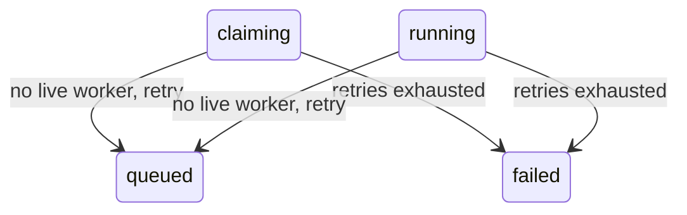

# Crash and recovery

When the worker or the machine dies mid-job, Postgres can keep a job in `claiming` or `running`
that no process is working on, a slot row can be left behind, and Redis can lose a queue entry.
On the next start, before it takes any work, the worker runs a reconciler that repairs the gap
between Postgres and the queue.

## At a glance

- Trigger: worker process start (`pnpm dev:worker`, the user unit
  `deploy/systemd/steward-worker@.service`, or a manual restart). Once per process, before the
  first queue delivery.
- Starts in / ends in: finds `claiming` and `running` jobs and leaves them `queued` or `failed`;
  leaves `queued` jobs `queued` and adds the missing queue entry; deletes leaked `slots` rows.
- Main files: `src/worker/reconcile.ts`, `src/composition/worker.ts`, `src/db/store.ts`,
  `src/allocate.ts`, `src/worker/queue.ts`, `src/worker/process-job.ts`, `src/platform/git.ts`.

The reconciler's moves, all legal edges of the state machine:



## Files involved

| File                                      | Role in this flow                                                                                           |
| ----------------------------------------- | ----------------------------------------------------------------------------------------------------------- |
| `src/entries/worker.ts`                   | Process entry: start the worker, poll Linear, handle `SIGTERM` / `SIGINT`.                                  |
| `src/composition/worker.ts`               | Start order: migrate, reconcile with an always-dead liveness probe, consume the queue, poll.                |
| `src/worker/reconcile.ts`                 | The reconciler: lost claims, leaked slots, queued jobs missing from the queue, error collection.            |
| `src/worker/queue.ts`                     | BullMQ wrapper: what "present" means, enqueue with a delay, duplicate handling.                             |
| `src/db/store.ts`                         | `listJobs`, `transitionJob` (deletes the slot row on the way out of a holding state), `releaseLeakedSlots`. |
| `src/allocate.ts`                         | `HOLDING_STATES`, `holdsSlot`, `findLeakedSlots`.                                                           |
| `src/retry-policy.ts`                     | `decideAfterFailure`: retry with backoff, or fail, for kind `infra`.                                        |
| `src/worker/process-job.ts`               | The retried run: clears a leftover worktree before creating one, cleans up in `finally`.                    |
| `src/platform/git.ts`                     | `removeWorktree`: the `--force` removal, the debris case, the prune, the clone guard.                       |
| `src/bootstrap.ts`                        | `BACKOFF`: `baseMs` 30 000, `maxMs` 600 000.                                                                |
| `src/platform/config.ts`                  | `MAX_ATTEMPTS` (default 3), `SLOT_COUNT` (default 3), `REPO_PATH`, `RUNS_DIR`, `BASE_BRANCH`.               |
| `tests/integration/reconcile.int.test.ts` | Every reconciler branch, against a real Postgres.                                                           |

## Step by step

### 1. Start order, and the probe that assumes one worker

`src/entries/worker.ts` builds the worker and calls `start()`. In `src/composition/worker.ts`,
`start` migrates the database, reconciles, and only then starts the BullMQ consumer, so no
delivery arrives while state is still being repaired.

Source: `src/composition/worker.ts` (the start order)

```ts
  const start = async (): Promise<void> => {
    await migrateDb(db)
    // No job survives a restart of this single worker process, so none has a live worker.
    const report = await reconcile(
      { db, queue, isWorkerAlive: () => Promise.resolve(false) },
      { now: clock(), rand: Math.random, backoff: BACKOFF, slotCount: config.SLOT_COUNT },
    )
    logger.info('Reconciled on startup', { ...report })
```

The probe always answers `false`. That constant is the single-worker assumption, and
`docs/status.md` states it: "The reconciler assumes one worker per instance."

With two workers on the same database and queue (this follows from reading the code; no test runs two workers), worker B would treat worker A's live jobs as
abandoned: it moves the row to `queued` or `failed`, deletes A's slot, and enqueues the job
again. A's run then calls `transitionJob` to `done` on a row that is no longer `running`, which
throws `IllegalTransitionError`. `recordFailure` in `src/worker/process-job.ts` sees that the
job no longer holds a slot, logs `left queued during the run, failure not recorded`, and drops
the result. The queued copy runs the job a second time. Both runs use the same worktree path,
`RUNS_DIR/<job-id>/worktree`, so their cleanups can delete each other's tree.

### 2. The holding-state loop, claiming first, then running

Only these two states hold a slot, so only these two can be left stranded:

Source: `src/allocate.ts` (the holding states)

```ts
export const HOLDING_STATES = ['claiming', 'running'] as const satisfies readonly JobState[]
```

`reconcile` walks them in order, and inside a state `listJobs` returns the newest job first. A
job with a live worker is skipped and keeps its slot. Every other job goes through
`recoverLostJob`.

Source: `src/worker/reconcile.ts` (`reconcile`, the holding-state loop)

```ts
  for (const state of HOLDING_STATES) {
    for (const job of await listJobs(deps.db, { state })) {
      try {
        if (await deps.isWorkerAlive(job.id)) {
          continue
        }
        const outcome = await recoverLostJob(deps, job, opts)
        if (outcome === 'retried') {
          report.retried.push(job.id)
          enqueuedRetries.add(job.id)
        } else {
          report.failed.push(job.id)
        }
      } catch (error) {
        errors.push(error)
      }
    }
  }
```

### 3. Retry with backoff, or fail

The decision is the same one a live failure uses: kind `infra`, the recorded `attempt`,
`maxAttempts`, the injected clock, and one random number.

Source: `src/worker/reconcile.ts` (`recoverLostJob`, the decision)

```ts
  const decision = decideAfterFailure({
    kind: 'infra',
    attempt: job.attempt,
    maxAttempts: job.maxAttempts,
    now: opts.now,
    rand: opts.rand(),
    backoff: opts.backoff,
  })
```

The two outcomes, with fixed reason strings:

Source: `src/worker/reconcile.ts` (`recoverLostJob`, the two outcomes)

```ts
  if (decision.action === 'fail') {
    await transitionJob(deps.db, job.id, 'failed', {
      now: opts.now,
      failureKind: 'infra',
      reason: RETRIES_EXHAUSTED_REASON,
    })
    return 'failed'
  }

  await transitionJob(deps.db, job.id, 'queued', {
    now: opts.now,
    failureKind: 'infra',
    reason: WORKER_LOST_REASON,
    nextRunAt: decision.nextRunAt,
  })
  await deps.queue.enqueue(job.id, Math.max(0, decision.nextRunAt.getTime() - opts.now.getTime()))
  return 'retried'
```

The constants are `worker lost on restart` and `worker lost on restart; retries exhausted`. Both
paths record `failureKind: 'infra'`.

### 4. The slot row, the attempt counter and the delay

`src/db/store.ts` `transitionJob` writes the state, appends the `job_events` row, and deletes the
slot row in one transaction, because the job leaves a holding state:

Source: `src/db/store.ts` (`transitionJob`, the slot release)

```ts
    if (holdsSlot(from) && !holdsSlot(to)) {
      await tx.delete(slots).where(eq(slots.jobId, id))
    }
```

So a retried job's slot is gone before `releaseLeakedSlots` runs, and `report.slotsFreed` stays
empty for it. Only the job id appears, in `retried` or `failed`.

Each move to `claiming` adds one to `attempt`:

Source: `src/db/store.ts` (`nextAttempt`)

```ts
function nextAttempt(from: JobState, to: JobState, attempt: number): number {
  if (to === 'claiming') return attempt + 1
  if (isManualRetry(from, to)) return 0
  return attempt
}
```

A job killed on its first run is found with `attempt = 1`. The reconciler does not add an
attempt of its own; it spends the one the dead run used. With `MAX_ATTEMPTS = 3` (config
default), three claims are allowed: two crash-retries, then `failed`.

Source: `src/bootstrap.ts` (the production backoff)

```ts
/** First retry waits 30 s; the delay doubles up to 10 minutes. */
export const BACKOFF: BackoffOptions = { baseMs: 30_000, maxMs: 600_000 }
```

`src/retry-policy.ts` adds `factor = 2` and `jitterRatio = 0.2` when they are not given. The
first crash-retry is `30 000 * (0.8 + 0.4 * rand)` ms, so 24 000 to 36 000 ms; the second is
48 000 to 72 000 ms.

Source: `src/worker/reconcile.ts` (`delayMsFor`)

```ts
function delayMsFor(job: Job, now: Date): number {
  if (job.nextRunAt === null) {
    return 0
  }
  return Math.max(0, job.nextRunAt.getTime() - now.getTime())
}
```

### 5. Leaked slot rows are freed

A slot row is valid only while its job is `claiming` or `running`. Every other row is leaked.

Source: `src/allocate.ts` (`findLeakedSlots`)

```ts
export function findLeakedSlots(held: ReadonlyArray<{ slot: number; jobState: JobState | null }>): number[] {
  const leaked = new Set<number>()
  for (const row of held) {
    if (row.jobState === null || !holdsSlot(row.jobState)) {
      leaked.add(row.slot)
    }
  }
  return [...leaked].sort((a, b) => a - b)
}
```

Source: `src/db/store.ts` (`releaseLeakedSlots`)

```ts
export async function releaseLeakedSlots(db: Db): Promise<number[]> {
  const leaked = findLeakedSlots(await heldSlots(db))
  if (leaked.length === 0) {
    return []
  }
  await db.delete(slots).where(inArray(slots.slot, leaked))
  return leaked
}
```

This runs after the holding-state loop, so slots already removed by a transition are not
reported, and before the queued pass. A `queued` job that still holds a slot row, for example
after a crash between `acquireSlot` and the move to `claiming`, therefore has its slot freed in
the same run that re-enqueues it.

### 6. Queued jobs missing from the queue are enqueued

A `queued` job needs one BullMQ record, or nothing will deliver it.

Source: `src/worker/reconcile.ts` (`reconcile`, the queued pass)

```ts
  for (const job of await listJobs(deps.db, { state: 'queued' })) {
    if (enqueuedRetries.has(job.id)) {
      continue
    }
    try {
      if (await deps.queue.hasJob(job.id)) {
        continue
      }
      await deps.queue.enqueue(job.id, delayMsFor(job, opts.now))
      report.requeued.push(job.id)
    } catch (error) {
      errors.push(error)
    }
  }
```

Presence covers four BullMQ states; a `completed` or `failed` record does not count:

Source: `src/worker/queue.ts` (what "present" means)

```ts
const PENDING_STATES = ['waiting', 'delayed', 'prioritized'] as const
const PRESENT_STATES = [...PENDING_STATES, 'active'] as const
```

`enqueue` returns early when the job is already pending, so duplicates do not stack. Each new
record gets the key `<job-id>_<uuid>`, because BullMQ ignores an `add` whose id exists; the
steward id travels in `data.id` and that is what presence compares. This pass writes no
`job_events` row: only Redis changes, plus the `requeued` array in the report.

### 7. Errors are collected, then thrown together

Each job is wrapped. One failure does not stop the rest; at the end the errors are rethrown as
one `AggregateError`:

Source: `src/worker/reconcile.ts` (`reconcile`, the end)

```ts
  if (errors.length > 0) {
    throw new AggregateError(errors, `Reconciler could not repair ${errors.length} item(s)`)
  }
```

`src/composition/worker.ts` `start` does not catch it, so the queue consumer never starts, and
the entry awaits `start()` with no `try`:

Source: `src/entries/worker.ts` (the end of the entry)

```ts
process.on('SIGTERM', () => void shutdown())
process.on('SIGINT', () => void shutdown())

await worker.start()
await worker.poll()
```

The process ends with an unhandled rejection. The unit has `Restart=on-failure` and
`RestartSec=5`, so systemd starts it again five seconds later. Nothing in the reconciler retries
by itself.

### 8. The retried run clears its leftover worktree

The reconciler never touches the disk. The retry's own `processJob` clears the crash site after
the fetch and before it looks at the branch:

Source: `src/worker/process-job.ts` (before the worktree is created)

```ts
    // A worker that died mid-run never ran its cleanup. Clear what it left, or `git worktree add`
    // refuses the path on every retry. The branch and its commits are not touched.
    await deps.git.removeWorktree(deps.config.repoPath, worktreePath)
```

Source: `src/platform/git.ts` (`removeWorktree`)

```ts
export async function removeWorktree(repoPath: string, worktreePath: string): Promise<void> {
  const repo = resolve(repoPath)
  const target = resolve(worktreePath)
  if (target === repo || repo.startsWith(target + sep)) {
    throw new Error(`Refusing to remove ${target}: it is the clone or a folder that holds it`)
  }
  if (!existsSync(target)) {
    // The directory can be gone while git still has its admin entry. Pruning
    // keeps a later worktree at the same path from being rejected as registered.
    await runGit(['-C', repoPath, 'worktree', 'prune'])
    return
  }
  const listing = await runGit(['-C', repoPath, 'worktree', 'list', '--porcelain'])
  const registered = listing.split('\n').some((line) => line === `worktree ${target}`)
  if (registered) {
    await runGit(['-C', repoPath, 'worktree', 'remove', '--force', worktreePath])
    return
  }
  rmSync(target, { recursive: true, force: true })
  await runGit(['-C', repoPath, 'worktree', 'prune'])
}
```

What is lost and what is kept:

- `git worktree remove --force` deletes the directory even with local modifications.
  Uncommitted edits and untracked files are lost.
- Commits survive. The branch is a ref in the clone's `.git`, outside the worktree directory.
  `branchExists` finds `agent/<ticketKey>` and `attachWorktree` continues on it.
- The transcript survives. It sits in `RUNS_DIR/<job-id>/`, beside `worktree`, not inside it.
  `createTranscriptWriter` appends to `transcript.jsonl` and repairs a last line left without
  its newline.
- The guard refuses the clone itself and any folder that holds it. `processJob` calls
  `removeWorktree` before the run without a `try`, so such a misconfiguration fails the job as
  `infra` instead of deleting anything.

## Worked example: TST-1 is killed while `running`

Setup: `SLOT_COUNT = 3`, `MAX_ATTEMPTS = 3`, `BASE_BRANCH = main`, production `BACKOFF`. Job id
`a1b2c3d4-0000-4000-8000-000000000001`. The new worker starts at `2026-10-30T10:00:00Z`.

Before the crash:

| table        | rows                                                                                              |
| ------------ | ------------------------------------------------------------------------------------------------- |
| `jobs`       | `state = running`, `attempt = 1`, `max_attempts = 3`, `next_run_at = null`, `failure_kind = null` |
| `slots`      | `slot = 0`, `job_id = a1b2c3d4-…0001`, `acquired_at = 09:59:58Z`                                  |
| `job_events` | `null → queued`, `queued → claiming`, `claiming → running`                                        |

Also: a BullMQ record in `steward-personal` with `data.id` = the job id, state `active`; the
worktree at `RUNS_DIR/a1b2c3d4-…0001/worktree` on branch `agent/tst-1`, known to git; and
`transcript.jsonl` in the same run folder. The worker is killed at `10:00:00`, so no cleanup,
no `removeWorktree`, no `releaseSlot`, no transition runs.

The reconciler, in order:

1. `migrateDb`: nothing to apply. `assertSlotCount(3)`: passes.
2. Holding-state loop: no `claiming` rows, finds TST-1 in `running`.
3. `isWorkerAlive` answers `false`.
4. `decideAfterFailure`: kind `infra`, `attempt = 1`, `maxAttempts = 3`, so `1 < 3` and the
   action is `retry`. With `rand = 0.5` the jitter factor is exactly 1.0, so `nextRunAt` is
   `10:00:30` (30 000 ms).
5. `transitionJob` to `queued`: state, `failure_kind = infra`, `next_run_at = 10:00:30`, a new
   event row, and the `slots` row deleted, all in one transaction.
6. `enqueue(job.id, 30000)`: one delayed BullMQ record, key `a1b2c3d4-…0001_<uuid>`. The id is
   added to `enqueuedRetries`.
7. `releaseLeakedSlots`: the table is empty, so `[]`.
8. Queued pass: the job is in `enqueuedRetries`, so it is skipped, not enqueued twice.
9. Report `{ requeued: [], retried: ['a1b2c3d4-…0001'], failed: [], slotsFreed: [] }`, logged as
   `{"level":"info","msg":"Reconciled on startup",…}`.

After the reconcile:

| table        | rows                                                                                      |
| ------------ | ----------------------------------------------------------------------------------------- |
| `jobs`       | `state = queued`, `attempt = 1`, `next_run_at = 10:00:30Z`, `failure_kind = infra`        |
| `slots`      | empty                                                                                     |
| `job_events` | the three rows plus `running → queued`, `infra`, `worker lost on restart`, at `10:00:00Z` |

Redis has one delayed record due at `10:00:30`. Disk is unchanged: the reconciler does not touch
files.

At `10:00:30` `processJob` takes slot 0, moves to `claiming` (`attempt` becomes 2) and
`running`, and reaches the pre-run `removeWorktree`. That removes the registered leftover with
`--force`: its uncommitted edits are lost, its commits on `agent/tst-1` survive.
`attachWorktree` continues the branch, `mergeIntoWorktree` merges `origin/main`, the echo
runner appends to the existing transcript, and the job ends `done` with `attempt = 2`,
`next_run_at = null`, `failure_kind = null`. The `finally` removes the new worktree and releases
the slot.

Final events: `null → queued`, `queued → claiming`, `claiming → running`, `running → queued`
(infra, worker lost), `queued → claiming`, `claiming → running`, `running → done`.

The crash cost the uncommitted work in that worktree and the agent session (a new run starts the
runner from scratch). It did not cost the job row, the events, the transcript, or the branch and
its commits.

## Scenarios

### 1. The worker dies while a job is `running`

**State.** `state = running`, `attempt` = claims so far, slot row present, queue record `active`,
worktree and transcript on disk.

**Repair.** `recoverLostJob` moves it to `queued` with kind `infra`, reason
`worker lost on restart`, `nextRunAt = now + backoff`, and enqueues it with that delay. The
transition deletes the slot row. If `attempt >= maxAttempts`, it moves to `failed` instead and
does not enqueue (scenario 5).

**Events.** One row: `running → queued`, `infra`, `worker lost on restart`. Then the retry's
normal `queued → claiming → running → done` rows.

**Check.** The startup log lists the id in `retried`; `slots` has no row for the job; the last
event is the `running → queued` row.

```sql
select state, attempt, next_run_at, failure_kind from jobs where ticketKey = 'TST-1';
select slot, job_id from slots;
select from_state, to_state, failure_kind, reason, at
from job_events where job_id = '<job-id>' order by id;
```

### 2. The worker dies in `claiming` with no slot

**State.** `state = claiming`, `attempt` already incremented by the claim, no slot row. The test
builds this state directly; a crash between `acquireSlot` and the transition normally leaves
the slot row behind. The repair does not read the slot row.

**Repair.** `claiming` is the first entry of `HOLDING_STATES`, so it is repaired before
`running`. The same path applies: `claiming → queued` with kind `infra`, or `claiming → failed`
when the attempt is spent. `transitionJob` has no slot row to delete, and
`releaseLeakedSlots` reports nothing.

**Events.** `claiming → queued` (or `claiming → failed`), `infra`.

**Check.** This must return no rows after a successful start; a row means the reconcile threw
before reaching it (scenario 7).

```sql
select ticketKey, state, attempt from jobs where state = 'claiming';
```

### 3. A `queued` job is missing from the queue

**State.** `state = queued`, `next_run_at` null or future, no slot, no worktree. Redis has no
record, for example after a flush or an eviction. Nothing repairs this while the worker runs;
only the startup reconciler looks for missing entries.

**Repair.** The queued pass asks `hasJob`, gets `false`, and enqueues with delay
`max(0, next_run_at - now)`: 0 for null or past, the remaining milliseconds for the future.

**Events.** None. The `jobs` row does not change; only Redis and the `requeued` report array.

**Check.** The log lists the id in `requeued`. The queue keys show the record:

```bash
redis-cli -u "$REDIS_QUEUE_URL" --scan --pattern 'bull:steward-*'
```

BullMQ's default prefix is `bull`, the queue name is `steward-<INSTANCE>`, a delayed job is in
`delayed`, a due one in `wait`.

### 4. A leaked slot row on a `done` job

**State.** `state = done` and a `slots` row still names the job. How it got there is not
modelled; the test inserts it. With a live worker the transition to `done` deletes the row, so
this is a leftover.

**Repair.** The holding-state loop ignores the job, because `done` holds no slot.
`releaseLeakedSlots` sees the slot, deletes the row by slot number, and reports it in
`slotsFreed`.

**Events.** None; `done` is terminal, so no transition is possible.

**Check.** The slot number appears in `slotsFreed` in the log, and the row is gone. The store
test `reports held slots and frees leaked ones` covers the same rule for a `proposed` job.

```sql
select slot, job_id from slots order by slot;
```

### 5. Retries exhausted when found `running`

**State.** `state = running`, `attempt = maxAttempts` (2 of 2 in the test, 3 of 3 by default),
slot row present, queue record `active`, worktree on disk.

**Repair.** `decideAfterFailure` returns `fail` when `attempt >= maxAttempts`. The job moves to
`failed` with kind `infra` and reason `worker lost on restart; retries exhausted`; the
transition deletes the slot row. It is not enqueued, and `processJob` would ignore a late
delivery because the row is not `queued`.

**Events.** `running → failed`, `infra`, the longer reason. This is the dead-letter state.

**Check.** `state` is `failed`, `failureKind` is `infra`, `slot` is `null`, and `allowedActions`
contains `retry`. A manual retry resets `attempt` to 0 and enqueues it:

```bash
curl -s -H "Authorization: Bearer <API_TOKEN>" "http://127.0.0.1:3000/v1/jobs/<job-id>"
curl -s -X POST -H "Authorization: Bearer <API_TOKEN>" \
  "http://127.0.0.1:3000/v1/jobs/<job-id>/retry"
```

### 6. A leftover worktree on retry

**Registered with git.** The directory is there and `git worktree list --porcelain` names it.
`removeWorktree` runs `git worktree remove --force`: the directory goes even with local changes,
so uncommitted edits and untracked files are lost. Commits on the branch survive, because the
branch is a ref in the clone. `branchExists` then continues `agent/tst-1` and merges
`origin/main` into it. The test asserts the crash-time commit is an ancestor of the branch and
the path is gone from the listing.

**Not registered (debris).** The directory exists but git has no admin entry, for example a
crash between `mkdir` and git's bookkeeping. The listing does not name it, so `removeWorktree`
uses `rmSync` with `recursive` and `force`, then prunes. The same prune also clears the case
where the directory is gone but the admin entry remains.

**The safety guard.** Resolved paths are compared first:

Source: `src/platform/git.ts` (the guard at the top of `removeWorktree`)

```ts
  if (target === repo || repo.startsWith(target + sep)) {
    throw new Error(`Refusing to remove ${target}: it is the clone or a folder that holds it`)
  }
```

**Check.**

```bash
git -C "$REPO_PATH" worktree list --porcelain
ls "$RUNS_DIR/<job-id>"
git -C "$REPO_PATH" log --oneline -3 agent/tst-1
```

After a successful retry the worktree is gone from both places, the branch still exists, and
`transcript.jsonl` is still in the run folder.

### 7. One job throws and the others are still repaired

**State.** Any holding state, plus a failing dependency: a Redis error from `hasJob` or
`enqueue`, or a database error from a transition. The test makes the queue throw for one id.

**Repair.** The error goes into `errors` and the loops continue. `releaseLeakedSlots` and the
queued pass still run for the other jobs, and the run ends with one `AggregateError`
(`Reconciler could not repair <n> item(s)`). The failing job keeps its state for a later run.

**Events.** Repaired jobs write their event rows; the failing job writes none.

**Check.** The log shows the error and the process exits; systemd restarts it after 5 seconds.
Once the dependency is back, a later `Reconciled on startup` line repairs what is left. A failure
_after_ a successful transition is already repaired in the same run: the row is `queued` and not
in `enqueuedRetries`, so the queued pass enqueues it, though the run still throws.

### 8. The reconciler runs twice and changes nothing

**State.** What the first run left: no holding job, no leaked slot, the retried job `queued` and
present in the queue.

**Repair.** Nothing: the loop finds no job, `releaseLeakedSlots` finds no row, and the queued
pass skips a job that is present. The second report is
`{ requeued: [], retried: [], failed: [], slotsFreed: [] }`.

**Events.** None. No event row, no new queue record, no changed row.

**Check.** The second start logs an all-empty report, and
`select count(*) from job_events where job_id = '<job-id>'` is unchanged.

## Branches

| If ...                                                                                           | Then ...                                                                                                                          | Where in code                                                               | Test that covers it                                                                                                                                                                                             |
| ------------------------------------------------------------------------------------------------ | --------------------------------------------------------------------------------------------------------------------------------- | --------------------------------------------------------------------------- | --------------------------------------------------------------------------------------------------------------------------------------------------------------------------------------------------------------- |
| A job is `claiming` or `running`, the probe says the worker is gone, and `attempt < maxAttempts` | Move to `queued` with kind `infra`, reason `worker lost on restart`, set `nextRunAt`, delete the slot row, enqueue with the delay | `src/worker/reconcile.ts` `recoverLostJob`                                  | `tests/integration/reconcile.int.test.ts`: `retries a running job whose worker is gone and frees its slot`                                                                                                      |
| The same, but `attempt >= maxAttempts`                                                           | Move to `failed`, kind `infra`, reason `worker lost on restart; retries exhausted`, delete the slot row, do not enqueue           | `src/worker/reconcile.ts` `recoverLostJob`                                  | same file: `fails a running job whose retries are exhausted, freeing its slot and not enqueuing it`                                                                                                             |
| The probe says a worker is alive                                                                 | Skip the job, keep its slot and state                                                                                             | `src/worker/reconcile.ts` `reconcile`                                       | same file: `leaves a running job with a live worker alone and keeps its slot`                                                                                                                                   |
| A job is `claiming` and holds no slot row                                                        | Same retry path; nothing depends on the slot row                                                                                  | `src/worker/reconcile.ts` `reconcile`                                       | same file: `handles a claiming job that holds no slot and has no live worker`                                                                                                                                   |
| A `queued` job is missing from the queue                                                         | Enqueue with delay 0 (null or past `nextRunAt`) or the remaining time                                                             | `src/worker/reconcile.ts` `reconcile`, `delayMsFor`                         | same file: `enqueues a queued job missing from the queue, and not one already present`; `uses the next run time as the delay, and zero for a past one`                                                          |
| A `queued` job is already in the queue                                                           | Leave it alone, add no record                                                                                                     | `src/worker/queue.ts` `hasJob`                                              | same file: `enqueues a queued job missing from the queue, and not one already present`                                                                                                                          |
| The job was just retried by the holding-state loop                                               | The queued pass skips it and keeps the backoff delay                                                                              | `src/worker/reconcile.ts` `reconcile` (`enqueuedRetries`)                   | same file: `leaves queued jobs already handled as retries in step one to the retry path`                                                                                                                        |
| A slot row exists on a job that is not `claiming` or `running`                                   | Delete it, report the slot number in `slotsFreed`                                                                                 | `src/db/store.ts` `releaseLeakedSlots`, `src/allocate.ts` `findLeakedSlots` | same file: `frees a leaked slot row on a done job`; `tests/integration/store.int.test.ts`: `reports held slots and frees leaked ones`                                                                           |
| A `queued` job holds a slot row (crash between `acquireSlot` and `claiming`)                     | The slot is freed before the queued pass, so the retry can take it                                                                | `src/worker/reconcile.ts` `reconcile` (order of steps)                      | no test                                                                                                                                                                                                         |
| One job throws, in either pass                                                                   | Record the error, repair the rest, throw one `AggregateError` at the end                                                          | `src/worker/reconcile.ts` `reconcile`                                       | `tests/integration/reconcile.int.test.ts`: `keeps reconciling other jobs when one job throws, then rethrows an AggregateError`                                                                                  |
| The reconciler runs twice                                                                        | The second report is all empty, with no new events or queue records                                                               | `src/worker/reconcile.ts` `reconcile`                                       | same file: `changes nothing on a second run straight after the first`                                                                                                                                           |
| The retry finds its old worktree registered with git                                             | `git worktree remove --force`; keep the branch and its commits                                                                    | `src/platform/git.ts` `removeWorktree`                                      | `tests/integration/process-job.int.test.ts`: `recovers when a crashed run left its worktree behind, keeping the commits on the branch`                                                                          |
| The retry finds a directory git does not know                                                    | `rmSync` it, then `git worktree prune`                                                                                            | `src/platform/git.ts` `removeWorktree`                                      | same file: `recovers when a crash left a directory that git does not know as a worktree`; `src/platform/git.test.ts`: `removes a directory that git does not know as a worktree, so the path can be used again` |
| The worktree directory is gone but git has the admin entry                                       | `git worktree prune` and return                                                                                                   | `src/platform/git.ts` `removeWorktree`                                      | `src/platform/git.test.ts`: `clears stale metadata when the worktree directory is already gone`                                                                                                                 |
| The target is the clone or a folder that holds it                                                | Throw `Refusing to remove ...`, delete nothing                                                                                    | `src/platform/git.ts` `removeWorktree`                                      | same file: `never deletes the clone itself or a folder that holds it`                                                                                                                                           |
| The retried job finds every slot taken                                                           | Enqueue again 5000 ms later, leave the job `queued`                                                                               | `src/worker/process-job.ts` `processJob`                                    | `tests/integration/process-job.int.test.ts`: `re-enqueues with a delay when no slot is free and leaves the job queued`                                                                                          |
| A delivery arrives for a job that is not `queued`                                                | Log `not queued, ignoring`, return                                                                                                | `src/worker/process-job.ts` `processJob`                                    | same file: `ignores a job that is not queued`                                                                                                                                                                   |
| Two enqueues for the same job arrive                                                             | One delivery                                                                                                                      | `src/worker/queue.ts` `enqueue`                                             | `tests/integration/queue.int.test.ts`: `treats a duplicate enqueue as one job`                                                                                                                                  |
| A handler re-enqueues its own job                                                                | Accepted, a second delivery happens                                                                                               | `src/worker/queue.ts` `enqueue`                                             | same file: `accepts a re-enqueue of the same job from inside its own handler`; `accepts a re-enqueue after the job already completed`                                                                           |
| A handler throws                                                                                 | The delivery is marked failed in BullMQ; the worker keeps taking jobs                                                             | `src/worker/queue.ts` `startWorker`                                         | same file: `keeps working after a handler throws`                                                                                                                                                               |

## See it yourself

Run a worker from the app checkout; it finds the instance env file itself:

```bash
pnpm dev:worker
```

To model a hard kill, so that no `SIGTERM` handler and no cleanup runs:

```bash
pkill -9 -f 'src/entries/worker.ts'
```

The startup log line is the fastest check of the decision:

```bash
journalctl --user -u steward-worker@personal -n 20 --no-pager | grep 'Reconciled on startup'
```

For the rows, load the instance env and use psql:

```bash
set -a; . "$HOME/steward-instances/personal/.env"; set +a
psql "$DATABASE_URL"
```

```sql
select j.ticketKey, j.state, j.attempt, j.next_run_at, s.slot
from jobs j left join slots s on s.job_id = j.id
where j.state in ('claiming', 'running');

select s.slot, j.ticketKey, j.state from slots s
left join jobs j on j.id = s.job_id order by s.slot;

select from_state, to_state, failure_kind, reason, at
from job_events where job_id = '<job-id>' order by id;
```

Disk and API checks:

```bash
ls -la "$RUNS_DIR/<job-id>"
git -C "$REPO_PATH" worktree list --porcelain
curl -s -H "Authorization: Bearer <API_TOKEN>" "http://127.0.0.1:3000/v1/jobs/<job-id>"
```

The reconciler's own tests, against a test database:

```bash
TEST_DATABASE_URL=postgres://127.0.0.1:5432/steward_test \
  pnpm test:integration tests/integration/reconcile.int.test.ts
```

## Not built yet

- The retention sweep of `RUNS_DIR` and the transcripts. `RUN_RETENTION_DAYS` (default 30) is
  parsed in `src/platform/config.ts` and never read. Phase 5, so a crashed run's folder stays.
- Branch cleanup. A crash-retry continues `agent/<ticketKey>`, and no code deletes that branch,
  locally or on the remote. Phase 5.
- Redis append-only-file durability after a hard kill was not tested (`docs/status.md`). If the
  queue loses its data, a `queued` job waits until the next worker start, because only the
  reconciler looks for missing entries.
- The container start order was not tested on the real box. `migrateDb` runs before the
  reconcile, so a Postgres that is not accepting connections yet fails the start; the unit's
  `Restart=on-failure` retries it.
- The repo does not test the BullMQ record left in `active` by a killed worker.
  `src/worker/queue.ts` sets no stalled-job options, so BullMQ's defaults decide when that
  record is offered again; `processJob`'s `not queued, ignoring` guard absorbs a second
  delivery.

Docs disagree: `docs/architecture.md`, `docs/project-brief.md` and `docs/decisions.md` (#3) say
the leaked-slot rule covers final or failed jobs. The code frees a slot row for every state that
does not hold a slot, which also includes `queued`, `proposed` and `pr_open`.
