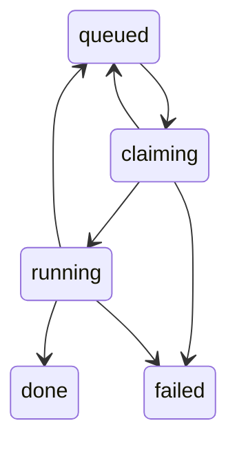

# Git, worktrees and branches

This flow covers the code a job works on: how the instance's clone is made, how each job gets its
own worktree and branch, and every way the git step can branch and fail. It starts when the worker
picks a queued job and ends when the worktree is gone again.

## At a glance

- Trigger: the queue hands a job id to `processJob` in `src/worker/process-job.ts`.
- Starts in / ends in: `queued` -> `claiming` -> `running` -> `done`, or `failed`, or back in
  `queued` for a retry.
- Main files: `src/worker/process-job.ts`, `src/platform/git.ts`, `src/platform/config.ts`,
  `scripts/setup-repo.sh`.



## Files involved

| File                                        | Role in this flow                                                                     |
| ------------------------------------------- | ------------------------------------------------------------------------------------- |
| `src/platform/git.ts`                       | Every git command, the name guards, worktree create/attach/remove, fetch, merge.      |
| `src/worker/process-job.ts`                 | Builds the branch name, classifies a fetch failure, picks new or existing branch.     |
| `src/platform/config.ts`                    | `REPO_PATH`, `RUNS_DIR` and `BASE_BRANCH`: validation and defaults.                   |
| `src/composition/worker.ts`                 | Passes those config values and the `git` functions into `processJob`.                 |
| `scripts/setup-repo.sh`                     | Clones the repo once per instance, marks the clone, pins its git identity.            |
| `src/platform/git.test.ts`                  | Unit tests for each git helper against throwaway repos.                               |
| `tests/integration/process-job.int.test.ts` | The `base and branch` describe block: the whole job against a real repo and Postgres. |
| `scripts/setup-repo.test.sh`                | Tests the env file reader and the default paths of `setup-repo.sh`.                   |
| `src/retry-policy.ts`                       | What happens after each failure kind: retry with backoff, or fail.                    |

## Step by step

### 1. One clone per instance, made by hand, once

The worker never clones. An operator runs `scripts/setup-repo.sh <instance> <owner/name> [dest]`
once, through `pnpm repo:setup`. The third argument is optional, and its default points into that
instance's folder:

Source: `scripts/setup-repo.sh` (default destination)

```bash
dest="${3:-$HOME/steward-instances/$instance/repo}"
```

A clone that already exists is not cloned again; the script still writes the marker and the identity
into it, so running it twice is safe. A new clone uses the token of the configured account, not
whichever account `gh` has active, and stores no token:

Source: `scripts/setup-repo.sh` (the clone step)

```bash
  # git ignores GH_TOKEN on its own: it has to ask gh for the token, so the configured account
  # is the one used even when another account is active.
  GH_TOKEN="$(gh auth token --user "$GH_ACCOUNT")" \
    git -c credential.helper='!gh auth git-credential' clone "https://github.com/$repo.git" "$dest"
```

The clone is then marked as steward's. The marker is local git config plus a file at
`.git/steward.json`, so neither is committed and neither shows up in `git status`. Both carry the
instance name, the repo, the role `worktree-source` and the account:

Source: `scripts/setup-repo.sh` (the marker)

```bash
git -C "$dest" config --local steward.instance "$instance"
git -C "$dest" config --local steward.role "worktree-source"
git -C "$dest" config --local steward.repo "$repo"
printf '{"instance":"%s","repo":"%s","role":"worktree-source","account":"%s"}\n' \
```

The git identity is pinned per clone, from `GH_ACCOUNT`, `GIT_USER_NAME` and `GIT_USER_EMAIL`. Those
three are read from the environment or from `~/steward-instances/<instance>/.env`. The env file is
parsed, never run as shell code: `scripts/setup-repo.test.sh` proves that a line holding
`$(touch marker)` stays text and does not run.

Source: `scripts/setup-repo.sh` (the identity)

```bash
# The clone authors as the instance says, so the orchestrator's commits and the agent's agree.
git -C "$dest" config --local user.name "$GIT_USER_NAME"
git -C "$dest" config --local user.email "$GIT_USER_EMAIL"
git -C "$dest" config --local steward.account "$GH_ACCOUNT"
```

What the clone holds after the script runs, for instance `personal` and repo `octo/example-repo`: the
keys `steward.instance` = `personal`, `steward.role` = `worktree-source`, `steward.repo` =
`octo/example-repo`, `steward.account` = `octo`, plus `user.name` = `Octo Cat` and `user.email` =
`octo@example.test`. Identity is per clone, so two instances never share a commit author and no
`gh auth switch` is needed at run time. The script prints the `REPO_PATH` line for the instance env
file.

### 2. The paths and the base branch come from config

`REPO_PATH` has no default: it must be set and it must be absolute. `RUNS_DIR` defaults to
`$HOME/steward-instances/$INSTANCE/runs` when `HOME` is set, and is otherwise required.
`BASE_BRANCH` defaults to `main` when it is absent or empty.

Source: `src/platform/config.ts` (the `BASE_BRANCH` field)

```ts
  /** Branch a new `agent/*` branch starts from. */
  BASE_BRANCH: string
```

Source: `src/platform/config.ts` (inside `loadConfig`)

```ts
  const defaultRunsDir =
    typeof instance === 'string' && typeof home === 'string' && home.length > 0
      ? `${home}/steward-instances/${instance}/runs`
      : undefined
```

Source: `src/platform/config.ts` (the `REPO_PATH` rule)

```ts
  REPO_PATH: z
    .string()
    .min(1, 'must not be empty')
    .refine((value) => isAbsolute(value), 'must be an absolute path'),
```

For instance `personal` with the defaults and the job id
`11111111-1111-4111-8111-111111111111`, the worktree is
`/home/you/steward-instances/personal/runs/11111111-1111-4111-8111-111111111111/worktree` and the
branch for `TST-1` is `agent/tst-1`. `processJob` builds the path by joining three strings. Nothing
else decides it:

Source: `src/worker/process-job.ts` (in `processJob`)

```ts
const worktreePath = join(deps.config.runsDir, jobId, 'worktree')
```

### 3. The branch name is built from the ticket identifier

Source: `src/worker/process-job.ts` (the slug function)

```ts
function branchName(identifier: string): string {
  return `agent/${identifier.toLowerCase().replace(/[^a-z0-9]/g, '-')}`
}
```

The identifier is lowercased, then every character outside `a-z` and `0-9` becomes one `-`. Two
worked examples:

| Identifier  | After `toLowerCase()` | After the replace | Branch            |
| ----------- | --------------------- | ----------------- | ----------------- |
| `TST-1`     | `tst-1`               | `tst-1`           | `agent/tst-1`     |
| `TST-ext-1` | `tst-ext-1`           | `tst-ext-1`       | `agent/tst-ext-1` |

The result always starts with `agent/` and holds only `a-z`, `0-9` and `-`, so it can never trip the
branch guard in step 7. Linear's own `branchName` field is mapped into `WorkItem.branch` but is not
used here; the branch is always `agent/<slug>`.

### 4. Always fetch the base branch first, then cut from `origin/<base>`

The clone's own `HEAD` is never the starting point. It may be stale, or checked out on some other
branch. That was a real bug until the fetch was added.

Source: `src/platform/git.ts` (`fetchBase`)

```ts
/** Fetches one branch from a remote so a worktree can start from what is really on origin. */
export async function fetchBase(repoPath: string, remote: string, branch: string): Promise<void> {
  assertSafeRef(remote)
  assertSafeRef(branch)
  await runGit(['-C', repoPath, 'fetch', '--prune', remote, `+refs/heads/${branch}:refs/remotes/${remote}/${branch}`])
}
```

The explicit refspec means the fetch updates `refs/remotes/origin/<base>` and fetches no other
branch; `--prune` only drops a stale remote-tracking ref for that same branch. It never moves the
local `<base>` branch or `HEAD`. That matters in step 6: `branchExists` reads local branches, and
only the base branch is refreshed from the remote.

Source: `src/worker/process-job.ts` (in `processJob`)

```ts
    // A new branch starts from what is on origin now, never from whatever HEAD happens to be.
    const baseBranch = deps.baseBranch ?? 'main'
    await fetchBaseClassified(deps, baseBranch)
    const branch = branchName(current.identifier)
```

The worker always uses the remote named `origin`; the name is hard-coded in that call. `BASE_BRANCH`
reaches `processJob` from `src/composition/worker.ts`, and `processJob` falls back to `main` only
when the dependency is missing (the unit tests use that fallback).

### 5. Clear anything a dead worker left at the worktree path

A worker that dies mid-run never reaches its cleanup. The next attempt would meet a registered
worktree at the same path, and `git worktree add` would refuse it on every retry. So the path is
cleared first. The branch and its commits are not touched. The crash cases themselves, and the
`worktree prune` details, are in
[04-crash-and-recovery.md](./04-crash-and-recovery.md).

Source: `src/platform/git.ts` (`removeWorktree`, the clone guard and the missing-directory case)

```ts
export async function removeWorktree(repoPath: string, worktreePath: string): Promise<void> {
  const repo = resolve(repoPath)
  const target = resolve(worktreePath)
  if (target === repo || repo.startsWith(target + sep)) {
    throw new Error(`Refusing to remove ${target}: it is the clone or a folder that holds it`)
  }
  if (!existsSync(target)) {
    // The directory can be gone while git still has its admin entry. Pruning
    // keeps a later worktree at the same path from being rejected as registered.
    await runGit(['-C', repoPath, 'worktree', 'prune'])
    return
  }
```

Source: `src/platform/git.ts` (the same function, the registered and unregistered cases)

```ts
  const listing = await runGit(['-C', repoPath, 'worktree', 'list', '--porcelain'])
  const registered = listing.split('\n').some((line) => line === `worktree ${target}`)
  if (registered) {
    await runGit(['-C', repoPath, 'worktree', 'remove', '--force', worktreePath])
    return
  }
  rmSync(target, { recursive: true, force: true })
  await runGit(['-C', repoPath, 'worktree', 'prune'])
```

`--force` matters: it removes the worktree even with uncommitted edits, and a directory git does not
know as a worktree is deleted with `rmSync`. The guard refuses the clone itself and any folder that
holds the clone.

### 6. New branch, or existing branch plus a merge of the base

Source: `src/worker/process-job.ts` (in `processJob`)

```ts
    // A worker that died mid-run never ran its cleanup. Clear what it left, or `git worktree add`
    // refuses the path on every retry. The branch and its commits are not touched.
    await deps.git.removeWorktree(deps.config.repoPath, worktreePath)
    if (await deps.git.branchExists(deps.config.repoPath, branch)) {
      // An earlier attempt or an open pull request already owns this branch: continue on it,
      // then bring it up to date. A conflict is left in place for the agent, not thrown away.
      await deps.git.attachWorktree({ repoPath: deps.config.repoPath, worktreePath, branch })
      const outcome = await deps.git.mergeIntoWorktree(worktreePath, `origin/${baseBranch}`)
      if (outcome === 'conflict') {
        // TODO(phase-2): hand the conflicted tree to the runner to resolve. The echo stub cannot, and
        // finishing as `done` would report success and then throw the tree away.
        throw new AgentError(`merge conflict with origin/${baseBranch}; the echo runner cannot resolve it`)
      }
    } else {
      await deps.git.createWorktree({
        repoPath: deps.config.repoPath,
        worktreePath,
        branch,
        baseRef: `origin/${baseBranch}`,
      })
    }
```

`branchExists` reads one local ref:

Source: `src/platform/git.ts` (`branchExists`)

```ts
/** Whether a local branch exists, so a run can continue it instead of creating one. */
export async function branchExists(repoPath: string, branch: string): Promise<boolean> {
  try {
    await runGit(['-C', repoPath, 'rev-parse', '--verify', '--quiet', `refs/heads/${branch}`])
    return true
  } catch {
    return false
  }
}
```

On the new-branch path, `git worktree add -b <branch> <path> <baseRef>` creates the branch at
`origin/<base>` and checks it out in the new worktree:

Source: `src/platform/git.ts` (`createWorktree`)

```ts
  assertSafeBranch(opts.branch)
  if (await branchExists(opts.repoPath, opts.branch)) {
    // A retry after a failed attempt: keep the branch and any commits on it.
    await runGit(['-C', opts.repoPath, 'worktree', 'add', opts.worktreePath, opts.branch])
    return
  }
  await runGit(['-C', opts.repoPath, 'worktree', 'add', '-b', opts.branch, opts.worktreePath, opts.baseRef ?? 'HEAD'])
```

That inner reuse branch is a second safety net: called on its own, `createWorktree` attaches an
existing branch instead of failing. `processJob` never relies on it, because it checks the branch
first and takes the merge path.

On the existing-branch path, the branch is attached as it is, and then the fetched base is merged
into it:

Source: `src/platform/git.ts` (`attachWorktree`)

```ts
/** Checks out an existing branch (an earlier attempt or an open pull request) into a new worktree. */
export async function attachWorktree(opts: { repoPath: string; worktreePath: string; branch: string }): Promise<void> {
  assertSafeBranch(opts.branch)
  if (!(await branchExists(opts.repoPath, opts.branch))) {
    throw new Error(`Branch ${opts.branch} does not exist in ${opts.repoPath}; it cannot be attached`)
  }
  await runGit(['-C', opts.repoPath, 'worktree', 'add', opts.worktreePath, opts.branch])
}
```

Source: `src/platform/git.ts` (`mergeIntoWorktree`)

```ts
export async function mergeIntoWorktree(worktreePath: string, ref: string): Promise<MergeOutcome> {
  assertSafeRef(ref)
  const before = (await runGit(['-C', worktreePath, 'rev-parse', 'HEAD'])).trim()
  try {
    await runGit(['-C', worktreePath, 'merge', '--no-ff', '--no-edit', ref])
    // `git merge` exits 0 when there is nothing to merge, so compare the commit instead of the exit code.
    const after = (await runGit(['-C', worktreePath, 'rev-parse', 'HEAD'])).trim()
    return before === after ? 'up-to-date' : 'merged'
  } catch (error) {
    const unmerged = await runGit(['-C', worktreePath, 'diff', '--name-only', '--diff-filter=U']).catch(() => '')
    if (unmerged.trim() !== '') return 'conflict'
    throw error
  }
}
```

Three details decide the outcome. `--no-ff` forces a merge commit even when a fast-forward would be
possible, so an attached branch gains a visible merge when the base moved. `--no-edit` keeps the
default merge message, so no editor opens in a worker process. And `git merge` exits 0 when there is
nothing to merge, so the code compares the commit before and after: equal means `up-to-date`,
different means `merged`. A non-zero exit becomes `conflict` only when `git diff --diff-filter=U`
lists unmerged paths; otherwise the error is rethrown.

The code only ever runs `git merge`. It never rebases, and `git rebase` appears nowhere in `src/`.
The reason, as `docs/decisions.md` records it: a rebase would rewrite the PR branch and need a
force-push. A merge keeps every earlier commit reachable and adds one new commit on top.

### 7. The guards: what is refused before git runs

Every git call goes through `execFile` with an argument array, never a shell string, so a path or a
branch name cannot inject a command. Two guards reject names that git could read as an option, or
that break the ref rules. The branch guard runs in `createWorktree` and `attachWorktree`; the ref
guard runs in `fetchBase` and `mergeIntoWorktree`, which covers the remote name and the base ref.

Source: `src/platform/git.ts` (`assertSafeBranch`)

```ts
/** Refuse a branch name that git could read as an option, or that breaks ref rules. */
function assertSafeBranch(branch: string): void {
  if (branch.length === 0) {
    throw new Error('Branch name must not be empty')
  }
  if (branch.startsWith('-')) {
    throw new Error(`Branch name must not start with "-": ${branch}`)
  }
  if (/\s/.test(branch)) {
    throw new Error(`Branch name must not contain whitespace: ${branch}`)
  }
  if (branch.includes('..')) {
    throw new Error(`Branch name must not contain "..": ${branch}`)
  }
}
```

Source: `src/platform/git.ts` (`assertSafeRef`)

```ts
/** Refs and remotes come from config; refuse anything that could be read as an option. */
function assertSafeRef(value: string): void {
  if (!/^[A-Za-z0-9._/-]+$/.test(value) || value.startsWith('-') || value.includes('..')) {
    throw new Error(`Unsafe git ref: ${value}`)
  }
}
```

The branch guard cannot trip for a job branch, because `branchName` only produces `a-z`, `0-9`, `-`
and the `agent/` prefix. A hand-edited `BASE_BRANCH` with a space or `..` does trip `assertSafeRef`.
The guard throws a plain `Error`, and step 8 shows why that means `infra`, not `setup`.

### 8. Classify the failure, then retry or fail

Every git failure is caught in `processJob` and handed to `recordFailure`. The class of the error
object picks the failure kind:

Source: `src/worker/process-job.ts` (in `recordFailure`)

```ts
const kind: FailureKind = error instanceof SetupError ? 'setup' : error instanceof AgentError ? 'agent' : 'infra'
```

`decideAfterFailure` in `src/retry-policy.ts` then decides. `setup` and `agent` return
`{ action: 'fail' }`, so the job moves to `failed` at once. `infra` retries while `attempt <
maxAttempts`: the job moves back to `queued` with a delay. `MAX_ATTEMPTS` defaults to 3
(`src/platform/config.ts`). The production backoff is `{ baseMs: 30_000, maxMs: 600_000 }` in
`src/bootstrap.ts`, with a factor of 2 and ±20 % jitter, so the first retry is between 24 s and 36 s
away and later ones stop growing at 10 minutes. `attempt` is incremented when the job moves to
`claiming`, so a job that failed its first attempt records `attempt: 1` and keeps that number in the
failure row. The whole failure and retry flow is in
[03-failures-and-retries.md](./03-failures-and-retries.md).

### 9. Clean up, always

The `finally` block removes the worktree and releases the slot on every path: success, failure, and
a failure before `claiming`. A cleanup error is logged and swallowed so it cannot hide the original
failure.

Source: `src/worker/process-job.ts` (in `processJob`)

```ts
  } finally {
    try {
      await deps.git.removeWorktree(deps.config.repoPath, worktreePath)
    } catch (cleanupError) {
      logCleanupError(deps, jobId, 'removing the worktree', cleanupError)
    }
```

What stays on disk after a job, worked for `TST-1`:

| Path                                              | After the job                               |
| ------------------------------------------------- | ------------------------------------------- |
| `runs/<job-id>/worktree`                          | gone                                        |
| `runs/<job-id>/transcript.jsonl`                  | stays (written by the echo runner)          |
| `runs/<job-id>/raw.jsonl`                         | stays                                       |
| the branch `agent/tst-1` in the clone             | stays, on both success and failure          |
| the clone's `worktree` entry for the removed path | gone: removed with the directory, or pruned |

## Branches

Each test title is exact, except `rejects the unsafe branch name %j`, where `%j` stands for the
value under test. `(unit)` means `src/platform/git.test.ts`; `(integration)` means
`tests/integration/process-job.int.test.ts`.

| If ...                                        | Then ...                                                                   | Where in code                          | Test that covers it                                                                                     |
| --------------------------------------------- | -------------------------------------------------------------------------- | -------------------------------------- | ------------------------------------------------------------------------------------------------------- |
| no local `agent/<slug>` exists                | cut a new branch from `origin/<BASE_BRANCH>` and run                       | `processJob`                           | `starts a new branch from what is on origin now, not from a stale local HEAD` (integration)             |
| the local branch exists, base merges cleanly  | attach it, merge `origin/<base>` with `--no-ff`, run, earlier commits kept | `processJob`, `mergeIntoWorktree`      | `continues an existing branch and merges the base into it, keeping earlier commits` (integration)       |
| the merge conflicts                           | markers left in the tree, `AgentError`, job `failed` as `agent`, no retry  | `processJob`, `mergeIntoWorktree`      | `fails a merge conflict as an agent failure, because the echo runner cannot resolve it` (integration)   |
| the base branch is missing                    | `SetupError`, job `failed` as `setup`, no retry                            | `fetchBaseClassified`                  | `fails a missing base branch as setup, at once and without a retry` (integration)                       |
| the remote is wrong or missing                | `SetupError`, job `failed` as `setup`, no retry                            | `fetchBaseClassified`                  | `fails a remote that cannot be reached as setup, at once` (integration)                                 |
| the remote answers `Repository not found`     | `SetupError`, job `failed` as `setup`, no retry                            | `fetchBaseClassified`                  | `fails a fetch from a repository that is not there as setup, at once` (integration)                     |
| the network fails or times out                | rethrown unchanged, job `queued` as `infra`, retried with backoff          | `fetchBaseClassified`, `recordFailure` | `retries a transient network failure as infra, with the slot freed` (integration)                       |
| `REPO_PATH` does not exist                    | `SetupError`, job `failed` as `setup`, no retry                            | `processJob`                           | `fails a missing repository path immediately as setup, with no retry` (integration)                     |
| the branch or ref name is unsafe              | guard throws a plain `Error`, so the job retries as `infra`                | `assertSafeBranch`, `assertSafeRef`    | `rejects the unsafe branch name %j` (`it.each`, unit)                                                   |
| the worktree path still exists                | clear it first, then create                                                | `processJob`, `removeWorktree`         | `recovers when a crashed run left its worktree behind, keeping the commits on the branch` (integration) |
| the branch is checked out in another worktree | git refuses, the plain `Error` makes it `infra`, retried                   | `attachWorktree`                       | `treats a git failure as infra and retries` (integration)                                               |
| `git worktree add` fails for any other reason | plain `Error`, job `queued` as `infra`                                     | `processJob`                           | `fails clearly when the same worktree is created twice` (unit, message only)                            |

## Each branch, worked

### 1. New branch

Job for `TST-1` on a clone whose local `main` sits at commit A while `origin/main` sits at B. The
fetch moves the remote-tracking ref to B, `branchExists` finds no local `agent/tst-1`, and the
worker runs `git worktree add -b agent/tst-1 <path> origin/main`. The branch points at B, the
clone's `main` still points at A, and the job walks `claiming` -> `running` -> `done`.

Events: `(null -> queued)`, `(queued -> claiming)`, `(claiming -> running)`, `(running -> done)`.
Job row: `state = done`, `attempt = 1`, `slot = null`.

### 2. The branch already exists

An earlier attempt or an open PR left `agent/tst-1` with commit C on top of A, and `origin/main` has
moved to B. The worker attaches the branch and merges `origin/main` with `--no-ff --no-edit`, so the
branch gains merge commit M with parents C and B. `mergeIntoWorktree` returns `merged`, or
`up-to-date` when the base was already in. The job ends `done`; earlier commits are kept because
nothing is rewritten.

Why not rebase: the branch may already be the head of an open PR. The reason, as `docs/decisions.md`
records it: a rebase would rewrite the PR branch and need a force-push. A merge adds one commit and
leaves the old ones intact. `src/platform/git.ts` has no rebase call.

Events: `(null -> queued)`, `(queued -> claiming)`, `(claiming -> running)`, `(running -> done)`.
Job row: `state = done`, `attempt = 1`, `slot = null`.

### 3. The merge conflicts

Job for `TST-1` where the branch and `origin/main` both changed `README.md`. The merge stops with
unmerged paths, so `mergeIntoWorktree` returns `conflict` and `processJob` throws
`AgentError('merge conflict with origin/main; the echo runner cannot resolve it')`.

What happens to the markers, exactly:

1. `git merge` writes `<<<<<<<`, `=======`, `>>>>>>>` into the conflicted files in the worktree, and
   records `MERGE_HEAD` and the unmerged index entries in the worktree's admin entry inside the
   clone's `.git`. No commit is made, so `refs/heads/agent/tst-1` does not move.
2. `recordFailure` reads `AgentError` as `agent`, `decideAfterFailure` returns `fail`, and the job
   moves `claiming` -> `failed` with that reason. `attempt` stays 1.
3. The `finally` block runs `git worktree remove --force`, which deletes the directory, the files
   with markers, the index and `MERGE_HEAD` together.

Nothing carries the markers afterwards, and nothing carries the merge: the branch is exactly where
it was. A human retry (`failed` -> `queued` resets `attempt` to 0) meets the same conflict until
phase 2 hands the tree to a real agent. Events: `(null -> queued)`, `(queued -> claiming)`,
`(claiming -> failed)` with `failure_kind = agent` and the reason above. `running` never appears, no
queue entry is made, and the slot row is deleted.

### 4. The base branch is missing

`BASE_BRANCH=no-such-branch` on a clone whose origin has only `main`. The fetch fails with a message
of the form `fatal: couldn't find remote ref refs/heads/no-such-branch`, which matches
`couldn't find remote ref`, so `fetchBaseClassified` wraps it in `SetupError`. The worktree is never
created. Job row: `state = failed`, `failure_kind = setup`, `attempt = 1`, `slot = null`.

### 5. The remote is wrong or missing

The test repoints `origin` at a path that does not exist. The fetch fails with
`fatal: '<path>' does not appear to be a git repository`, which matches the first pattern. A remote
name git does not know matches the second, `No such remote`. Both are `SetupError`: retrying a
fetch from a remote that does not exist cannot work.

Job row: `state = failed`, `failure_kind = setup`, `slot = null`.

### 6. `Repository not found`

GitHub answers `remote: Repository not found.` and the pattern matches. A wrong URL and a token that
cannot see a private repo produce the same sentence, because GitHub answers 404 for both. An expired
token, a token for the wrong account and a typo in the repo name all land here as `setup`. That is
deliberate: each needs a person to fix it, and an early `failed` with this reason beats waiting
through the backoff. Other auth messages, such as `Authentication failed`, do not match and are
retried as `infra`; `docs/status.md` lists that split as accepted, not loved.

Job row: `state = failed`, `failure_kind = setup`, `slot = null`.

### 7. A network error or a timeout

`fatal: unable to access 'https://github.com/x/y.git/': Could not resolve host: github.com` matches
none of the four patterns, so `fetchBaseClassified` rethrows it unchanged. It is a plain `Error`, so
`recordFailure` reads it as `infra` and the job moves to `queued` with `failure_kind = infra` and
`next_run_at` set. The queue entry is re-enqueued with the same delay and the slot row is deleted.
On the third failed attempt (`MAX_ATTEMPTS` default 3) the job lands in `failed`, the dead letter,
where a human retries or cancels it.

### 8. The English-message caveat

The classification reads git's English text, and the four patterns are English phrases. Nothing in
the worker sets a locale, so a clone whose git prints another language (through `LANG`, `LC_ALL` or
a translated git build) produces messages that match none of the patterns. Every such failure is
then `infra` and retried, including a missing base branch and `Repository not found`.
`docs/status.md` lists this as a known limit, and its to-do list has the fix: run the fetch with
`LC_ALL=C`. No test covers the non-English case. The last test in the group,
`retries an unrelated fetch error that says "not found" as infra`, pins the narrower rule: the
pattern needs the full phrase, not the word "not found".

### 9. An unsafe branch or ref name

`assertSafeBranch` refuses an empty name, a leading `-`, any whitespace (space or tab), and `..`.
`assertSafeRef` allows only `[A-Za-z0-9._/-]` and refuses a leading `-` and `..`. Both run before
git is called. A job branch cannot trip the branch guard, because `branchName` only produces `a-z`,
`0-9`, `-` and the `agent/` prefix; `BASE_BRANCH=main..old` does trip `assertSafeRef`. The guard
throws a plain `Error` and nothing maps it to `SetupError`, so the job retries as `infra` and fails
the same way every attempt. The guard is tested (`rejects the unsafe branch name %j`); the
classification of a guard error is not.

### 10. The worktree path already exists

`processJob` calls `removeWorktree` before it looks at the branch, so a leftover path from a dead
worker is cleared rather than met. A registered worktree is removed with `--force`; a plain directory git
does not know is deleted with `rmSync`; both end with `git worktree prune`. The branch and its commits
stay, which is what makes scenario 2 work after a crash. If removal itself fails, the plain `Error`
makes the job retry as `infra`. If something else holds the branch (a second worktree checked out on
it), `git worktree add` refuses and the job retries as `infra` too. The full crash story is in
[04-crash-and-recovery.md](./04-crash-and-recovery.md).

## See it yourself

The commands assume instance `personal` and its default clone
`~/steward-instances/personal/repo`.

List the worktrees of the clone. During a run there is a second line for the job's worktree; after
the run only the clone remains:

```bash
cd ~/steward-instances/personal/repo
git worktree list
```

List the branches a job left behind, newest commit first:

```bash
git branch --list 'agent/*' --sort=-committerdate
git log --oneline --graph --decorate -n 20 --all
```

Read the per-clone identity the setup script pinned:

```bash
git config --local --get steward.instance
git config --local --get steward.account
git config --local --get user.name
git config --local --get user.email
cat .git/steward.json
```

Show which branch and commit a job's worktree is on, while it still exists (a crash, or a run in
progress):

```bash
git -C ~/steward-instances/personal/runs/<job-id>/worktree rev-parse --abbrev-ref HEAD
git -C ~/steward-instances/personal/runs/<job-id>/worktree status
```

See what a finished job left in its run directory: the worktree is gone and the transcripts stay:

```bash
ls -la ~/steward-instances/personal/runs/<job-id>/
```

Read the job and its events, including the failure kind and the reason, from Postgres:

```sql
select id, identifier, state, attempt, max_attempts, failure_kind, next_run_at
from jobs
where identifier = 'TST-1';
```

```sql
select id, from_state, to_state, failure_kind, reason, at
from job_events
where job_id = '<job-id>'
order by id;
```

## Not built yet

- **Push, draft PR and the identity check before a push** (phase 4). Nothing pushes today: the
  worktree is removed and the branch stays on the clone only. `docs/decisions.md` and
  `docs/security.md` describe the planned check: `steward.instance` must equal `INSTANCE`,
  `user.email` must equal `GIT_USER_EMAIL`, and the token must belong to `GH_ACCOUNT`; a mismatch
  would fail as `setup`. There is no `jobs.branch` column yet either.
- **Branch cleanup after merge** (phase 5). Nothing deletes an `agent/*` branch, so branches
  accumulate in the clone. The retention sweep (`RUN_RETENTION_DAYS`) is also phase 5.
- **Handing a conflicted tree to the runner, and the two-strike guard** (phase 2). Today a conflict
  fails the job as `agent` and the worktree is removed, markers and all. `abortMerge` exists for the
  plan where a second conflict abandons the tree, but only its own unit test calls it.
- **A fetch of the branch the job continues.** `fetchBase` refreshes only the base branch, so
  `branchExists` sees only branches this clone already has. A PR branch that exists only on the
  remote is not attached; the run cuts a new `agent/<slug>` from the base instead. No test covers
  this, and `docs/decisions.md` does not discuss it. It belongs with the phase 4 push and the
  phase 5 poller.

Docs disagree: `docs/decisions.md` still calls the leftover-worktree bug unfixed ("Known bug (not
fixed here)"), while `src/worker/process-job.ts` clears the path before every run and
`docs/status.md` records that fix in PR #24.
