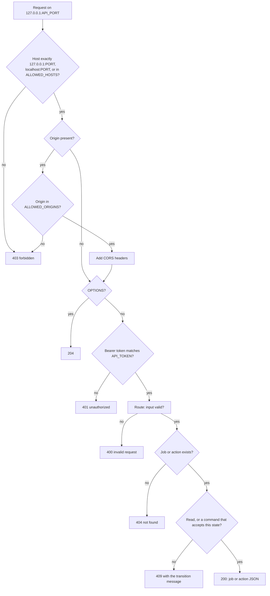

# The API and the dashboard

The API is one Hono app on the loopback address. Every `/v1` request passes the same four checks, then one route, then one command or query. The dashboard is a static build that the same process serves when `DASHBOARD_DIR` is set, and it calls those routes. This file follows a request from the socket to the JSON answer, and lists every way the API can refuse it.

## At a glance

- Trigger: a `curl` call, or a page load, poll or button press in the dashboard.
- Starts in / ends in: a read changes no state. A command moves the job one edge: `proposed` to `queued`, `proposed` to `declined`, `declined` to `proposed`, `failed` or `cancelled` to `queued`, or any live state to `cancelled`. An action decision changes only `pending_actions`.
- Main files: `src/api/app.ts`, `src/api/auth.ts`, `src/api/contract.ts`, `src/jobs-commands.ts`, `src/jobs-queries.ts`, `src/composition/api.ts`, `src/platform/static.ts`, `src/entries/api.ts`, `dashboard/src/api.ts`, `dashboard/src/data.tsx`



## Files involved

| File                            | Role in this flow                                                                                   |
| ------------------------------- | --------------------------------------------------------------------------------------------------- |
| `src/entries/api.ts`            | Process entry. Reads config, binds `127.0.0.1`, starts the server, handles stop signals.            |
| `src/composition/api.ts`        | Builds the app: wires store, queue and runner into reads and commands; mounts the static dashboard. |
| `src/api/auth.ts`               | Host allow-list, Origin allow-list, preflight answer, bearer token compare.                         |
| `src/api/app.ts`                | Routes, zod validators, the error-to-status map, the SSE log route.                                 |
| `src/api/contract.ts`           | Wire schemas shared with the browser, and the bodies for decline and reject.                        |
| `src/jobs-commands.ts`          | The five job commands, `allowedActionsFor`, the error classes.                                      |
| `src/jobs-queries.ts`           | Turns database rows into `JobSummary` and `ActionSummary`, and checks the list limit.               |
| `src/platform/static.ts`        | Reads a file under `DASHBOARD_DIR` and builds the response.                                         |
| `src/platform/config.ts`        | `API_TOKEN`, `API_PORT`, `ALLOWED_ORIGINS`, `ALLOWED_HOSTS`, `DASHBOARD_DIR`.                       |
| `dashboard/src/api.ts`          | Browser client: token storage, `fetch` wrapper, SSE frame reader.                                   |
| `dashboard/src/data.tsx`        | One polling store for jobs and actions, toasts, sign-out on 401.                                    |
| `dashboard/src/job-actions.tsx` | The action buttons and the confirm-before-acting dialogs.                                           |

## Step by step

### 1. The process listens on loopback only

`src/entries/api.ts` loads the config, calls `composeApi` in `src/composition/api.ts`, and passes the app to `serve` with `hostname: '127.0.0.1'`. The port is `API_PORT`, default 3000 and at least 1024 (`src/platform/config.ts`). A packet addressed to any other address of the machine never reaches the app, so there is no firewall rule to get wrong.

Source: `src/entries/api.ts`

```ts
const server = serve({ fetch: app.fetch, port: config.API_PORT, hostname: '127.0.0.1' }, (info) => {
  logger.info('API listening', { instance: config.INSTANCE, address: info.address, port: info.port })
})
```

What changes: nothing. The server runs until SIGTERM or SIGINT, which closes it, the queue and the database pool.

### 2. The Host header must name this port

`createAuthMiddleware` in `src/api/auth.ts` is mounted on `/v1/*` only. Its first check is `isAllowedHost`. The compare is exact apart from case: the value must be `127.0.0.1:<API_PORT>`, `localhost:<API_PORT>`, or one exact entry of `ALLOWED_HOSTS`. A missing Host fails too. The port is part of the compare, so `127.0.0.1` without a port fails, and so does a proxy that forwards another port.

Source: `src/api/auth.ts`

```ts
function isAllowedHost(host: string | undefined, port: number, extraHosts: readonly string[]): boolean {
  if (host === undefined) return false
  const normalized = host.toLowerCase()
  return normalized === `127.0.0.1:${port}` || normalized === `localhost:${port}` || extraHosts.includes(normalized)
}
```

`ALLOWED_HOSTS` is for a reverse proxy or a tunnel: a host name with no scheme and no wildcard, and a port only when the entry carries one. The default is empty. This check is what stops DNS rebinding, where a page on another site resolves its own name to `127.0.0.1`.

What changes: nothing. The answer is `403` with the body `{"error":"forbidden"}` and no reason (a to-do in `docs/status.md`).

### 3. The Origin header, the preflight, and the token

A browser sends `Origin` on a cross-origin request, and also on a POST to its own origin. A request with no Origin passes: `curl` and a plain GET send none. A request with an Origin must match one entry of `ALLOWED_ORIGINS` exactly, scheme and port included. The default list is empty, which refuses every request that carries one. An allowed Origin gets four CORS headers echoed back. A preflight (`OPTIONS`) stops at the Origin check with `204` and no token, because a browser never puts `Authorization` on a preflight.

Then the token: `Authorization: Bearer <token>`, scheme case-insensitive, value non-empty. The compare is constant-time for two values of the same length; a length mismatch returns false before `timingSafeEqual`, which would throw on it.

Source: `src/api/auth.ts`

```ts
export function createAuthMiddleware(config: AuthConfig): MiddlewareHandler {
  return async (c, next) => {
    if (!isAllowedHost(c.req.header('host'), config.port, config.allowedHosts)) {
      return c.json({ error: 'forbidden' }, 403)
    }

    const origin = c.req.header('origin')
    if (origin !== undefined && !config.allowedOrigins.includes(origin)) {
      return c.json({ error: 'forbidden' }, 403)
    }

    if (origin !== undefined) {
      c.header('Access-Control-Allow-Origin', origin)
      c.header('Vary', 'Origin')
      c.header('Access-Control-Allow-Headers', ALLOW_HEADERS)
      c.header('Access-Control-Allow-Methods', ALLOW_METHODS)
    }

    // A preflight carries no Authorization header; only an allowed Origin reaches this point.
    if (c.req.method === 'OPTIONS') {
      return c.body(null, 204)
    }

    const token = bearerToken(c.req.header('authorization'))
    if (token === null || !safeEqual(token, config.apiToken)) {
      return c.json({ error: 'unauthorized' }, 401)
    }

    await next()
  }
}
```

What changes: nothing. The two refusals are `403 {"error":"forbidden"}` and `401 {"error":"unauthorized"}`. The token is never echoed and never logged; `src/api/app.test.ts` (`it('never puts the token in a response body')`) checks every route.

### 4. The route validates its input

Each route declares its own zod schemas, and a failed check answers `400` with `{"error":"invalid request"}` before the handler runs. Job ids must be UUIDs. Action ids are any non-empty string, so an unknown action id reaches the store and comes back as `404`.

Source: `src/api/app.ts`

```ts
const idParamSchema = z.object({ id: z.uuid() })
const actionParamSchema = z.object({ id: z.string().min(1) })
const listQuerySchema = z.object({
  state: z.enum(JOB_STATES).optional(),
  limit: z.coerce.number().int().min(1).max(500).optional(),
})
const logQuerySchema = z.object({ after: z.coerce.number().int().min(0).optional() })
const actionFilterSchema = z.object({ status: z.enum(ACTION_STATUSES).optional() })
```

The body schemas live in `src/api/contract.ts`, so the browser and the server share them. A decline needs a reason of at least one character after trimming. A reject may carry a reason or none.

Source: `src/api/contract.ts`

```ts
export const declineBodySchema = z.object({
  reason: z.string().trim().min(1),
})

export const rejectBodySchema = z.object({
  reason: z.string().trim().min(1).optional(),
})
```

What changes: nothing. A rejected request never touches the database.

### 5. Reads: the wire shape

`src/jobs-queries.ts` decides what a caller may see. `toJobSummary` drops `sourceId` (the tracker's own id), turns the two dates into ISO strings, and adds `allowedActions`. The compile-time assertion in `src/api/contract.ts` makes the schema and this projection fail together if either drifts.

Source: `src/jobs-queries.ts`

```ts
function toJobSummary(job: Job): JobSummary {
  return {
    id: job.id,
    ticketKey: job.ticketKey,
    source: job.source,
    state: job.state,
    attempt: job.attempt,
    maxAttempts: job.maxAttempts,
    slot: job.slot,
    nextRunAt: job.nextRunAt === null ? null : job.nextRunAt.toISOString(),
    failureKind: job.failureKind,
    allowedActions: allowedActionsFor(job.state),
  }
}
```

The list limit is checked, not enforced. `listJobs` and `listActions` use `DEFAULT_LIMIT = 100` when the caller gives no limit, and `assertLimit` refuses anything outside 1 to 500 with a `RangeError`. The value is then passed to the store, and the Postgres store in `src/db/store.ts` builds no `limit(...)` clause: both list queries return every matching row, newest first by `createdAt`. The limit only has an effect in the fake stores of the unit tests.

### 6. Commands: the states each one accepts

`src/jobs-commands.ts` holds every rule. A route validates its input, calls one function, and that function loads the job and calls `requireFrom`. `requireFrom` needs both things: the command's own list of accepted states, and an edge in the state machine.

Source: `src/jobs-commands.ts`

```ts
function requireFrom(job: Job, to: JobState, allowed: readonly JobState[]): void {
  if (!allowed.includes(job.state) || !canTransition(job.state, to)) {
    throw new IllegalTransitionError(job.state, to)
  }
}
```

Source: `src/jobs-commands.ts`

```ts
const CONFIRMABLE: readonly JobState[] = ['proposed']
const DECLINABLE: readonly JobState[] = ['proposed']
const RECONSIDERABLE: readonly JobState[] = ['declined']
const RETRYABLE: readonly JobState[] = ['failed', 'cancelled']
const CANCELLABLE: readonly JobState[] = ['queued', 'claiming', 'running', 'pr_open', 'in_review', 'changes_requested']
```

The state machine allows `running` to `queued` for the automatic retry after an infra failure. A hand retry must not use that edge, or a retry press on a running job would restart it. That is why `RETRYABLE` names two states instead of taking the edge.

`allowedActionsFor` reads the same lists, so a client is never offered a button the command would refuse.

Source: `src/jobs-commands.ts`

```ts
export function allowedActionsFor(state: JobState): JobAction[] {
  const actions: JobAction[] = []
  if (CONFIRMABLE.includes(state)) actions.push('confirm', 'decline')
  if (RECONSIDERABLE.includes(state)) actions.push('reconsider')
  if (RETRYABLE.includes(state)) actions.push('retry')
  if (CANCELLABLE.includes(state)) actions.push('cancel')
  return actions
}
```

Cancel stops the run before it changes the row, so an agent still working is told to stop first. For the echo runner that call writes one `orchestrator` envelope to the transcript with `data: { msg: 'cancelled', jobId }`, which then appears in the live log.

What changes: the `jobs` row, one `job_events` row, a queue entry for confirm and retry, a deleted `slots` row when the job held one, and for cancel the runner's cancel call.

### 7. A command's row is re-read before the answer

A job command returns the domain row, which still has the tracker's `sourceId` and `Date` objects. The route calls `reload`, which asks the read layer for the same id and answers with the wire shape. If the row vanished between the two calls, `reload` throws `JobNotFoundError`, which maps to `404`. An action decision skips `reload`: its answer is `toActionSummary` of the row the store returned.

Source: `src/api/app.ts`

```ts
async function reload(reads: ApiReads, id: string): Promise<JobSummary> {
  const view = await reads.getJob(id)
  if (view === null) throw new JobNotFoundError(id)
  return view
}
```

What changes: nothing. The response always shows the committed row, not the object the command produced.

### 8. Errors become status codes in one place

`app.onError` maps the four domain error classes, plus `HTTPException`, and nothing else. The messages of the two `409` classes are sent as they are, because they name both states and tell the person what happened. Every other error becomes `{"error":"internal"}` with no message and no stack.

| Error thrown                                      | Status      | Body                         |
| ------------------------------------------------- | ----------- | ---------------------------- |
| `JobNotFoundError`, `ActionNotFoundError`         | 404         | `{"error":"not found"}`      |
| `IllegalTransitionError`, `ActionNotPendingError` | 409         | `{"error": <error.message>}` |
| `HTTPException` with a status of 500 or more      | 500         | `{"error":"internal"}`       |
| `HTTPException` with a lower status               | that status | `{"error": <error.message>}` |
| anything else                                     | 500         | `{"error":"internal"}`       |

`IllegalTransitionError` builds its message in `src/transitions.ts`: `Illegal job state transition: <from> -> <to>`. `ActionNotPendingError` builds `Pending action is <status>, not pending`.

What changes: nothing. `src/api/app.test.ts` (`it('maps an unknown error to 500 without a stack trace or the token')`) injects an error that contains the token and checks the body is only `{"error":"internal"}`.

### 9. The live log is a polled SSE stream

`GET /v1/jobs/:id/log` first checks the job exists, then works out the resume point. The `Last-Event-ID` header wins over `?after=`, and a header that is not a plain sequence number is a `400`. The dashboard never sends the header; it sends `?after=`.

Source: `src/api/app.ts`

```ts
        const { id } = c.req.valid('param')
        const job = await reads.getJob(id)
        if (job === null) return c.json({ error: 'not found' }, 404)

        const lastEventId = c.req.header('last-event-id')
        let after = c.req.valid('query').after ?? 0
        if (lastEventId !== undefined) {
          const sequence = parseSequence(lastEventId)
          if (sequence === null) return c.json({ error: 'invalid request' }, 400)
          after = sequence
        }

        return streamJobLog(c, deps, job.id, after)
```

`streamJobLog` writes the frames itself. Each envelope becomes one frame with `id: <seq>` and `data: <the envelope as JSON>`, and the loop asks the read function for envelopes newer than the last one it sent, every `LOG_POLL_MS` = 1000 ms. One frame on the wire:

```text
id: 7
data: {"seq":7,"ts":"2026-01-02T03:04:05.000Z","kind":"assistant","data":{"text":"hello"}}

```

The read function is `src/runner/transcript.ts` `readTranscript` on `runner.transcriptDir(jobId)`. It reads `transcript.jsonl` only: it skips blank lines, skips a half-written last line, and returns the envelopes with `seq > afterSeq`. `raw.jsonl` sits in the same directory and no route opens it; it holds unredacted agent output and is treated as sensitive (`docs/security.md`).

A failure after the headers are sent cannot become a status code, so the catch writes one more frame, `data: {"error":"internal"}`. The dashboard skips any frame that is not a transcript envelope, so that notice costs it nothing.

What changes: nothing on disk. The stream ends when the client aborts; `src/api/app.test.ts` (`it('stops polling after the request aborts')`) counts the read calls after an abort.

### 10. The dashboard is a static route outside `/v1`

`composeApi` mounts one extra route, and only when `DASHBOARD_DIR` is set. An empty value counts as unset (`src/platform/config.ts`). The route is `app.get('*')`, registered after the `/v1` routes and outside the `/v1/*` middleware, so it skips the Host check, the Origin check and the token.

Source: `src/composition/api.ts`

```ts
  const dashboardDir = config.DASHBOARD_DIR
  const withStatic =
    dashboardDir === undefined ? app : app.get('*', (c) => staticResponse(dashboardDir, c.req.path) ?? c.notFound())
```

Source: `src/platform/static.ts`

```ts
export function staticResponse(root: string, requestPath: string): Response | null {
  const file = readStaticFile(root, requestPath)
  if (file === null) return null
  return new Response(file.body, {
    status: 200,
    // nosniff: the browser must trust the type we send, never guess one from the bytes.
    headers: { 'Content-Type': file.contentType, 'X-Content-Type-Options': 'nosniff' },
  })
}
```

`resolveAssetPath` maps `/` to `index.html`, strips the leading slashes, percent-decodes the path, normalises it, and requires the result to start with the resolved root plus a separator. A `..` segment, an encoded `%2e%2e`, an absolute path and a malformed escape such as `%zz` all fail the check or the decode. `readStaticFile` returns null for a missing file, a directory and a path outside the root, so `?? c.notFound()` answers `404`. The query string is ignored. The type comes from the extension (`.html`, `.js`, `.css`, `.json`, `.svg`, `.woff`, `.woff2`, `.png`, `.ico`, `.map`), else `application/octet-stream`.

Skipping the token is accepted because the route serves build output, which is public by nature. It has one condition: nothing secret may ever be placed in `DASHBOARD_DIR`, and a symlink inside it can point outside it (`docs/status.md`, "Known limits"). The build adds a Content-Security-Policy `<meta>` tag with `script-src 'self'`, `connect-src 'self'` and `default-src 'none'` (`dashboard/csp.ts`), so the page cannot load or call anything but its own origin.

What changes: nothing. Files are read on each request; there is no cache header.

### 11. The browser client

The token lives in `sessionStorage` under the key `steward.token`. `request` adds it as a bearer header to every call, and adds `Content-Type: application/json` only when there is a body. A non-2xx answer becomes an `ApiError` with the server's `error` text, or `HTTP <status>` when the body is not JSON.

Source: `dashboard/src/api.ts`

```ts
const TOKEN_KEY = 'steward.token'

// The token lives in sessionStorage only (see docs/security.md on the XSS trade-off).
export const token = {
  get: (): string | null => sessionStorage.getItem(TOKEN_KEY),
  set: (value: string): void => sessionStorage.setItem(TOKEN_KEY, value),
  clear: (): void => sessionStorage.removeItem(TOKEN_KEY),
}
```

The dashboard uses two transports. Jobs and actions are polled: `DataProvider` fetches `GET /v1/jobs` and `GET /v1/actions` together every `POLL_MS` = 5000 ms, and a `401` clears the token and returns to the sign-in form. After 20 seconds without a good poll the status becomes stale. The transcript is streamed, with a reconnect every 2000 ms in `dashboard/src/job-detail.tsx`, resuming from the highest `seq` it has seen.

Source: `dashboard/src/data.tsx`

```ts
const POLL_MS = 5000
const TOAST_MS = 5000
const STALE_AFTER_MS = 20_000
```

`followLog` reads the response body as a stream and parses the frames itself, because `EventSource` cannot send an `Authorization` header. Every button goes through `run`, which calls the API, shows a toast, and refreshes the poll.

What changes: `sessionStorage` on sign-in and sign-out; nothing else in the browser.

## Every route

Every `/v1` route can also answer `500 {"error":"internal"}` from the error map, and `403` (Host or Origin) and `401` (token) before it runs; the table leaves those out.

| Method  | Path                      | What it does                                                                           | Job states that allow it                                                     | Statuses           |
| ------- | ------------------------- | -------------------------------------------------------------------------------------- | ---------------------------------------------------------------------------- | ------------------ |
| GET     | `/v1/jobs`                | Lists jobs, newest first. Optional `?state=` and `?limit=` (1 to 500).                 | any                                                                          | 200, 400           |
| GET     | `/v1/jobs/:id`            | One job.                                                                               | any                                                                          | 200, 400, 404      |
| GET     | `/v1/jobs/:id/log`        | SSE stream of the transcript. `?after=` or `Last-Event-ID`.                            | any (the job must exist)                                                     | 200, 400, 404      |
| POST    | `/v1/jobs/:id/confirm`    | `proposed` to `queued`, then enqueue.                                                  | `proposed`                                                                   | 200, 409, 404      |
| POST    | `/v1/jobs/:id/decline`    | `proposed` to `declined`, with a reason in the body.                                   | `proposed`                                                                   | 200, 400, 409, 404 |
| POST    | `/v1/jobs/:id/reconsider` | `declined` back to `proposed`.                                                         | `declined`                                                                   | 200, 409, 404      |
| POST    | `/v1/jobs/:id/retry`      | `failed` or `cancelled` to `queued`, then enqueue.                                     | `failed`, `cancelled`                                                        | 200, 409, 404      |
| POST    | `/v1/jobs/:id/cancel`     | Stops the run, then moves to `cancelled`.                                              | `queued`, `claiming`, `running`, `pr_open`, `in_review`, `changes_requested` | 200, 409, 404      |
| GET     | `/v1/actions`             | Lists actions, newest first. Optional `?status=`.                                      | no job state; the action status filters it                                   | 200, 400           |
| POST    | `/v1/actions/:id/approve` | Decides a pending action as `approved`.                                                | no job state; the action must be `pending`                                   | 200, 409, 404, 500 |
| POST    | `/v1/actions/:id/reject`  | Decides it as `rejected`, reason optional.                                             | no job state; the action must be `pending`                                   | 200, 400, 409, 404 |
| OPTIONS | `/v1/*`                   | Preflight answer, allowed Origin only.                                                 | none                                                                         | 204                |
| GET     | `*`                       | The built dashboard, only when `DASHBOARD_DIR` is set. No Host, Origin or token check. | none                                                                         | 200, 404           |

A path that matches no route falls through to Hono's own `404`. With `DASHBOARD_DIR` set, the `*` route handles it and still answers `404`. An unknown `/v1` path has passed the auth middleware by then, so it needs the token first.

## A worked example for each action

The job is `TST-1`, id `11111111-1111-4111-8111-111111111111`, `source: linear`, `maxAttempts: 3`. The clock reads `2026-01-02T03:04:05.000Z`. Each response below names the fields that change; the rest of the object is unchanged.

**Confirm.** `POST /v1/jobs/<id>/confirm` with no body.

```bash
curl -s -X POST -H "Authorization: Bearer <API_TOKEN>" \
  http://127.0.0.1:3000/v1/jobs/11111111-1111-4111-8111-111111111111/confirm
```

`200` with `"state":"queued"` and `"allowedActions":["cancel"]`. Then `enqueue` puts the id on the queue. Event: `proposed -> queued`, reason `confirmed`. The attempt counter is unchanged; it rises when a job becomes `claiming` and resets to 0 on a hand retry.

**Decline with a reason.** Body `{"reason":"out of scope for this sprint"}`; the schema and the command both trim it.

```bash
curl -s -X POST -H "Authorization: Bearer <API_TOKEN>" -H 'Content-Type: application/json' \
  -d '{"reason":"out of scope for this sprint"}' \
  http://127.0.0.1:3000/v1/jobs/11111111-1111-4111-8111-111111111111/decline
```

`200` with `"state":"declined"` and `"allowedActions":["reconsider"]`. Event: `proposed -> declined`, reason `out of scope for this sprint`. Nothing is queued.

**Reconsider.** `POST /v1/jobs/<id>/reconsider`. `200` with `"state":"proposed"` and `"allowedActions":["confirm","decline"]`. Event: `declined -> proposed`, reason `reconsidered`. No queue entry: a proposal waits for a person.

**Retry.** Start from `state: failed`, `attempt: 3`, `failureKind: "infra"`, `nextRunAt` in the future. `POST /v1/jobs/<id>/retry` answers `200` with `"state":"queued"`, `"attempt":0`, `"failureKind":null`, `"nextRunAt":null`, `"allowedActions":["cancel"]`, and enqueues the job. `src/db/store.ts` `transitionJob` resets the attempt for a hand retry (`isManualRetry`) and keeps no failure kind. Event: `failed -> queued`, reason `retried by hand`.

**Cancel.** Start from `state: running`, `slot: 1`. `POST /v1/jobs/<id>/cancel` answers `200` with `"state":"cancelled"`, `"slot":null`, `"allowedActions":["retry"]`. The order matters: `cancelRun` first, then the transition, which deletes the `slots` row because `running` holds a slot and `cancelled` does not. Event: `running -> cancelled`, reason `cancelled by hand`. The echo runner also appends `{"msg":"cancelled","jobId":...}` to `transcript.jsonl`.

**Approve an action.** `POST /v1/actions/<action-id>/approve` with no body.

```bash
curl -s -X POST -H "Authorization: Bearer <API_TOKEN>" \
  http://127.0.0.1:3000/v1/actions/33333333-3333-4333-8333-333333333333/approve
```

```json
{"id":"33333333-3333-4333-8333-333333333333","jobId":"11111111-1111-4111-8111-111111111111","kind":"comment","payload":{"body":"hello"},"status":"approved","reason":null,"createdAt":"2026-01-02T03:04:05.000Z","decidedAt":"2026-01-02T03:04:05.000Z"}
```

`decideAction` refuses an action that is not `pending`, then sets `status` and `decided_at`. No `job_events` row is written; only the `pending_actions` row changes. Sending the write is phase 4, so an approved action stays approved and nothing leaves the machine.

**Reject an action.** Same route with `/reject`. A body of `{"reason":"wrong wording"}` stores that reason; no body at all is also `200` and leaves the reason `null`. The dashboard's Reject button sends `{}`, so a rejection from the dashboard is always without a reason. A reason that trims to empty is a `400`.

## Refusals

**An illegal move.** A `done` job, then confirm:

```bash
curl -s -i -X POST -H "Authorization: Bearer <API_TOKEN>" \
  http://127.0.0.1:3000/v1/jobs/11111111-1111-4111-8111-111111111111/confirm
```

```http
HTTP/1.1 409 Conflict
content-type: application/json

{"error":"Illegal job state transition: done -> queued"}
```

`CONFIRMABLE` does not contain `done`, so `requireFrom` throws. A retry of a `running` job gives `Illegal job state transition: running -> queued`, even though the state machine has that edge. Nothing is written and nothing is enqueued; `src/api/app.test.ts` (`it('returns 409 for a done job and names both states')`) checks the queue stays empty, and `src/jobs-commands.test.ts` (`it('never retries a job that is finished, or one that is already in flight')`) walks `done`, `merged`, `running`, `queued` and `pr_open`. A `409` is a normal answer to a button the page should not have offered; the dashboard shows it as a red toast.

**An unknown id.** `GET /v1/jobs/99999999-9999-4999-8999-999999999999` answers `404 {"error":"not found"}`. An id that is not a UUID never reaches the store: `400 {"error":"invalid request"}`. An action id is not checked for shape: `actionParamSchema` in `src/api/app.ts` is `z.string().min(1)`, not `z.uuid()` like the job routes. A valid UUID that names no action answers `404 {"error":"not found"}`. **A string that is not a UUID, such as `/v1/actions/anything/approve`, reaches Postgres, which rejects it for the `uuid` column, and the API answers `500 {"error":"internal"}`. This is a known bug (checked against a running server): it should be a `400`, like the job routes.** An action that exists but is no longer `pending` answers `409 {"error":"Pending action is approved, not pending"}`; it is decided once.

**An invalid body or query.**

| Request                                                     | Status | Body                          |
| ----------------------------------------------------------- | ------ | ----------------------------- |
| `POST .../decline` with no body, or with `{"reason":"   "}` | 400    | `{"error":"invalid request"}` |
| `POST .../reject` with `{"reason":"   "}`                   | 400    | `{"error":"invalid request"}` |
| `GET /v1/jobs?state=bogus`                                  | 400    | `{"error":"invalid request"}` |
| `GET /v1/jobs?limit=0`, `?limit=501` or `?limit=abc`        | 400    | `{"error":"invalid request"}` |
| `GET /v1/actions?status=bogus`                              | 400    | `{"error":"invalid request"}` |
| `GET /v1/jobs/<id>/log?after=-1`                            | 400    | `{"error":"invalid request"}` |
| `GET /v1/jobs/<id>/log` with `Last-Event-ID: nope`          | 400    | `{"error":"invalid request"}` |

A limit the route accepts still does not cut the list, because the store ignores it.

**A wrong address or a wrong token.**

| Request                                                      | Status | Body                       |
| ------------------------------------------------------------ | ------ | -------------------------- |
| `Host: evil.example:3000`, or `Host: 127.0.0.1` with no port | 403    | `{"error":"forbidden"}`    |
| `Origin: https://evil.example`                               | 403    | `{"error":"forbidden"}`    |
| No `Authorization` header, or `Bearer wrong`                 | 401    | `{"error":"unauthorized"}` |

The order is fixed: a bad Host with a good token is a `403`, never a `401`. A hostile page cannot even measure how close its token guess was.

## Reaching the dashboard

The API listens on `127.0.0.1` only, so a browser on another machine needs a tunnel. The local port must equal `API_PORT`, because the Host check compares the port:

```bash
ssh -L 3000:127.0.0.1:3000 you@example.com    # then open http://127.0.0.1:3000/
```

A tunnel on another port, `-L 8080:127.0.0.1:3000`, sends `Host: localhost:8080`, so every `/v1` call answers `403` while the static page still loads.

The page and the API share an origin, so the reads work with the default empty `ALLOWED_ORIGINS`. A POST does not: a browser adds `Origin` to a POST even to the same origin, and the check refuses any Origin not in the list. So the page's own origin, `http://127.0.0.1:3000` or the tunnel's `http://localhost:3000`, must be in `ALLOWED_ORIGINS` for the buttons to work. A working page with a `403` on every button is that rule.

For development the same rule explains the proxy in `dashboard/vite.config.ts`: the dev server is `127.0.0.1:5173`, it forwards `/v1` to `http://127.0.0.1:3000` with `changeOrigin` (so the Host becomes `127.0.0.1:3000`), and the browser's Origin is `http://localhost:5173`, which must be in `ALLOWED_ORIGINS`.

## Branches

| If ...                                                                          | Then ...                                                  | Where in code                               | Test that covers it                                                                                                                                                                      |
| ------------------------------------------------------------------------------- | --------------------------------------------------------- | ------------------------------------------- | ---------------------------------------------------------------------------------------------------------------------------------------------------------------------------------------- |
| The Host is not one of the accepted values, or only contains one as a suffix    | `403 {"error":"forbidden"}`                               | `src/api/auth.ts` `isAllowedHost`           | `src/api/app.test.ts` `it('rejects a bad Host header')`, `it('rejects a host that only contains a configured one')`                                                                      |
| The Host is an `ALLOWED_HOSTS` entry in another case                            | `200`, after lowercasing                                  | `src/api/auth.ts` `isAllowedHost`           | `it('accepts a configured proxy host, ignoring case')`                                                                                                                                   |
| There is an Origin that is not in `ALLOWED_ORIGINS`                             | `403`, preflight included                                 | `src/api/auth.ts`                           | `it('rejects a bad Origin')`, `it('rejects a preflight from a bad Origin')`                                                                                                              |
| There is no Origin at all                                                       | The request passes                                        | `src/api/auth.ts`                           | `it('allows a request with no Origin')`                                                                                                                                                  |
| The Origin is allowed                                                           | CORS headers echoed, with `Vary: Origin`                  | `src/api/auth.ts`                           | `it('sends CORS headers for an allowed Origin')`                                                                                                                                         |
| The method is `OPTIONS` and the Origin is allowed                               | `204`, no token needed                                    | `src/api/auth.ts`                           | `it('answers a preflight for an allowed Origin without a token')`                                                                                                                        |
| The token is missing or wrong, including a different length                     | `401`, and no throw                                       | `src/api/auth.ts` `safeEqual`               | `it('rejects a token of a different length without throwing')`                                                                                                                           |
| A job id is not a UUID                                                          | `400` before the store is called                          | `src/api/app.ts` `idParamSchema`            | `it('returns 400 for a non-uuid id')`                                                                                                                                                    |
| The state or action status filter is not a known value                          | `400`                                                     | `src/api/app.ts`                            | `it('returns 400 for an unknown state filter')`, `it('returns 400 for an unknown action status filter')`                                                                                 |
| The route asks for a limit above 500                                            | `400` from `max(500)`                                     | `src/api/app.ts` `listQuerySchema`          | no test                                                                                                                                                                                  |
| No limit is given                                                               | The read layer uses 100, and the store returns every row  | `src/jobs-queries.ts`, `src/db/store.ts`    | `src/jobs-queries.test.ts` `it('defaults to 100 and refuses anything above 500')` (fake store)                                                                                           |
| A `last-event-id` header is not a sequence number                               | `400`, even when `?after=` is valid                       | `src/api/app.ts` `parseSequence`            | `it('returns 400 for an invalid Last-Event-ID')`                                                                                                                                         |
| The log route names a job that does not exist                                   | `404` before the stream starts                            | `src/api/app.ts`                            | `it('returns 404 for a missing job')`                                                                                                                                                    |
| The client aborts an open log stream                                            | The poll loop ends                                        | `src/api/app.ts` `streamJobLog`             | `it('stops polling after the request aborts')`                                                                                                                                           |
| Any other error is thrown                                                       | `500 {"error":"internal"}`, no message                    | `src/api/app.ts` `onError`                  | `it('maps an unknown error to 500 without a stack trace or the token')`                                                                                                                  |
| `DASHBOARD_DIR` is unset                                                        | No `*` route; `/` is Hono's own `404`                     | `src/composition/api.ts`                    | no test                                                                                                                                                                                  |
| `/v1` is called with `DASHBOARD_DIR` set                                        | The token is still needed                                 | `src/composition/api.ts`, `src/api/app.ts`  | no test (`docs/status.md` lists it as a to-do)                                                                                                                                           |
| A static path climbs out of the root, encoded or not, or has a malformed escape | `404`                                                     | `src/platform/static.ts` `resolveAssetPath` | `src/platform/static.test.ts` `it('refuses a path that climbs out of the root')`, `it('refuses an encoded climb')`, `it('returns null for a traversal path and for a malformed escape')` |
| A static path names a directory or a missing file                               | `404`                                                     | `src/platform/static.ts` `readStaticFile`   | `it('returns null for a missing file, a directory, and a traversal attempt')`                                                                                                            |
| A static file exists                                                            | `200` with its type and `X-Content-Type-Options: nosniff` | `src/platform/static.ts` `staticResponse`   | `it('answers 200 with the content type and nosniff')`                                                                                                                                    |
| The dashboard gets a `401` while polling                                        | The token is cleared and the sign-in form returns         | `dashboard/src/data.tsx` `refresh`          | no test                                                                                                                                                                                  |
| The dashboard's log stream drops                                                | It reconnects after 2000 ms from the last `seq`           | `dashboard/src/job-detail.tsx` `LiveLog`    | `dashboard/src/api.test.ts` `it('asks for lines after the given sequence number')`                                                                                                       |
| A log frame is not JSON or not an envelope                                      | The frame is skipped, the stream stays open               | `dashboard/src/api.ts` `followLog`          | `it('skips a malformed frame instead of ending the stream')`                                                                                                                             |

## See it yourself

The token is the value of `API_TOKEN`. Export it once so the commands stay short:

```bash
export API_TOKEN='<API_TOKEN>'
```

List jobs, then one job and the pending actions:

```bash
curl -s -H "Authorization: Bearer $API_TOKEN" 'http://127.0.0.1:3000/v1/jobs?state=failed&limit=5'
curl -s -H "Authorization: Bearer $API_TOKEN" http://127.0.0.1:3000/v1/jobs/11111111-1111-4111-8111-111111111111
curl -s -H "Authorization: Bearer $API_TOKEN" 'http://127.0.0.1:3000/v1/actions?status=pending'
```

Tail the transcript. `-N` stops curl from buffering, so frames appear as they are written:

```bash
curl -sN -H "Authorization: Bearer $API_TOKEN" \
  'http://127.0.0.1:3000/v1/jobs/11111111-1111-4111-8111-111111111111/log?after=0'
```

One action, then the event it wrote:

```bash
curl -s -X POST -H "Authorization: Bearer $API_TOKEN" -H 'Content-Type: application/json' \
  -d '{"reason":"out of scope for this sprint"}' \
  http://127.0.0.1:3000/v1/jobs/11111111-1111-4111-8111-111111111111/decline

psql "$DATABASE_URL" -c \
  "select id, from_state, to_state, reason, failure_kind, at from job_events where job_id = '11111111-1111-4111-8111-111111111111' order by id"
```

Prove the refusals without touching the job:

```bash
curl -s -o /dev/null -w '%{http_code}\n' -H 'Host: evil.example:3000' \
  -H "Authorization: Bearer $API_TOKEN" http://127.0.0.1:3000/v1/jobs   # 403
curl -s -o /dev/null -w '%{http_code}\n' http://127.0.0.1:3000/v1/jobs  # 401
```

Build and open the dashboard. The build writes `dashboard/dist` and adds the CSP tag; point the API at it and restart the API, then open `http://127.0.0.1:3000/` and paste `API_TOKEN`:

```bash
pnpm --filter steward-dashboard build
export DASHBOARD_DIR="$PWD/dashboard/dist"
export ALLOWED_ORIGINS="http://127.0.0.1:3000"
pnpm dev:api
```

Or run the dev server, whose own origin must be in the list:

```bash
export ALLOWED_ORIGINS="http://localhost:5173"
pnpm dev:api
pnpm --filter steward-dashboard dev   # http://localhost:5173
```

## Known problems

Both were found by checking this document against the code and a running server. Neither is
fixed yet. Each needs a test first.

- **`limit` is not enforced.** `GET /v1/jobs?limit=5` validates the number (1 to 500) and passes
  it down, but `listJobs` in `src/db/store.ts` takes only a `state` filter. Every matching row
  comes back, so the list grows without bound as jobs accumulate.
- **A non-UUID action id answers `500`.** `POST /v1/actions/anything/approve` and `.../reject`
  return `500 {"error":"internal"}`. The action routes validate the id as a non-empty string
  (`actionParamSchema` in `src/api/app.ts`), while the job routes validate a UUID. The fix is
  `z.uuid()`, which gives the same `400` the job routes give.

## Not built yet

- The API has no job titles, projects, costs or health data, so those panels of the design do not exist. The overview counts the jobs it already has (`dashboard/src/pages.tsx` `Today`), and the slot grid is built from the `slot` field of the job list. `README.md` states the limit; no phase in `docs/status.md` schedules those panels.
- There is no route to create, edit or delete a job. Jobs arrive from Linear through the worker (`docs/status.md`, "What works today").
- Approving an action only marks it approved. Sending the write to Linear or GitHub is phase 4.
- The operator MCP and the per-job agent tools are planned and not written (`docs/status.md`, "Next" and "Not built yet"). Agents must never be given `/v1`, because they could approve their own actions.
- No rate limit, no log line per request, and no record of who pressed what beyond the `job_events` row.

Docs disagree: docs/security.md calls the dashboard "phase 6" and future, but it exists, is served by `src/composition/api.ts`, and has tests.
Docs disagree: README.md (the production dashboard section) does not say that the page's own origin must be in `ALLOWED_ORIGINS` for a POST, so a reader following it gets a working page and `403` on every action button.
