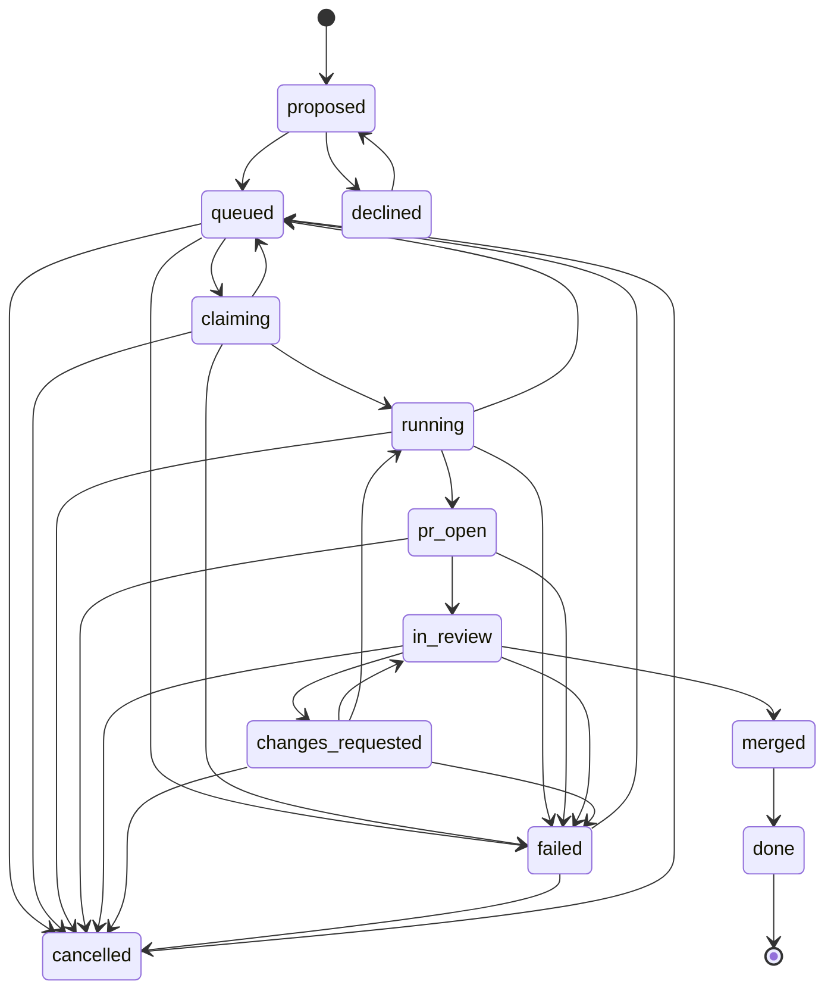

# Planned phases 2 to 6: the flows the design describes

> Nothing in this document is built. It describes the planned phases. The documents 01 to 07 describe what the code does today.

This document turns the phase roadmap into flows. For each of phases 2 to 6 it gives the goal, the planned steps, the failure branches the design already names, and the questions that block it. Every claim comes from one of five documents: the brief (`docs/project-brief.md`), the decision log (`docs/decisions.md`), the architecture (`docs/architecture.md`), the security page (`docs/security.md`), and the status page (`docs/status.md`). Where a planned step hooks into code that exists today, a verbatim snippet shows the hook. No snippet here is new code, and no step here has run.

## At a glance

- Trigger: a person starts the next phase. Nothing in this file runs on its own.
- Starts in / ends in: phases 2 and 3 act inside `running`. Phase 4 opens `pr_open`. Phase 5 walks `in_review` to `merged` and `done`. Phase 6 changes no state.
- Where it attaches: `src/worker/process-job.ts` (the run), `src/runner/echo.ts` and `src/bootstrap.ts` (the runner choice), `src/retry-policy.ts` (the `agent` case), `src/transitions.ts` (the PR states), `src/db/schema.ts` (`pending_actions`).
- Preconditions the documents state: every phase starts in dry-run and dry-run goes off only after you read the logged JSON (brief, "Rollout"); the work instance exists only after the personal instance has run a full ticket-to-draft-PR cycle (brief, "Rollout"; decisions, entry 11).

## How to read the citations

| Short form   | File                    |
| ------------ | ----------------------- |
| brief        | `docs/project-brief.md` |
| decisions    | `docs/decisions.md`     |
| architecture | `docs/architecture.md`  |
| security     | `docs/security.md`      |
| status       | `docs/status.md`        |

- A citation names the section, for example (brief, "Phase roadmap", item 2) or (decisions, entry 7).
- **Docs disagree** lines mark places where these files say different things. This document reports the difference and does not choose between them.
- **Not stated** lines mark a step the design names without a rule. Nothing is filled in here.
- **Unverified** marks a claim that decisions lists under "Unverified", or a status item under "Not yet checked".

## Phase 2: a real agent in a Podman container

### Goal

Replace the echo stand-in with a headless Claude Code run inside a limited Podman container, and write the agent's own events to the transcript (brief, "Phase roadmap", item 2; architecture, "Phase boundaries", item 2; status, "Phase 2 (real agent)").

### Planned flow

On the happy path this phase changes step 4 of `docs/flows/01-happy-path.md`, "The worker takes the id and runs `processJob`", and the transcript contents in its step 5.

1. **The runner is swapped at composition.** `createContext` builds one runner for the worker, and `processJob` calls `deps.runner.start(current)` right after the move to `running`. Phase 2 replaces the echo factory with the Claude Code runner and keeps the interface.

   Source: `src/bootstrap.ts` (`createContext`, runner choice)

   ```ts
   const queue = createJobQueue({ redisUrl: config.REDIS_QUEUE_URL, queueName: `steward-${config.INSTANCE}` })
   // TODO(phase-2): replace the echo runner with the Claude Code runner.
   const runner = createEchoRunner({ runsDir: config.RUNS_DIR, clock })
   ```

   The interface is already the contract the real runner must meet: start, feedback and cancel.

   Source: `src/types.ts` (`AgentRunner`)

   ```ts
   export interface AgentRunner {
     start(job: Job): Promise<{ sessionId: string }>
     resume(sessionId: string, feedback: string): Promise<void>
     cancel(jobId: string): Promise<void>
   }
   ```

   What changes on the happy path: the echo implementation and its `TODO(phase-2)` marker go. The steps before `runner.start` (slot, fetch, worktree, `running`) stay exactly as they are.

2. **The container starts with the limits the brief names.** The brief writes the launch flags as `--userns=keep-id`, `--cpus`, `--memory=2g`, `--pids-limit`, `--cap-drop=ALL`, `no-new-privileges` (brief, "Phase roadmap", item 2). Status adds that the launch has no host networking and no published ports (status, "Phase 2 (real agent)").

   The brief gives a value for `--memory=2g` only. It names `--cpus`, `--pids-limit`, a timeout cap and a max-turns cap without values (brief, "Phase roadmap", item 2), and writes `no-new-privileges` without a flag name. Those numbers and that flag form are not in the design.

3. **The container gets no host environment and only the worktree.** Security states that the launch must pass no host environment into the container, that the agent works in a local worktree and commits locally, and that the agent never holds GitHub or tracker credentials (security, "Credentials and the agent boundary"). The decision log makes the container the real isolation boundary, because user systemd units on this box do not enforce their filesystem sandbox (decisions, "User units do not sandbox the filesystem on this box"). The container does get the instance's git identity as `GIT_AUTHOR_NAME`, `GIT_AUTHOR_EMAIL`, `GIT_COMMITTER_NAME` and `GIT_COMMITTER_EMAIL`, because it has no `~/.gitconfig` (decisions, "Which account an instance acts as").

4. **The agent works in the worktree and commits locally.** The brief's flow step 2 is "the agent works in a local worktree and commits locally. No credentials in the container" (brief, "Flow per job (phases 3-4)"). Whether the agent commits as it goes is not decided: status lists "Unsaved work" under "Not yet answered", item 3.

5. **Its events become transcript lines.** Status names "Claude Code runner and a mapper from its events to transcript entries" (status, "Phase 2 (real agent)"). The transcript already has the shape the mapper writes into: one `{ seq, ts, kind, data }` envelope per line, `kind` in `system | assistant | tool | result | error | orchestrator`, with the raw agent event kept unmodified in `data` (brief, "Transcripts").

   What changes on the happy path: today the echo runner writes four transcript lines and three `raw.jsonl` lines (happy path, step 5). With a real agent the line count and kinds come from the agent, and `raw.jsonl` becomes the byte-exact stream. Redaction does not change: agent output is stored unmodified and the API never serves `raw.jsonl` (security, "Redaction").

6. **The per-job MCP gives the agent four tools.** Status lists a per-job MCP with `get_task`, `post_progress`, `draft_comment` (creates a pending action) and `finish` (status, "Phase 2 (real agent)"). `draft_comment` writes a `pending_actions` row; that table and its approve/reject path already exist, and nothing is sent before a person approves (brief, "Writes to outside systems").

   Source: `src/db/schema.ts` (`pendingActions`)

   ```ts
   /** Every outside write that needs a human decision before it is sent. */
   export const pendingActions = pgTable(
     'pending_actions',
     {
       id: uuid('id').primaryKey().defaultRandom(),
       jobId: uuid('job_id')
         .notNull()
         .references(() => jobs.id),
       kind: text('kind').notNull(),
       payload: jsonb('payload').$type<unknown>().notNull(),
       status: text('status').$type<ActionStatus>().notNull().default('pending'),
       reason: text('reason'),
       createdAt: timestamptz('created_at').notNull(),
       decidedAt: timestamptz('decided_at'),
     },
     (table) => [check('pending_actions_status_check', sql`${table.status} in (${sql.raw(quotedList(ACTION_STATUSES))})`)],
   )
   ```

   The transport under probe is a unix socket inside the rootless container (status, "Phase 2 (real agent)", first bullet; status, "Not yet checked"). Not stated: the payload of `get_task`, the payload of `post_progress`, the result shape of `finish`, and what happens when a tool call names another job.

7. **The operator MCP is for the person, and the agent never gets `/v1`.** Status puts the operator MCP next: build it over stdio, with adapters over the commands and queries. It gives the reason the agent must not hold the API: "Agents must never be given the `/v1` API, because they could approve their own actions" (status, "Next"). The design's gate is a person: every outside write waits for approval (brief, "Writes to outside systems"). The same status line says to write a document for the operator MCP, the per-job tool contract and the probes; status lists it as not written and gives it no phase (status, "What does not exist yet"; status, "Next").

8. **A merge conflict goes to the agent, with a two-strike guard.** When the branch already exists, the worktree is attached and `origin/<base>` is merged in. A conflict leaves the markers in the tree, and phase 2 hands that tree to the runner (decisions, "Worktree and branch rule").

   Source: `src/worker/process-job.ts` (`processJob`, the conflict branch)

   ```ts
      if (outcome === 'conflict') {
        // TODO(phase-2): hand the conflicted tree to the runner to resolve. The echo stub cannot, and
        // finishing as `done` would report success and then throw the tree away.
        throw new AgentError(`merge conflict with origin/${baseBranch}; the echo runner cannot resolve it`)
      }
   ```

   The guard is not built: the same decision log says a second conflict for the same job, or a large `origin/<base>..branch` diff, fails the job as `agent`, and `abortMerge` exists for that path (decisions, "Worktree and branch rule"). Status asks the same question in "Not yet answered", item 4.

   What changes on the happy path: the paragraph in step 4 that says a conflict fails as `agent` and the branch table row "The branch exists, a worktree was left behind, or the base merge conflicts" both become the handoff instead of the failure (happy path document).

9. **The job still ends at `done`.** `pr_open` is phase 4. The `TODO(phase-4)` line in `processJob` and the `running -> done` edge stay until then, so the last move on the happy path does not change in phase 2.

### Failure branches the design names

| If                                                                     | Then                                                                              | Source                                                                |
| ---------------------------------------------------------------------- | --------------------------------------------------------------------------------- | --------------------------------------------------------------------- |
| Container start, timeout, OOM, network, or a Redis/Postgres blip fails | `infra`: exponential backoff, retried until `maxAttempts` (default 3)             | brief, "Job lifecycle"; architecture, "Failure kinds and retry rules" |
| The agent runs but produces no usable result                           | `agent`: the phase 3 validation loop, not generic backoff                         | brief, "Job lifecycle"; decisions, entry 5                            |
| The same job conflicts a second time, or the diff is large             | `agent` (the guard is not built)                                                  | decisions, "Worktree and branch rule"                                 |
| Config, repo path, auth or identity is wrong                           | `setup`: never retried                                                            | brief, "Job lifecycle"                                                |
| A person cancels while the agent runs                                  | the run is told to stop (`AgentRunner.cancel`), then the row moves to `cancelled` | brief, "Job lifecycle"; `src/jobs-commands.ts`                        |

Not stated: whether `cancel` kills the container or asks the agent to stop, and what the mapper does when the stream-json shape does not match. Status says to verify those shapes before writing the mapper (brief, "Transcripts"; status, "Not yet checked").

### Open questions that block it

Copied from the status and decision lists. Items marked unverified come from the "Unverified" list or from "Not yet checked".

- status, "Not yet answered", item 3: "**Unsaved work.** Does an agent commit as it goes? A crash recovery clears the worktree and drops uncommitted edits. Phase 2 must choose."
- status, "Not yet answered", item 4: "**Merge conflicts.** The echo runner cannot resolve one, so the job fails as `agent` today. What does the real runner do, and when does it give up?"
- status, "Not yet answered", item 5: "**Network for job containers.** Which outside hosts may an agent reach? Only the model API, or also package registries? Not decided."
- status, "Not yet answered", item 7: "**`ask_human`.** It needs a new `awaiting_input` state. Deferred." The state `awaiting_input` is not in the state list (brief, "Job lifecycle"; `src/types.ts`).
- decisions, "Open items", item 5: "Readiness ordering between the container services and the host units. A small retry in the entry point, or a health-based unit dependency, is needed before phase 2."
- decisions, "Open items", item 1: there is no build script, so the units run `dist/` files that do not exist. The worker and API ran with `tsx`, not under the units (decisions, "Verified on the box (2026-10-27)"), and the units cannot start (decisions, "Unverified"). Boot with lingering enabled is unchecked too (status, "Not yet checked").
- Unverified: boot with lingering enabled and the host units starting under systemd (decisions, "Unverified"; status, "Not yet checked").
- Unverified: "Container readiness ordering. A container service is active as soon as `podman run -d` returns, which is before Postgres accepts connections" (decisions, "Unverified").
- Unverified: "Claude Code stream-json event shapes, and a unix-socket MCP inside a rootless container" (status, "Not yet checked").

## Phase 3: validate before anything leaves the box

### Goal

Run the validator in the container (typecheck, lint, tests and a diff policy) and send a failure back to the agent, with at most 2 retries, before anything is pushed (brief, "Phase roadmap", item 3; brief, "Flow per job (phases 3-4)", step 3; architecture, "Phase boundaries", item 3).

### Planned flow

On the happy path this phase inserts itself between `deps.runner.start(current)` and the `TODO(phase-4)` line in step 4.

1. **The validator runs after the agent, in the container.** The brief names typecheck, lint and test in the container, plus a diff policy (brief, "Phase roadmap", item 3). It runs before the push, so a failing run leaves nothing outside the box: "Fail: nothing is pushed and the draft stays empty" (brief, "Flow per job (phases 3-4)", step 3).
2. **The diff policy is a rule the documents do not state.** The brief and the architecture both name it (brief, "Phase roadmap", item 3; architecture, "Phase boundaries", item 3). The only size limit in the brief is a standards rule, "PRs stay under 800 lines" (brief, "Standards"), and the documents do not say that the validator enforces it. Not stated: what the diff policy rejects, and in which units the 800-line rule is measured.
3. **A validation failure goes to the agent, not to the backoff.** The retry policy already has the branch point, and the `agent` case is where the loop attaches.

   Source: `src/retry-policy.ts` (`decideAfterFailure`, the `agent` case)

   ```ts
     case 'agent':
       // TODO(phase-3): agent failures go to the validation feedback loop, not generic backoff
       return { action: 'fail' }
   ```

   The loop feeds the failure back through `AgentRunner.resume(sessionId, feedback)`, the second method of the runner interface (architecture, "Interfaces"). Today the `agent` case returns `fail` at once (happy path document, branch table: "A step after the slot is taken throws").

4. **The loop is capped at 2, then the job fails.** The brief gives the number: "retries ≤2" (brief, "Phase roadmap", item 3). After that the job is a dead letter: `failed` means retries are exhausted (brief, "Job lifecycle"; architecture, "Failure kinds and retry rules"). No marker marks the loop; the grep in the hooks section below finds only the `TODO(phase-3)` in the retry policy, so the loop is new code rather than a stub to fill.
5. **Nothing is pushed and the draft stays empty.** That sentence describes the phase 4 order, where the claim (step 1 of the job flow) comes before validation (step 3). The build order in the roadmap puts validation (phase 3) before the claim (phase 4), so between the two phases there is no draft to stay empty (brief, "Flow per job (phases 3-4)"; brief, "Phase roadmap", items 3 and 4).
6. **A validated job still ends where the build order puts it.** The documents do not say where a validated run ends before phase 4 exists. Today the stub goes to `done` (happy path, step 4), and `TODO(phase-4)` marks the move that changes when the claim and the push exist.

Not stated: whether the validation loop runs inside `running` or moves the job. The only edge that resembles a feedback loop is `changes_requested -> running`, and the brief ties `changes_requested` to a review of an open pull request (brief, "Job lifecycle"), which is phase 5.

### Failure branches the design names

| If                                 | Then                                                                    | Source                                                                |
| ---------------------------------- | ----------------------------------------------------------------------- | --------------------------------------------------------------------- |
| Typecheck, lint or tests fail      | `agent`: the capped feedback loop, at most 2 retries                    | brief, "Job lifecycle"; brief, "Phase roadmap", item 3                |
| The diff policy rejects the change | the same loop, by the same `agent` kind (the rule itself is not stated) | brief, "Phase roadmap", item 3                                        |
| The loop runs out of retries       | `failed`, the dead letter: retry or cancel by hand                      | brief, "Job lifecycle"; architecture, "Failure kinds and retry rules" |

Not stated: a failure kind for a validator that cannot run (for example a broken test image). The brief lists three kinds only: `infra`, `agent`, `setup` (brief, "Job lifecycle").

### Open questions that block it

- No item in status, "Not yet answered" or "Not yet checked", and no entry in decisions, "Open items" or "Unverified", names the validator. The blocking gap is a rule the documents name but do not define: the diff policy (above).
- The count "retries ≤2" has no definition of what is counted. The documents do not say whether it means 2 retries after the first run, and they do not say whether it reuses `MAX_ATTEMPTS` (default 3), which is the infra counter (brief, "Phase roadmap", item 3; architecture, "Failure kinds and retry rules").

## Phase 4: claim, push, and writes that need approval

### Goal

Make the claim visible before the agent starts (an empty commit and a draft pull request), push the validated commits once, put the validation report in the pull request body, and write to Linear and ntfy only in the ways the design allows (brief, "Flow per job (phases 3-4)"; brief, "Phase roadmap", item 4; status, "Later").

### Planned flow

On the happy path this phase changes step 3 (confirm), step 4 (the claim and the last move) and the files on disk in step 5.

1. **Intake skips a ticket that already has a pull request.** Before claiming, check for an open pull request, draft or not, whose branch or title carries the ticket identifier and that this instance did not make. If one exists, skip the ticket: log it, create no job and no proposal (brief, "Intake (Linear)"). The brief lists this rule among the decisions taken since the last draft (brief, "Decided since the last draft"). On the happy path nothing changes for TST-1, because it has no pull request.

   Not stated: how the check tells a pull request made by this instance from one made by hand. The skip rule names the distinction; no document gives the test.

2. **Confirm also moves the ticket.** A confirm moves the ticket `Todo`/`Backlog` to `In Progress` in Linear and queues the job (brief, "Intake (Linear)"; brief, "Writes to outside systems"). The write is guarded: `ALLOWED_STATUSES` defaults to `[In Progress]`, so the only move the orchestrator may make is into `In Progress`, and phase 4 must pass the list to the write path and check the target before any mutation (decisions, "The orchestrator never moves a ticket past `In Progress`").

   What changes on the happy path: step 3 today writes only the local row and the queue, and the happy path document closes with a "Docs disagree" line saying so. Phase 4 makes that line false.

3. **The claim happens at `claiming`.** The orchestrator pushes an empty commit to `agent/<identifier>` and opens a draft pull request before the agent starts; the pull request is the visible lock (brief, "Flow per job (phases 3-4)", step 1; decisions, entry 7). A claim failure means no agent started (brief, "Job lifecycle"), and `claiming` holds the slot (decisions, entry 4).

   Unverified: "GitHub's acceptance of a pull request from an empty commit is not tested yet" (decisions, entry 7; decisions, "Open items", item 2; status, "Not yet checked"). The brief tells you to verify it in a scratch repo and record the result in the decision log (brief, "Flow per job (phases 3-4)", step 1).

4. **The branch used is recorded in `jobs.branch`.** The decision log puts the column in the row at claim time and says it is never recomputed from the identifier afterwards, because a pull request's head branch can differ from the tracker's suggested branch name (decisions, "Worktree and branch rule"). The decision log names the column in the future tense; `src/db/schema.ts` defines no such column today.

5. **The agent runs and the validator runs, as in phases 2 and 3.** The claim sits first, so a failed run leaves the draft empty (brief, "Flow per job (phases 3-4)", steps 1 to 3).

6. **The identity check runs before the push.** Three conditions must hold, or the push is refused: the clone's `steward.instance` equals `INSTANCE`, the clone's `user.email` equals `GIT_USER_EMAIL`, and `gh api user` for the resolved token returns `GH_ACCOUNT`. The failure kind is `setup`, never retried (decisions, "Which account an instance acts as"). Security states the same guard in one line, before any push (security, "Per-instance isolation").

7. **The orchestrator pushes once.** The agent's commits go to the same branch once, with the validation report in the pull request body (brief, "Flow per job (phases 3-4)", step 4). The orchestrator does the pushing; agents only commit locally in a worktree (brief, "Rules"; security, "Credentials and the agent boundary"). The credential route the documents name is the `gh` account's token, read at push time: `GH_TOKEN=$(gh auth token --user "$GH_ACCOUNT")` (decisions, "Which account an instance acts as").

8. **The move is `running -> pr_open`.** That edge exists and has no caller today. Phase 4 replaces the stub move.

   Source: `src/worker/process-job.ts` (`processJob`, run and finish)

   ```ts
       current = await transitionJob(deps.db, jobId, 'running', { now: deps.clock() })
       await deps.runner.start(current)
       // TODO(phase-4): go to pr_open after validation and the draft pull request.
       await transitionJob(deps.db, jobId, 'done', { now: deps.clock() })
   ```

   The same phase removes the stub edge, because `done` would then be reached only through a merge.

   Source: `src/transitions.ts` (the allowed-moves table)

   ```ts
     // TODO(phase-4): remove running -> done. It exists only for the phase-1 echo worker stub.
     running: ['pr_open', 'done', 'queued', 'failed', 'cancelled'],
     pr_open: ['in_review', 'failed', 'cancelled'],
     in_review: ['changes_requested', 'merged', 'failed', 'cancelled'],
     changes_requested: ['in_review', 'running', 'failed', 'cancelled'],
     merged: ['done'],
   ```

   What changes on the happy path: the last move is `running -> pr_open`, the slot is freed there (a `pr_open` job holds none; decisions, entry 4), and the job waits for a person instead of finishing.

9. **The tracker gets a link, and comments wait for approval.** The pull request link goes on the ticket automatically if it is not already linked. Comments are drafted in full, shown to you, and sent only after approval, never `auto` (brief, "Writes to outside systems"). The draft is a `pending_actions` row, the table phase 1 already built with the approve/reject logic and the endpoints; nothing is sent before approval (brief, "Writes to outside systems"; brief, "Tables (Drizzle)"). The per-job `draft_comment` tool from phase 2 creates that row (status, "Phase 2 (real agent)").

10. **ntfy says the draft is ready.** The brief's last flow step is a "draft ready" notification (brief, "Flow per job (phases 3-4)", step 5). The decision log says ntfy is self-hosted and carries "the identifier and title only, never ticket bodies" (decisions, "Decisions taken 2026-10-28"). A new failure is notified once plus a daily reminder (brief, "Job lifecycle"; architecture, "Failure kinds and retry rules").

    Docs disagree: security says "send only identifiers and states, never ticket bodies" (security, "Notifications and tracker text"), while decisions says identifier and title. Both agree that the body never leaves the box.

11. **The run stops at `pr_open`.** The person reviews and marks the pull request ready (brief, "Flow per job (phases 3-4)", step 5). `in_review` and the poller are phase 5.

### Failure branches the design names

| If                                                        | Then                                                                   | Source                                                                             |
| --------------------------------------------------------- | ---------------------------------------------------------------------- | ---------------------------------------------------------------------------------- |
| The claim fails                                           | no agent starts; the documents do not say which state the job lands in | brief, "Job lifecycle"                                                             |
| Validation fails                                          | nothing is pushed and the draft stays empty                            | brief, "Flow per job (phases 3-4)", step 3                                         |
| The clone or the `gh` account does not match the instance | `setup`: the push is refused, never retried                            | decisions, "Which account an instance acts as"; security, "Per-instance isolation" |
| A job fails or is cancelled and a draft is left behind    | closing the draft pull request needs your approval                     | brief, "Writes to outside systems"                                                 |
| A comment is drafted                                      | it becomes a pending action; nothing is sent before approval           | brief, "Writes to outside systems"; `src/db/schema.ts`                             |
| A failure reaches the dead letter                         | notify once per new failure plus a daily reminder                      | brief, "Job lifecycle"; architecture, "Failure kinds and retry rules"              |

Not stated: the failure kind for a failed claim, for a failed push, or for a rejected Linear write. A pending action has a `failed` status in the table (`src/types.ts`), but the documents do not say what sets it. The documents also do not assign the "close the leftover draft" action to a phase: the phase 4 roadmap item covers the claim and the push, and the phase 5 item covers the poller and cleanup, so neither names it (brief, "Phase roadmap", items 4 and 5).

### Open questions that block it

- status, "Not yet answered", item 2: "**Leaving In Progress.** On the personal instance, does the owner move a ticket on, or does steward do it when a draft is ready? Assumed: the owner."
- status, "Not yet answered", item 6: "**Notifications.** Self-hosted ntfy is chosen. Still open: how a phone button reaches an API that listens only on `127.0.0.1`."
- Unverified: "GitHub accepts a draft PR whose branch has only an empty commit" (status, "Not yet checked"; decisions, entry 7; decisions, "Open items", item 2).
- Unverified: "The syntax of ntfy action buttons" (status, "Not yet checked"). The brief also lists ntfy action syntax among the facts to verify against official docs or a probe (brief, "Rules").
- decisions, "Open items", item 3 is still open for the tracker: a run with `Todo` and `Backlog` tickets, a second page of results, and a team with more than one user to prove `isMe` filters. That probe covers the read query and its filters, not the write path.

Docs disagree: the brief lists a `StatusReporter` interface as a phase 1 stub (brief, "Interfaces"), while the architecture says the status reporter is added in phase 4, when something implements it (architecture, "Interfaces"). It is not in `src/types.ts` today.

## Phase 5: read GitHub, then clean up

### Goal

Poll GitHub for reviews, `/agent` comments, check conclusions and merges, move the job and the ticket to match, and sweep old runs and merged branches (brief, "Phase roadmap", item 5; architecture, "Phase boundaries", item 5; status, "Later").

### Planned flow

Phase 5 starts where the happy path ends. It changes no step of the happy path document; it adds the steps after `pr_open` that the last row of that document's branch table points at.

1. **The poller reads four things.** The roadmap names reviews, `/agent` comments, Actions `conclusion`, and merge (brief, "Phase roadmap", item 5). The architecture shortens the same list to reviews, comments, check results and merge (architecture, "Phase boundaries", item 5). Not stated: the poll interval, a separate credential for reads, and how a GitHub read failure is retried. The only credential route the documents name is the `gh` token read at push time (decisions, "Which account an instance acts as").
2. **A review that asks for changes starts another run.** The brief's lifecycle has `in_review ⇄ changes_requested` (brief, "Job lifecycle"). The first move out of `pr_open` is `pr_open -> in_review`; then `in_review -> changes_requested`, and feedback starts a run with `changes_requested -> running` (architecture, "Job states and transitions"). The runner's `resume(sessionId, feedback)` is the interface for that feedback (architecture, "Interfaces").
3. **An `/agent` comment is a way in.** The roadmap lists `/agent` comments among what the poller reads (brief, "Phase roadmap", item 5; architecture, "Phase boundaries", item 5). Not stated: the comment syntax, who may write it, and which state it acts from.
4. **A check conclusion is read but has no rule.** The roadmap names Actions `conclusion` (brief, "Phase roadmap", item 5). Not stated: what a failed conclusion does to the job.
5. **An approval moves the ticket, not the job.** On the work instance the PR approval moves the ticket to `In Review`, automatically, when `autoInReview` is on (brief, "Writes to outside systems"; brief, "Decided since the last draft"). On the personal instance there is no review approval, `autoInReview` is off, and there is no `In Review` move (brief, "Decided since the last draft"). The brief names no job state for "approved"; the only edges out of `in_review` are `changes_requested`, `merged`, `failed` and `cancelled` (architecture, "Job states and transitions").
6. **A merge closes the job.** The roadmap lists merge among the poller's duties (brief, "Phase roadmap", item 5). The state machine has the matching pair: `in_review -> merged`, then `merged -> done` (architecture, "Job states and transitions"). Not stated: whether steward performs the merge or only observes it. The brief's flow says you review and mark the pull request ready yourself, and says nothing about who merges (brief, "Flow per job (phases 3-4)", step 5).
7. **The retention sweep deletes old run directories.** Retention is `RUN_RETENTION_DAYS`, default 30, and the sweep is phase 5 (brief, "Transcripts"; architecture, "Transcripts"; security, "Files on disk"). Both transcript files live in the run directory, so the sweep removes them together. Not stated: whether a failed job's runs are kept longer.
8. **Branch cleanup deletes merged branches.** Phase 5 deletes `agent/*` branches once merged and prunes dead worktrees (decisions, "Worktree and branch rule"; status, "Later"). The per-job worktree is already removed after every run; the branch stays so a retry or a later run can continue it (decisions, "Two roots: app and instance data").

### Failure branches the design names

| If                               | Then                                                                                    | Source                                                             |
| -------------------------------- | --------------------------------------------------------------------------------------- | ------------------------------------------------------------------ |
| A review asks for changes        | `in_review -> changes_requested`, then `changes_requested -> running` with the feedback | brief, "Job lifecycle"; architecture, "Job states and transitions" |
| The pull request is merged       | `in_review -> merged`, then `merged -> done`; both are final and a retry returns 409    | brief, "Job lifecycle"; architecture, "Job states and transitions" |
| A person cancels a job in review | `in_review -> cancelled`; the draft pull request is left for a decision                 | brief, "Writes to outside systems"; `src/jobs-commands.ts`         |
| The poller cannot read GitHub    | not stated                                                                              | —                                                                  |
| A check conclusion is a failure  | not stated                                                                              | —                                                                  |

Not stated: a failure path for the poller itself, and any retry rule for GitHub reads. The Linear client's 429/5xx rule (happy path, step 1) is not described for GitHub.

### Open questions that block it

- status, "Not yet answered", item 2, quoted in phase 4 above, decides the one tracker move that follows `In Progress`. On the personal instance the design says there is no approval and no `In Review` move (brief, "Decided since the last draft"), so that half of the poller has nothing to act on there.
- No other item in status, "Not yet answered" or "Not yet checked", and no entry in decisions, "Open items" or "Unverified", names the GitHub poller. The merge actor, the `/agent` syntax and the check-conclusion rule are gaps in the documents, not open items in them.

## Phase 6: a second agent and a box-wide semaphore

### Goal

Put a second agent adapter (OpenCode) behind the same runner interface, and cap test runs across the whole box with one semaphore (brief, "Phase roadmap", item 6; architecture, "Phase boundaries", item 6; status, "Later").

### Planned flow

Phase 6 changes no step of the happy path document, and no job state.

1. **A second adapter implements the same three methods.** The architecture defines `AgentRunner` as "starts, resumes and cancels one agent run" (architecture, "Interfaces"), and the brief's roadmap names an OpenCode adapter (brief, "Phase roadmap", item 6). Not stated: the OpenCode command line, its flags, its event shapes, how it resumes a session, and whether the per-job MCP tools are part of the adapter contract. No document names any of these.
2. **The box-wide test semaphore.** `SLOT_COUNT` is per instance (default 3, range 1 to 16) and the allocator takes the count as an argument (brief, "Instances"; architecture, "Slots"). The box-wide test semaphore is a `flock` under `/run/steward/` and arrives in phase 6 (brief, "Instances"). Status calls it "a box-wide semaphore for test runs" (status, "Later"). Not stated: the lock count, the wait timeout, and the failure kind when a run cannot take the lock. The three failure kinds do not mention a lock wait (brief, "Job lifecycle").
3. **The unanswered concurrency question sits behind it.** Status asks how many jobs may run at once: the cap is 3 per instance, a second instance would double it, and the machine has 15 GiB, so the total needs a limit (status, "Not yet answered", item 9). That item is about jobs, not test runs; the documents do not connect the two.
4. **The dashboard is already built, and three documents still call it phase 6.** Status lists the dashboard as working and served from the API's origin (status, "What works today", "API and dashboard"). The brief's roadmap, the architecture's phase list and the security page all put the dashboard in phase 6 (brief, "Phase roadmap", item 6; architecture, "Phase boundaries", item 6; security, "The future dashboard").

### Failure branches the design names

None. No document names a failure branch for the second adapter or for the semaphore, and none says how a second adapter's failures map to the existing three kinds (brief, "Job lifecycle").

### Open questions that block it

- status, "Not yet answered", item 9: "**How many jobs at once.** The cap is 3 per instance. A second instance would double it. The machine has 15 GiB of memory, so the total needs a limit."
- No item in status, "Not yet answered" or "Not yet checked", and no entry in decisions, "Open items" or "Unverified", names OpenCode or the semaphore. The adapter's CLI and the lock's numbers are gaps in the documents.
- Docs disagree: the dashboard is built (status, "What works today"), while the brief, the architecture and security call it phase 6 (brief, "Phase roadmap", item 6; architecture, "Phase boundaries", item 6; security, "The future dashboard").

## The hooks that exist today, found with grep

These are the `TODO(phase-N)` markers on `main` today:

```bash
grep -rn "TODO(phase-" src
```

| Marker and place                                 | Phase | What the planned flow replaces                                                          |
| ------------------------------------------------ | ----- | --------------------------------------------------------------------------------------- |
| `src/bootstrap.ts`, `createContext`              | 2     | The echo runner becomes the Claude Code runner.                                         |
| `src/runner/echo.ts`, `createEchoRunner`         | 2     | The stand-in itself is replaced or retired.                                             |
| `src/worker/process-job.ts`, the conflict branch | 2     | A conflict fails the job; it is handed to the agent instead, with the two-strike guard. |
| `src/retry-policy.ts`, `decideAfterFailure`      | 3     | The `agent` case returns `fail`; it enters the capped validation loop.                  |
| `src/worker/process-job.ts`, run and finish      | 4     | `running -> done` becomes `running -> pr_open`, after the claim and the push.           |
| `src/transitions.ts`, the allowed-moves table    | 4     | `running -> done` is removed; the stub edge goes with the echo worker.                  |

Phases 5 and 6 have no marker, although the brief's phase 1 scope asked for typed stubs and `TODO(phase-N)` markers for the work it left out (brief, "Phase 1 scope"). The phase 4 `StatusReporter` is in the same position: the brief calls it a phase 1 stub, and it is not in `src/types.ts` (brief, "Interfaces"; architecture, "Interfaces").

## The full planned lifecycle

All 29 planned edges, drawn from the state machine. `running -> done` is left out because phase 4 removes it; it is the edge that stands in today.



The table has 30 edges today. `running -> done` is the thirtieth and is the stub. Ten edges have no caller at all: `running -> pr_open`, `pr_open -> in_review`, `pr_open -> failed`, `in_review -> changes_requested`, `in_review -> merged`, `in_review -> failed`, `changes_requested -> in_review`, `changes_requested -> running`, `changes_requested -> failed`, and `merged -> done`. The three cancel edges out of `pr_open`, `in_review` and `changes_requested` are wired in `cancelJob` (`CANCELLABLE` in `src/jobs-commands.ts`), but no job reaches those states today, so they are wired and unreachable. The brief calls these states the PR states and part of the job lifecycle (brief, "Job lifecycle"); the architecture says every edge is enforced by one function (architecture, "Job states and transitions").

## Phase by phase: what each one adds

| Phase | New state edges used (existing, unused today)                                                                                                                                                   | New tables or columns named                                                | New env keys the documents name                                                                                          | Blocking questions                                                                                                                                |
| ----- | ----------------------------------------------------------------------------------------------------------------------------------------------------------------------------------------------- | -------------------------------------------------------------------------- | ------------------------------------------------------------------------------------------------------------------------ | ------------------------------------------------------------------------------------------------------------------------------------------------- |
| 2     | none. The job still ends `running -> done`.                                                                                                                                                     | none named                                                                 | none. The documents name Podman flags and caps, not env keys.                                                            | status 3, 4, 5, 7; decisions open item 5; unverified: host units, boot with lingering, container start order, stream-json shapes, unix-socket MCP |
| 3     | none. `running -> failed` already has a caller.                                                                                                                                                 | none named; decisions entry 1 expects validation reports as their own data | none named                                                                                                               | no list item names the validator; the diff policy rule is unstated; what "≤2" counts is unstated                                                  |
| 4     | `running -> pr_open`. `running -> done` is removed.                                                                                                                                             | `jobs.branch` (decisions, "Worktree and branch rule")                      | `GH_ACCOUNT`, `GIT_USER_NAME` and `GIT_USER_EMAIL` already exist; the documents name no new key                          | status 2, 6; unverified: empty-commit draft PR, ntfy action syntax; the claim/push failure kinds are unstated                                     |
| 5     | `pr_open -> in_review`, `in_review -> changes_requested`, `changes_requested -> running`, `in_review -> merged`, `merged -> done`. The three cancel edges out of those states become reachable. | none named                                                                 | `RUN_RETENTION_DAYS` exists and the sweep does not; `autoInReview` is named as a per-instance setting, not as an env key | status 2 for the ticket side; unstated: merge actor, `/agent` syntax, check-conclusion rule, poll interval and read credential                    |
| 6     | none                                                                                                                                                                                            | none named                                                                 | none named                                                                                                               | status 9; OpenCode specifics unstated; the dashboard phase disagrees across the documents                                                         |

## How a planned flow becomes a real one

When a phase ships, its section here moves into the numbered document that owns the flow it changes: the happy path (01), intake (02), failures and retries (03), crash and recovery (04), git and branches (05), API and dashboard (06), or deploy and startup (07). The moved text is rewritten in the past tense of the code, with the `Source:` snippets and the test titles that pin the behaviour. The same pull request updates `docs/status.md`, because that file requires a line to change in the pull request that changes the fact (status, "How to keep this file true"). A phase is not "shipped" while any "Unverified" or "Not yet checked" item it depends on is still open; when one is settled, the brief's rules say to verify it and record the evidence in the decision log (brief, "Rules").
