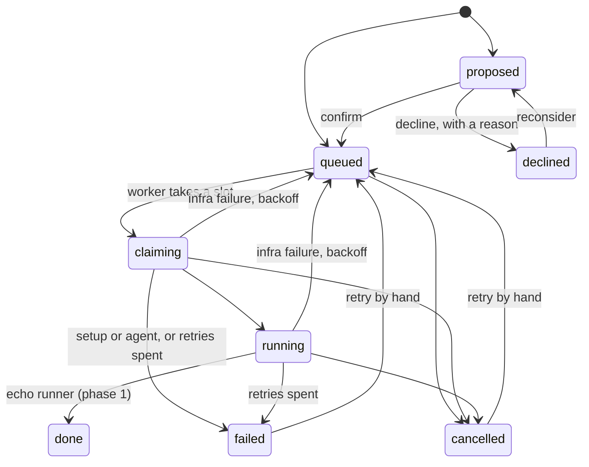

# How steward works: flows

This directory explains what steward does, one flow at a time. Start with the happy path. Then
read the branch you care about. Each file quotes the real code, names the files and tests behind
every claim, and says what is not built yet.

For the current state at a glance (what works, what is left, what is open), read
[../status.md](../status.md). For the reasons behind decisions, read [../decisions.md](../decisions.md).
This directory is about behaviour: what happens, in what order, and what you will see.

## Map

| File                                                     | The question it answers                                                         |
| -------------------------------------------------------- | ------------------------------------------------------------------------------- |
| [01-happy-path.md](01-happy-path.md)                     | What happens to one ticket from Linear to a finished job?                       |
| [02-intake.md](02-intake.md)                             | Which tickets become jobs, which become proposals, and which are skipped?       |
| [03-failures-and-retries.md](03-failures-and-retries.md) | What happens when a job fails? How do retries, the dead letter and cancel work? |
| [04-crash-and-recovery.md](04-crash-and-recovery.md)     | What happens when the worker or the machine dies mid-job?                       |
| [05-git-and-branches.md](05-git-and-branches.md)         | How does a job get its code? What happens on a conflict or a bad remote?        |
| [06-api-and-dashboard.md](06-api-and-dashboard.md)       | How does a request travel, and how can it be refused? What does each button do? |
| [07-deploy-and-startup.md](07-deploy-and-startup.md)     | How does an instance come to exist, and what happens when its processes start?  |
| [08-planned-phases.md](08-planned-phases.md)             | What is planned for phases 2 to 6? (None of it is built.)                       |

Files 01 to 07 describe the code as it is. File 08 describes intent only.

## The job lifecycle that exists today

Every edge below is in `src/transitions.ts` and is used by the code on `main`. The states for
pull requests (`pr_open`, `in_review`, `changes_requested`, `merged`) exist in the state machine
but nothing reaches them yet; see [08-planned-phases.md](08-planned-phases.md).

## Which file for which situation

| You see or want to know...                                          | Read                             |
| ------------------------------------------------------------------- | -------------------------------- |
| A job sits in `proposed` and you wonder why                         | [02](02-intake.md)               |
| A ticket never became a job                                         | [02](02-intake.md)               |
| A job is `failed`, and you want the reason and the fix              | [03](03-failures-and-retries.md) |
| A job is stuck in `claiming` or `running` after a restart           | [04](04-crash-and-recovery.md)   |
| A branch, a worktree or a merge conflict surprised you              | [05](05-git-and-branches.md)     |
| The dashboard shows an error toast, or the API says 401, 403 or 409 | [06](06-api-and-dashboard.md)    |
| The worker or API will not start, or the config is rejected         | [07](07-deploy-and-startup.md)   |
| You wonder when real agents arrive                                  | [08](08-planned-phases.md)       |

## Words used in these files

- **Instance**: one running copy of steward for one repository. It has its own folder, database,
  queues and ports.
- **Job**: one unit of work for one ticket. One row in the `jobs` table, and a history in
  `job_events`.
- **Proposal**: a job in state `proposed`. It waits for a person to confirm or decline it.
- **Slot**: permission to run one job now. A job holds a slot only while it is `claiming` or
  `running`. The default is 3 slots per instance.
- **Worktree**: a checkout of the repository made for one job, under `runs/<job-id>/worktree`.
  It is removed after every run. The branch stays.
- **Runner**: the part that does the work. Today it is an echo stand-in. In phase 2 it becomes
  Claude Code in a container.
- **Reconciler**: the check that runs when the worker starts. It repairs jobs that a crash left
  half done.
- **Dead letter**: the `failed` state. A job that lands there needs a person: retry it by hand.
- **Failure kind**: `infra` (retry with backoff), `agent` (needs an agent, no automatic retry) or
  `setup` (a retry cannot help).

## How to read the files

- A line that starts with `Source:` is followed by a code block that is a verbatim copy of that
  file. The function name is given, not a line number, because line numbers drift.
- A table called **Branches** lists each real fork in the code, the file where it happens, and
  the test that covers it. "No test" means exactly that.
- **Not built yet** names the phase that will add the missing piece.
- **Docs disagree** marks a place where another document says something different from the code.
  The code is the truth. The list is gathered below.

## What was checked, and how

These files were written on 2026-10-30 against `main` at `60ba869`.

- Every code excerpt (123 in total) was compared against its source file as an exact copy.
- Every file path, test title and job state named in the files was checked to exist.
- The status codes and error bodies in [06](06-api-and-dashboard.md) were checked by sending about
  35 requests to a running API wired to a test database. The same run found the second problem below.
- The error messages in [07](07-deploy-and-startup.md) were produced from the real config loader.
  The naming example was compared with the output of `deploy/render.sh`.
- Things that were reasoned from the code but not run are marked in the text, for example the
  behaviour of two workers on one queue and what systemd does after a crash.

This is **not enforced by CI**. A change to the code can make a file stale without any check
failing. See "Keeping this true" below.

## Problems found while writing

### Two bugs in the code

Neither is fixed. Each needs a failing test first.

1. **`limit` on `GET /v1/jobs` is ignored.** The route validates it, but `listJobs` in
   `src/db/store.ts` returns every row. Details in [06](06-api-and-dashboard.md) and
   [02](02-intake.md).
2. **A non-UUID action id answers `500`.** `POST /v1/actions/anything/approve` reaches Postgres
   as a `uuid`. The action routes validate a string, where the job routes validate a UUID. It should
   be a `400`. Details in [06](06-api-and-dashboard.md).

### Places where another document disagrees with the code

| Where                                                      | What the document says                                                             | What the code does                                                                       | Noted in                         |
| ---------------------------------------------------------- | ---------------------------------------------------------------------------------- | ---------------------------------------------------------------------------------------- | -------------------------------- |
| `docs/project-brief.md`                                    | A confirm moves the ticket to `In Progress` in Linear.                             | A confirm only writes the local row and the queue.                                       | [01](01-happy-path.md)           |
| `docs/decisions.md`, decision 6                            | Reaching `MAX_OPEN_PROPOSALS` makes tickets proposals.                             | The extra tickets are skipped and no row is created.                                     | [02](02-intake.md)               |
| `docs/architecture.md`                                     | A retry keeps the row and increments `attempt`.                                    | A manual retry resets `attempt` to 0.                                                    | [03](03-failures-and-retries.md) |
| `docs/decisions.md`                                        | The dead letter is where you "retry or cancel" a job.                              | The cancel command refuses a `failed` job.                                               | [03](03-failures-and-retries.md) |
| `docs/architecture.md`, `project-brief.md`, `decisions.md` | The leaked-slot rule covers final or failed jobs.                                  | It frees a slot row on any job that does not hold a slot.                                | [04](04-crash-and-recovery.md)   |
| `docs/decisions.md`                                        | The leftover-worktree bug is "not fixed here".                                     | It is fixed (PR #24).                                                                    | [05](05-git-and-branches.md)     |
| `docs/security.md`                                         | The dashboard is phase 6 and future.                                               | It exists and is served by the API.                                                      | [06](06-api-and-dashboard.md)    |
| `README.md`                                                | (Silent)                                                                           | The page's own origin must be in `ALLOWED_ORIGINS`, or every action button gets a `403`. | [06](06-api-and-dashboard.md)    |
| `docs/decisions.md`, item 23                               | A missing `ReadWritePaths=` path stops the unit.                                   | User units do not enforce it, as a later section says.                                   | [07](07-deploy-and-startup.md)   |
| `docs/project-brief.md` and `architecture.md`              | The brief lists `StatusReporter` as a phase 1 stub. The architecture says phase 4. | It is not in `src/types.ts`.                                                             | [08](08-planned-phases.md)       |

The ntfy content also differs: `docs/decisions.md` says "ticketKey and title only", and
`docs/security.md` says "identifiers and states". Both are phase 4 and not built.

## Keeping this true

- Change the file in the same pull request that changes the behaviour it describes.
- When a phase ships, move its section from [08](08-planned-phases.md) into the matching numbered
  file, and update [../status.md](../status.md) in the same pull request.
- Quote code only with a `Source:` line and an exact copy. Never retype an excerpt.
- Keep fixtures synthetic: `TST-1`, `example.com`, `<API_TOKEN>`. This repository is public.
- Prettier is set up so it does not reformat code blocks in this directory
  (`embeddedLanguageFormatting: "off"` for `docs/flows/*.md` in `.prettierrc.json`). Without that,
  it would break the exact copies.
